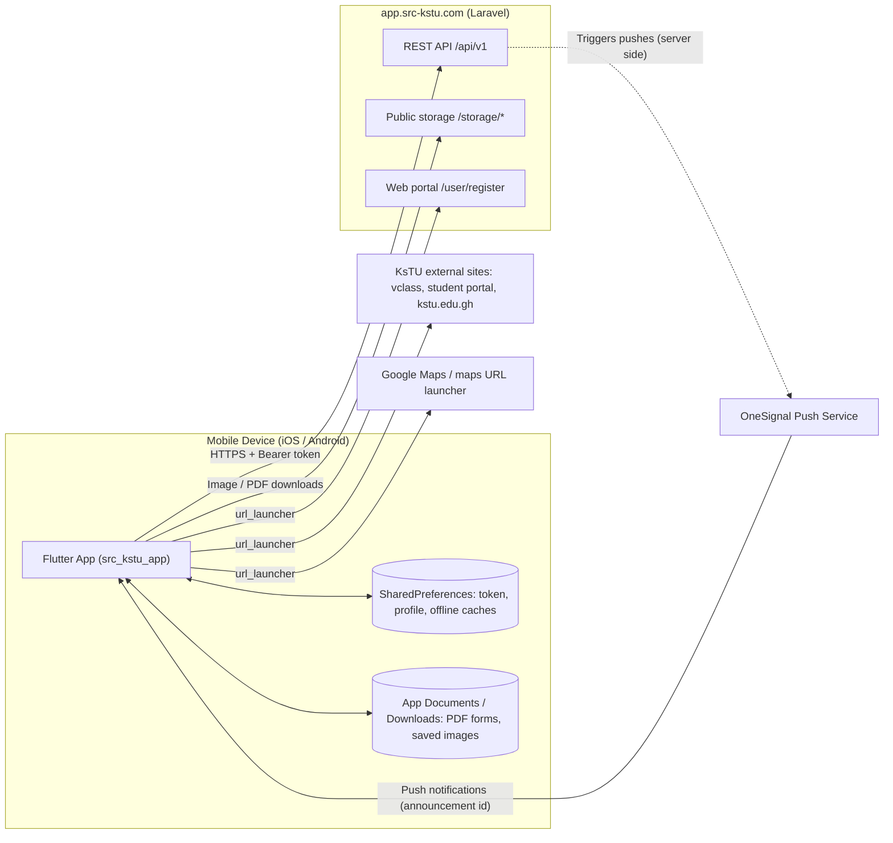
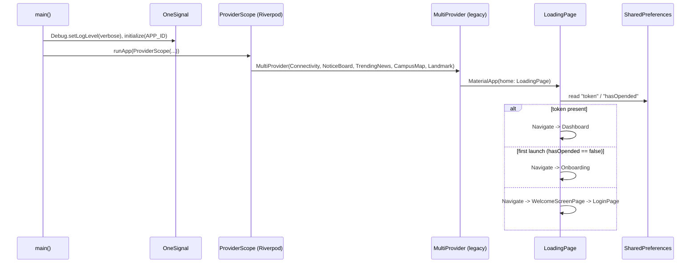
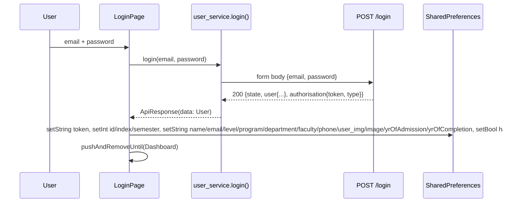
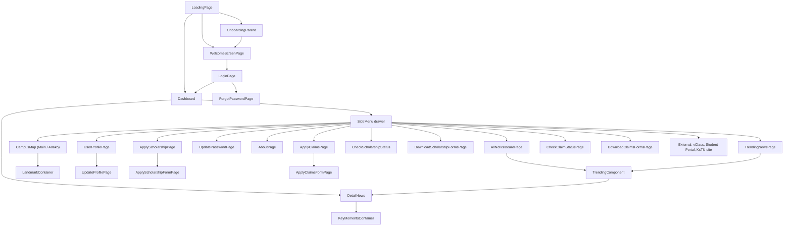
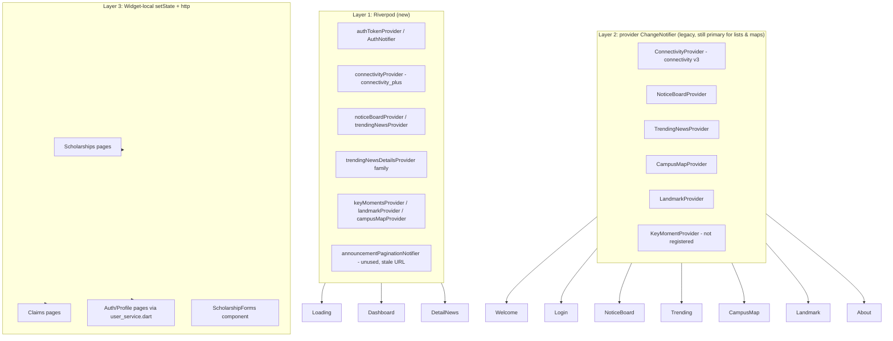
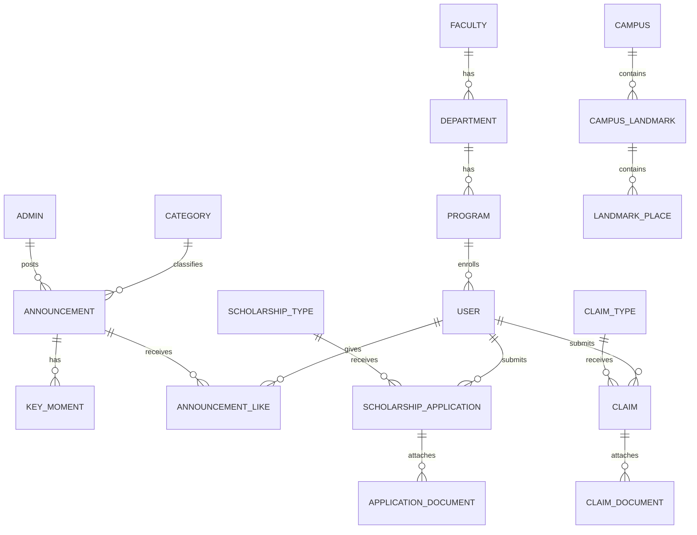

# KsTU SRC App — Architecture & Backend Reference

> Scope: Flutter mobile client (`src_kstu_app`, version `1.2.3+7`) and the Laravel REST backend it talks to.
> The backend source code is **not** part of this repository; the backend section below is reverse-engineered from the client's network calls.

---

## 1. High-Level System Overview



| Layer | Technology |
|---|---|
| Client | Flutter 3.47.x / Dart 3, Material UI, `google_fonts` (Poppins) |
| State | Riverpod 2 (`flutter_riverpod`, `riverpod_annotation` + codegen) **and** legacy `provider` (`ChangeNotifier`) **and** raw `setState` + `http` |
| Networking | `http` ^1.2.0 (primary), `dio` (file downloads) |
| Persistence | `shared_preferences` (auth token, profile, JSON page caches) |
| Push | `onesignal_flutter` (App ID hard-coded in `main.dart`) |
| Connectivity | `connectivity_plus` ^7 (Riverpod) **and** discontinued `connectivity` ^3 (legacy) |
| Files | `file_picker`, `image_picker`, `path_provider`, `share_plus` |
| Backend | Laravel (JWT/Sanctum-style bearer tokens), base `https://app.src-kstu.com/api/v1` |

---

## 2. Repository Layout

```
lib/
├── main.dart                      # Entry: OneSignal init, ProviderScope + MultiProvider, MaterialApp
├── components/                    # Reusable widgets
│   ├── colors.dart                # topColor / bottomColor / headColor palette
│   ├── side_menu.dart             # Drawer: navigation hub + logout + external links
│   ├── trending_component.dart    # Paginated announcement list (used by Notice Board & Trending)
│   ├── scholarship_forms.dart     # Reusable "download PDF forms" list (scholarships & claims)
│   ├── info_card.dart, random_qoute_generator.dart
├── feature/
│   ├── landmark_container.dart    # Landmark "places" list under a campus map landmark
│   └── pages/                     # All screens (see §5)
├── models/                        # Data models + constant.dart (all endpoint URLs)
├── providers/                     # Riverpod providers (new, codegen *.g.dart)
├── services/                      # Legacy ChangeNotifier providers + user_service.dart (auth API)
└── utils/announcement_sort.dart   # Newest-first sorting of announcements
```

Native shells: `ios/` (Runner, bundle display name **KSTU SRC**, team `T6277BM4RJ`) and `android/`.

---

## 3. Application Bootstrap



Key points:
- Two DI containers wrap the app: Riverpod `ProviderScope` **outside**, `provider`'s `MultiProvider` **inside**. Every screen can reach both.
- Push permission is requested from the `Dashboard` (not at startup). The push click listener is registered once (static `_pushListenerRegistered` guard) and navigates to `DetailNews` using the announcement id from the notification's additional data.

---

## 4. Authentication & Session Model



- **Token storage:** plain `SharedPreferences` key `"token"`. Every request reads it again via `getToken()` (legacy) or `authTokenProvider` (Riverpod).
- **Profile cache:** the full user profile is flattened into individual `SharedPreferences` keys at login and read back by Profile / Scholarship / Claims screens. It is only refreshed after a profile-picture upload (`GET /me`).
- **Logout:** `user_service.logout()` calls `SharedPreferences.clear()` — it does **not** call the backend `/logout` endpoint, and it wipes onboarding flags and offline caches too.
- **Riverpod auth:** `authTokenProvider` (FutureProvider) and `AuthNotifier` exist in `lib/providers/auth_provider.dart`, but Login/Logout bypass them (see bug report).
- **Registration / password reset:** registration is done in the web portal (`$asset_base_url/user/register` via `url_launcher`). Forgot-password posts the email; the backend sends a new password (UI says “to your phone number”).

---

## 5. Feature Modules & Screen Map



| Module | Screens / Widgets | State mechanism | Endpoints |
|---|---|---|---|
| Startup / Onboarding | `LoadingPage`, `OnboardingParent`, `WelcomeScreenPage` | Riverpod (Loading), legacy Provider + `FutureBuilder` (Welcome) | — |
| Auth | `LoginPage`, `ForgotPasswordPage`, `UpdatePasswordPage` | `setState` + `user_service.dart` | `/login`, `/forgot-password`, `/update-password` |
| Dashboard / News | `Dashboard`, `DetailNews`, `KeyMomentsContainer` | Riverpod (`trendingNewsProvider`, `noticeBoardProvider`, `trendingNewsDetailsProvider`, `keyMomentsProvider`) | `/announcements/*`, `/announcement/{id}`, `/announcement/moments/{id}`, `/post-interact/...` |
| Notice Board / Trending lists | `AllNoticeBoardPage`, `TrendingNewsPage`, `TrendingComponent` | Legacy `NoticeBoardProvider`, `TrendingNewsProvider` + local `setState` pagination | `/announcements/notice-board`, `/announcements/trending-news` |
| Campus Map | `CampusMap`, `LandmarkContainer`, shimmer | Legacy `CampusMapProvider`, `LandmarkProvider` | `/campus-map/*` |
| Profile | `UserProfilePage`, `UpdateProfilePage`, `ProfileDetails` | `setState` + SharedPreferences | `/me`, `/me/update-dp` |
| Scholarships | Apply, Apply Form (Stepper), Status, Download Forms | Raw `http` + `setState` | `/scholarships/types`, `/scholarships/apply`, `/scholarships/applications` |
| Insurance Claims | Apply, Apply Form (Stepper), Status, Download Forms | Raw `http` + `setState` | `/claims/types`, `/claims/apply`, `/claims/applications` |
| About / Links | `AboutPage`, side-menu links | Legacy connectivity | external URLs |

---

## 6. State Management — The Three Coexisting Layers

The project is mid-migration (see `MIGRATION_COMPLETE.md`, which overstates completion).



Consequences:
- Duplicate implementations of the same fetch logic (e.g. `noticeBoardProvider` vs `NoticeBoardProvider`) with **different caching behavior**.
- Two connectivity packages and two connectivity enums (`ConnectivityResult` vs custom `ConnectivityStatus`) that are compared against each other.
- Token is read from `SharedPreferences` in ~15 places instead of a single auth source.

### Offline caching strategy
| Data | Cache key (SharedPreferences) | Strategy |
|---|---|---|
| Notice board page N | `cached_notices_page_N` | Network-first, cache fallback on error |
| Trending page N | `cached_trend_page_N` | Network-first, cache fallback on error |
| Campus map (any campus) | `cached_map_page` | **Cache-first, single key for both campuses** (bug) |
| Profile | individual keys (`name`, `email`, ...) | Written at login only |

Announcement lists are sorted newest-first client-side by `utils/announcement_sort.dart` (ISO `created_at` → fallback parse of `created_at_formatted` → fallback to `id`).

---

## 7. External Integrations

| Integration | Where | Notes |
|---|---|---|
| OneSignal | `main.dart`, `dashboard.dart` | App ID hard-coded; verbose logging in production; click handler reads `additionalData['announcemet_id']` (sic). |
| url_launcher | `side_menu.dart`, `welcome_screen.dart`, `key_moments_container.dart`, `campus_map.dart` | vClass (`vclass.kstu.edu.gh`), student portal (`student.kstu.edu.gh/login`), `kstu.edu.gh`, web registration, map coordinates. |
| Dio downloads | `news_details.dart`, `scholarship_forms.dart`, `download_scholarship_forms_page.dart`, apply pages | Images / PDFs to app documents (iOS) or `/storage/emulated/0/Download` (Android). |
| share_plus | download pages | Used to "open" downloaded PDFs. |
| file_picker / image_picker | apply forms / update profile | PDF/JPG/PNG document uploads; profile photo. |

---

## 8. Backend (Laravel) — Reverse-Engineered Contract

### 8.1 Environments
| Constant | Value | Status |
|---|---|---|
| `buildUrl` | `https://app.src-kstu.com/api/v1` | **Active (production)** |
| `asset_base_url` | `https://app.src-kstu.com` | Active |
| (commented) | `https://kingthrive-com.stackstaging.com` | Old staging |
| (commented) | `http://16.16.192.97` | Old AWS IP |
| (commented) | `http://10.0.2.2:8000` | Local Android emulator |
| hard-coded | `https://ask-kstu-backend-v2-kingthrive-com.stackstaging.com/api/v1` | **Stale**, used only in unused pagination code |

### 8.2 Conventions
- **Auth:** `Authorization: Bearer <token>`; all requests send `Accept: application/json`.
- **Bodies:** `application/x-www-form-urlencoded` (auth endpoints) or `multipart/form-data` (uploads/applications).
- **Pagination:** standard Laravel `LengthAwarePaginator` (`current_page`, `data[]`, `last_page`, `per_page`, `total`, `links[]`, `next_page_url`, …). Notice/Trending lists appear to use page size 5.
- **Errors:** `422 {message, errors{field:[msg]}}` (client shows first error); `401 {message}`; success for creates = `201 {message, ...}`.
- **Storage:** public disk under `/storage/`: `announcement_imgs/`, `moment_imgs/`, `user_imgs/`, `landmark_imgs/`, plus PDF form files (relative `pdf_file_url` is prefixed with `/storage/`).

### 8.3 Endpoint Catalogue

#### Auth & Profile
| Method | Path | Request | Success response | Client caller |
|---|---|---|---|---|
| POST | `/login` | `email`, `password` | `200 {state, user{…}, authorisation{token, type}}` | `user_service.login` |
| POST | `/register` | `email, password, password_confirmation, name, gender, index_no, status, user_img, program_id, dept_id, yr_of_admission, yr_of_completion` | `201` same shape as login | `user_service.register` (unused; broken) |
| POST | `/logout` | — | — | **Never called** (constant only) |
| GET | `/me` | — | `200 {state?, user{…}, authorisation{…}}` (parsed with `User.fromJson`) | `getUserDetails` |
| POST | `/forgot-password` | `email` | `200 {message}` | `forgotPassword` |
| POST | `/me/update-dp` | multipart `user_img` | `200` | `updateUserProfile` |
| POST | `/update-password` | `old_pass`, `password`, `password_confirmation` | `200 {…}` | `updatePassword` |

#### Announcements
| Method | Path | Response | Notes |
|---|---|---|---|
| GET | `/announcements/notice-board?page=N` | `{announcements: {paginator of Announcement}}` | Notice board |
| GET | `/announcements/trending-news?page=N` | `{announcements: {paginator of Announcement}}` | Trending news |
| GET | `/announcement/{id}` | `{data: Announcement}` | Detail; increments views server-side (likely) |
| GET | `/announcement/moments/{announcementId}` | `{data: [AnnouncementKeyMoments]}` | Image gallery / "key moments" |
| POST | `/post-interact/announcements/{announcementId}/{status}` | `200` | Like (`status=1`) / unlike (`status=0`) |

#### Campus Map
| Method | Path | Response |
|---|---|---|
| GET | `/campus-map/main-campus-landmarks` | `{campus_landmarks: {paginator of CampusMapModel}}` |
| GET | `/campus-map/adako-landmarks` | `{campus_landmarks: {paginator of CampusMapModel}}` |
| GET | `/campus-map/landmark/map/{id}` | `{data: CampusMapModel}` |
| GET | `/campus-map/landmark/places/{landmarkId}` | `{data: [LandmarkModel]}` |

#### Scholarships
| Method | Path | Request | Response |
|---|---|---|---|
| GET | `/scholarships/types` | — | `{data: {paginator of ScholarshipType}}` |
| POST | `/scholarships/apply` | multipart: `scholarship_type_id, student_full_name, contact_number, parent_guardian_name, occupation, needy_reason, is_parent_alive (0/1), number_of_siblings, benefited_previously (0/1), student_department, student_programme, student_number, documents[i][file], documents[i][document_type]` | `201 {message}` |
| GET | `/scholarships/applications` | — | paginator of `ScholarshipApplication` (with `documents[]`) |

#### Insurance Claims
| Method | Path | Request | Response |
|---|---|---|---|
| GET | `/claims/types` | — | `{data: {paginator of ScholarshipType-shaped claim types}}` |
| POST | `/claims/apply` | multipart: `claim_type_id, student_full_name, level, contact_number, name_of_deceased, relation_to_deceased, date_of_death, place_of_death, hospital_name, doctor_name, mortuary_name, religious_body_name, burial_location, burial_date, has_body_been_buried (0/1), date_of_birth, student_department, student_programme, student_number, documents[i][file], documents[i][document_type]` | `201 {message}` |
| GET | `/claims/applications` | — | `{success, data: {paginator of Claim}}` |

### 8.4 Inferred Backend Domain Model



Notes:
- `category_id` distinguishes Notice Board vs Trending News announcements.
- Applications/claims have a workflow: `application_status` (e.g. pending / approved / rejected), `approved_by_name`, `approved_at`, `rejection_reason`.
- Scholarship and claim types define `required_document_types[]` / `optional_document_types[]`, which the app turns into dynamic upload fields.
- A web admin panel (not in this repo) manages announcements, landmarks, types and application review, and presumably dispatches OneSignal pushes.

---

## 9. Build & Release (iOS)
- Version source of truth: `pubspec.yaml` `version: 1.2.3+7` (also mirrored in `ios/Runner.xcodeproj/project.pbxproj`).
- Build: `flutter build ipa --release` → `build/ios/ipa/KSTU SRC.ipa`; signed with *Apple Distribution: David Otitiaku (T6277BM4RJ)*.
- App Store Connect rejects re-used marketing versions once a train is closed — bump `CFBundleShortVersionString` (the `x.y.z` part) for every new release.
- Dependency constraints that matter for modern Flutter: `font_awesome_flutter ^11`, `google_fonts ^6.2.1`, `http ^1.2.0`.

