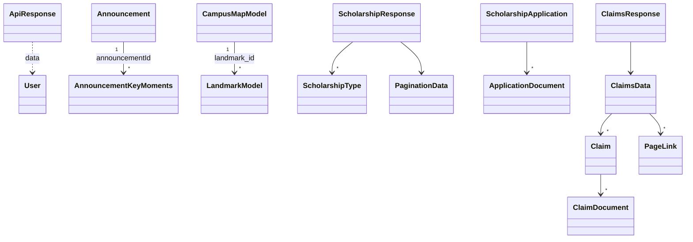

# KsTU SRC App — Data Models Reference

All models live in `lib/models/`. They are hand-written (no `json_serializable`/`freezed`). JSON keys are Laravel `snake_case`; Dart fields are mostly `camelCase` (with some `snake_case` exceptions).

| File | Classes | Used by |
|---|---|---|
| `constant.dart` | (URL constants, messages) | Everywhere |
| `api_response.dart` | `ApiResponse` | `user_service.dart`, auth/profile pages |
| `user.dart` | `User` | Login, `/me` |
| `announcement.dart` | `Announcement` | Dashboard, Notice Board, Trending, Detail |
| `annoucement_key_moment.dart` | `AnnouncementKeyMoments` | Key Moments gallery |
| `campus_map_model.dart` | `CampusMapModel` | Campus Map |
| `land-marks-model.dart` | `LandmarkModel` | Landmark places |
| `scholarship_type_model.dart` | `ScholarshipType`, `ScholarshipResponse`, `PaginationData` | Scholarships **and** Claims types |
| `scholarship_application_model.dart` | `ScholarshipApplication`, `ApplicationDocument` | Scholarship status |
| `claim.dart` | `ClaimsResponse`, `ClaimsData`, `Claim`, `ClaimDocument`, `PageLink` | Claim status |

Additional in-code models: `PaginationState` (`providers/announcement_pagination_provider.dart`), `ConnectivityStatus` enum (`services/connectivity_provider.dart`).



---

## 1. `ApiResponse` — [api_response.dart](file:///Users/kaliblip/Developer/KsTU%20SRC/src_kstu_app/lib/models/api_response.dart)

Generic result wrapper used by `user_service.dart`.

| Field | Type | Meaning |
|---|---|---|
| `data` | `Object?` | Payload on success (`User`, `String` message, or decoded `Map`) |
| `error` | `String?` | Human-readable error; `null` means success |

> Untyped: callers must cast (`response.data as User`), which crashes if both fields are `null` (happens when `getUserDetails` swallows an exception).

---

## 2. `User` — [user.dart](file:///Users/kaliblip/Developer/KsTU%20SRC/src_kstu_app/lib/models/user.dart)

Parsed from the **login / me** envelope, not from a flat user object:

```json
{
  "state": "...",
  "user": { "id": 1, "name": "...", ... },
  "authorisation": { "token": "...", "type": "bearer" }
}
```

| Dart field | Type | JSON path | Notes |
|---|---|---|---|
| `state` | `String?` | `state` | |
| `id` | `int?` | `user.id` | Stored as `id` |
| `name` | `String?` | `user.name` | |
| `email` | `String?` | `user.email` | |
| `gender` | `String?` | `user.gender` | |
| `userImg` | `String?` | `user.user_img` | Defaults to `'1'` when null (sentinel for "no photo"); file name under `/storage/user_imgs/` |
| `indexNo` | `int?` | `user.index_no` | Student number; stored as `index` (int) |
| `currentLevel` | `String?` | `user.current_level` | e.g. "200" |
| `currentSem` | `int?` | `user.current_sem` | 1 or 2 |
| `facultyId` / `deptId` / `programId` | `int?` | `user.faculty_id` / `dept_id` / `program_id` | |
| `status` | `int?` | `user.status` | |
| `yrOfAdmission` / `yrOfCompletion` | `String?` | `user.yr_of_admission` / `yr_of_completion` | |
| `phone` | `String?` | `user.phone` | |
| `createdAt` / `updatedAt` | `String?` | `user.created_at` / `updated_at` | |
| `facultyName` / `deptName` / `programName` | `String?` | `user.faculty_name` / `dept_name` / `program_name` | |
| `token` | `String?` | `authorisation.token` | Bearer token |
| `type` | `String?` | `authorisation.type` | |

- No `toJson()`. Throws `NoSuchMethodError` if `user` or `authorisation` is missing (e.g. if `/me` returns a flat user).
- **SharedPreferences mapping (login):** `token`, `id`, `name`, `index`, `gender`, `level`, `user_img`, `image` (duplicate), `semester`, `program`, `department`, `faculty`, `phone`, `email`, `yrOfAdmission`, `yrOfCompletion`, `hasOpended=true`.

---

## 3. `Announcement` — [announcement.dart](file:///Users/kaliblip/Developer/KsTU%20SRC/src_kstu_app/lib/models/announcement.dart)

Used for both Notice Board and Trending News (distinguished by `categoryId`).

| Dart field | Type | JSON key | Nullable in JSON? | Notes |
|---|---|---|---|---|
| `id` | `int` | `id` | no | |
| `featuredImage` | `String` | `featured_image` | **must not be null** | Body/HTML-ish content or image path (rendered in detail) |
| `featuredImageMin` | `String` | `featured_image_min` | must not be null | Thumbnail, prefixed with `announcement_imgUri` |
| `title` | `String` | `title` | no | |
| `status` | `int` | `status` | no | |
| `views` | `int` | `views` | no | |
| `adminId` | `int` | `admin_id` | no | |
| `categoryId` | `int` | `category_id` | no | Notice vs Trending |
| `createdAt` | `String` | `created_at` | defaults `''` | ISO-8601 |
| `createdAtFormatted` | `String` | `created_at_formatted` | defaults `''` | e.g. `"Saturday, 31st May 2026"`; UI splits on `', '` |
| `updatedAt` | `String` | `updated_at` | must not be null | |
| `likesCount` | `int` | `likes_count` | no | |
| `likesCountFormatted` | `String` | `likes_count_formatted` | no | e.g. `"1.2k"` |
| `viewsCountFormatted` | `String` | `views_count_formatted` | no | |
| `likedByAuthUser` | `bool` | `liked_by_auth_user` | no | Drives like icon |
| `likedUsers` | `List<dynamic>` | `liked_users` | **must be a list** | Untyped |

- Helpers: `announcementFromJson(String)`, `announcementToJson(Announcement)`.
- `toJson()` **omits `created_at_formatted`**, so data round-tripped through the offline cache loses the formatted date (cached copies are stored from raw JSON, so this only matters if `toJson` is used).
- Fields are non-final (mutable) — UI mutates nothing today, but the class is not immutable.
- Sorting: `utils/announcement_sort.dart` → `sortAnnouncementsByNewest()`.

---

## 4. `AnnouncementKeyMoments` — [annoucement_key_moment.dart](file:///Users/kaliblip/Developer/KsTU%20SRC/src_kstu_app/lib/models/annoucement_key_moment.dart)

Gallery images attached to an announcement (`GET /announcement/moments/{id}`).

| Dart field | Type | JSON key | Notes |
|---|---|---|---|
| `id` | `int` | `id` | |
| `announcementId` | `int` | `announcement_id` | FK → `Announcement.id` |
| `imageSubTitle` | `String` | `image_sub_title` | defaults `''` |
| `image` | `String` | `image` | defaults `''`; prefixed with `key_moment_uri` |
| `imageDescription` | `String` | `image_description` | defaults `''`; may contain links (rendered with `Linkify`) |
| `createdAt` | `DateTime` | `created_at` | `DateTime.parse` — throws on null/invalid |
| `updatedAt` | `DateTime` | `updated_at` | same |

File name is misspelled (`annoucement_`).

---

## 5. `CampusMapModel` — [campus_map_model.dart](file:///Users/kaliblip/Developer/KsTU%20SRC/src_kstu_app/lib/models/campus_map_model.dart)

A landmark on a campus (`/campus-map/*-landmarks`, `/campus-map/landmark/map/{id}`).

| Dart field | Type | JSON key | Notes |
|---|---|---|---|
| `id` | `int` | `id` | |
| `image` | `String` | **`img`** | Prefixed with `landmark_imgs` |
| `name` | `String` | `name` | |
| `latitude` | `String` | `latitude` | String, parsed for map launching |
| `longitude` | `String` | `longitude` | String |
| `status` | `int` | `status` | |
| `campus_id` | `int` | `campus_id` | snake_case Dart field |
| `campus` | `String` | `campus` | Campus name |
| `created_at` | `String` | `created_at` | defaults `''`; snake_case Dart field |
| `updatedAt` | `String` | `updated_at` | |

Breaks if the backend returns numeric `latitude`/`longitude` (typed `String`).

---

## 6. `LandmarkModel` — [land-marks-model.dart](file:///Users/kaliblip/Developer/KsTU%20SRC/src_kstu_app/lib/models/land-marks-model.dart)

"Places" inside a landmark (`/campus-map/landmark/places/{landmarkId}`).

| Dart field | Type | JSON key (fromJson) | JSON key (toJson) |
|---|---|---|---|
| `id` | `int` | `id` | `id` |
| `name` | `String` | `name` | `name` |
| `status` | `int` | `status` | `status` |
| `landmark_id` | `String` | `landmark_id` | **`campus_id`** ⚠️ |
| `created_at` | `String` | `created_at` (default `''`) | `created_at` |
| `updatedAt` | `String` | `updated_at` | `updated_at` |

- `landmark_id` typed `String` though it is a foreign key (likely `int` from Laravel) → potential `TypeError`.
- File name uses hyphens (`land-marks-model.dart`), against Dart conventions.

---

## 7. `ScholarshipType`, `ScholarshipResponse`, `PaginationData` — [scholarship_type_model.dart](file:///Users/kaliblip/Developer/KsTU%20SRC/src_kstu_app/lib/models/scholarship_type_model.dart)

Re-used for **both** scholarship types and insurance-claim types (`ApplyClaimsFormPage` takes a `ScholarshipType`).

### `ScholarshipType`
| Dart field | Type | JSON key | Notes |
|---|---|---|---|
| `id` | `int` | `id` | Sent as `scholarship_type_id` / `claim_type_id` |
| `name` | `String` | `name` | |
| `description` | `String?` | `description` | |
| `pdfFileUrl` | `String` | `pdf_file_url` | Absolute URL or path relative to `/storage/`; must not be null |
| `requiredDocuments` | `List<String>` | `required_document_types` | Snake-case doc keys (e.g. `birth_certificate`) → dynamic upload fields |
| `optionalDocuments` | `List<String>` | `optional_document_types` | |

### `ScholarshipResponse`
| Field | Source |
|---|---|
| `scholarships: List<ScholarshipType>` | `json['data']['data']` |
| `pagination: PaginationData` | `json['data']` |

### `PaginationData`
| Field | JSON key |
|---|---|
| `currentPage` | `current_page` |
| `lastPage` | `last_page` |
| `total` | `total` |
| `perPage` | `per_page` |

Overrides `==` but **not `hashCode`** (violates Dart equality contract).

---

## 8. `ScholarshipApplication`, `ApplicationDocument` — [scholarship_application_model.dart](file:///Users/kaliblip/Developer/KsTU%20SRC/src_kstu_app/lib/models/scholarship_application_model.dart)

All fields nullable (safest model in the project).

| Dart field | Type | JSON key |
|---|---|---|
| `id` | `int?` | `id` |
| `studentId` | `int?` | `student_id` |
| `scholarshipName` | `String?` | `scholarship_name` |
| `studentFullName` | `String?` | `student_full_name` |
| `studentNumber` | `String?` | `student_number` |
| `contactNumber` | `String?` | `contact_number` |
| `parentGuardianName` | `String?` | `parent_guardian_name` |
| `occupation` | `String?` | `occupation` |
| `needyReason` | `String?` | `needy_reason` |
| `applicationStatus` | `String?` | `application_status` |
| `approvedByName` | `String?` | `approved_by_name` |
| `approvedAt` | `String?` | `approved_at` |
| `rejectionReason` | `String?` | `rejection_reason` |
| `createdAt` / `updatedAt` | `String?` | `created_at` / `updated_at` |
| `status` | `int?` | `status` |
| `isParentAlive` | `bool?` | `is_parent_alive` ⚠️ Laravel often returns `0/1` ints unless cast |
| `numberOfSiblings` | `int?` | `number_of_siblings` |
| `benefitedPreviously` | `bool?` | `benefited_previously` ⚠️ same |
| `departmentName` | `String?` | `department_name` |
| `programName` | `String?` | `program_name` |
| `documents` | `List<ApplicationDocument>` | `documents` (defaults `[]`) |

`ApplicationDocument`: `id int?`, `applicationId int?` (`application_id`), `documentType String` (`document_type`), `fileUrl String?` (`file_url`).

`studentNumber` is `String?` here, but the app stores/sends the index number as an `int` → string conversion.

---

## 9. Claims models — [claim.dart](file:///Users/kaliblip/Developer/KsTU%20SRC/src_kstu_app/lib/models/claim.dart)

### `ClaimsResponse`
| Field | Type | JSON |
|---|---|---|
| `success` | `bool` | `success` |
| `data` | `ClaimsData` | `data` |

### `ClaimsData` (Laravel paginator)
| Field | Type | JSON |
|---|---|---|
| `currentPage` | `int` | `current_page` |
| `data` | `List<Claim>` | `data` |
| `firstPageUrl` | `String` | `first_page_url` |
| `from` | `int` | `from` ⚠️ `null` when the page is empty |
| `lastPage` | `int` | `last_page` |
| `lastPageUrl` | `String` | `last_page_url` |
| `links` | `List<PageLink>` | `links` |
| `nextPageUrl` | `dynamic` | `next_page_url` |
| `path` | `String` | `path` |
| `perPage` | `int` | `per_page` |
| `prevPageUrl` | `dynamic` | `prev_page_url` |
| `to` | `int` | `to` ⚠️ `null` when empty |
| `total` | `int` | `total` |

### `Claim`
| Dart field | Type | JSON key | Risk |
|---|---|---|---|
| `id` | `int` | `id` | |
| `studentId` | `int` | `student_id` | |
| `claimName` | `String` | `claim_name` | |
| `studentFullName` | `String` | `student_full_name` | |
| `studentNumber` | `String` | `student_number` | |
| `contactNumber` | `String` | `contact_number` | |
| `dateOfBirth` | `String` | `date_of_birth` | Optional in form → may be null |
| `nameOfDeceased` | `String` | `name_of_deceased` | |
| `relationToDeceased` | `String` | `relation_to_deceased` | |
| `dateOfDeath` | `String` | `date_of_death` | Optional in form |
| `placeOfDeath` | `String` | `place_of_death` | |
| `hospitalName` | `String` | `hospital_name` | |
| `doctorName` | `String` | `doctor_name` | Optional in form → null crash |
| `mortuaryName` | `String` | `mortuary_name` | Optional in form → null crash |
| `religiousBodyName` | `String` | `religious_body_name` | Optional in form → null crash |
| `hasBodyBeenBuried` | `bool` | `has_body_been_buried` | Sent as `'0'/'1'`; int back → crash |
| `burialLocation` | `String` | `burial_location` | Optional → null crash |
| `burialDate` | `String` | `burial_date` | Optional → null crash |
| `level` | `String` | `level` | |
| `applicationStatus` | `String` | `application_status` | |
| `approvedByName` | `String?` | `approved_by_name` | |
| `approvedAt` | `String?` | `approved_at` | |
| `rejectionReason` | `String?` | `rejection_reason` | |
| `createdAt` / `updatedAt` | `String` | `created_at` / `updated_at` | |
| `status` | `int` | `status` | |
| `departmentName` | `String` | `department_name` | |
| `programName` | `String` | `program_name` | |
| `documents` | `List<ClaimDocument>` | `documents` | Must be a list |

### `ClaimDocument`
| Field | Type | JSON |
|---|---|---|
| `id` | `int` | `id` |
| `claimId` | `int` | `claim_id` |
| `documentType` | `String` | `document_type` |
| `filePath` | `String` | `file_path` |
| `originalFilename` | `String` | `original_filename` |
| `fileSize` | `String` | `file_size` ⚠️ usually an int |
| `mimeType` | `String` | `mime_type` |
| `status` | `int` | `status` |
| `createdAt` / `updatedAt` | `String` | `created_at` / `updated_at` |
| `fileUrl` | `String` | `file_url` |

### `PageLink`
`url String?`, `label String`, `active bool`.

> `Claim` is the strictest model: nearly every field is non-nullable `String`, while the submission form leaves many of them optional. Any claim stored with an empty optional field will make the whole "Check Claim Status" list fail to parse.

---

## 10. Non-model state classes

### `PaginationState` (`providers/announcement_pagination_provider.dart`)
`items: List<Announcement>`, `currentPage: int`, `totalPages: int`, `isLoading: bool`, with `copyWith`. Used only by the unused `AnnouncementPaginationNotifier`.

### `ConnectivityStatus` (`services/connectivity_provider.dart`)
Custom enum (`WiFi`, `Cellular`, `Offline`) produced by the legacy `ConnectivityProvider` stream; incorrectly compared with `connectivity`'s `ConnectivityResult` in `welcome_screen.dart`.

---

## 11. Model-level recommendations
1. Adopt `json_serializable` or `freezed` to generate `fromJson`/`toJson` and eliminate key typos (`LandmarkModel.toJson`).
2. Make optional backend fields nullable (`Claim`, `Announcement.featuredImage`, `CampusMapModel.latitude`).
3. Normalize booleans: accept `bool`, `int` (0/1) and `"0"/"1"` via a helper.
4. Make models immutable (`final` fields, `const` constructors) and add `hashCode` wherever `==` is overridden.
5. Introduce a shared generic `Paginated<T>` instead of `ClaimsData` / `PaginationData` / raw `Map` parsing.
6. Rename `ScholarshipType` → `ApplicationType` (or add a `ClaimType`) since it backs both features.
7. Rename files to `snake_case` (`announcement_key_moment.dart`, `landmark_model.dart`).

