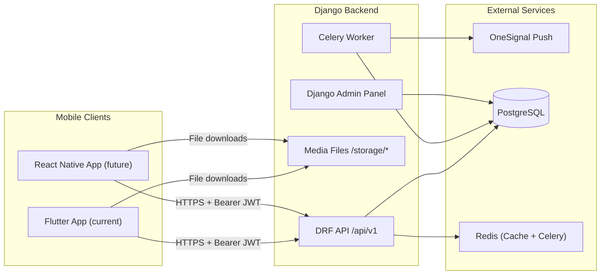
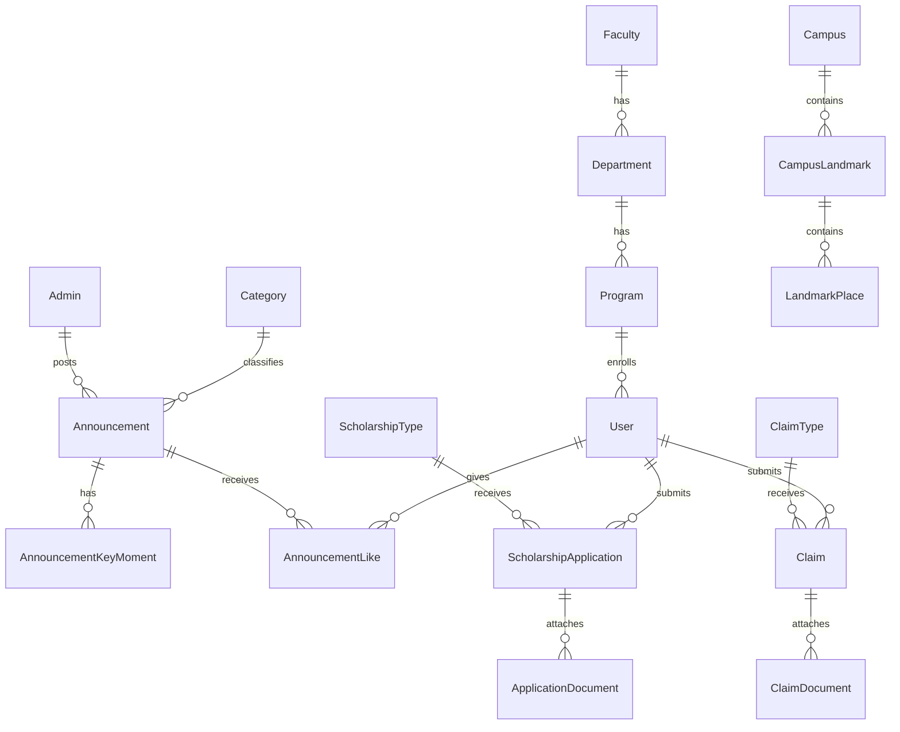
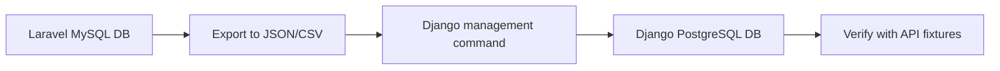
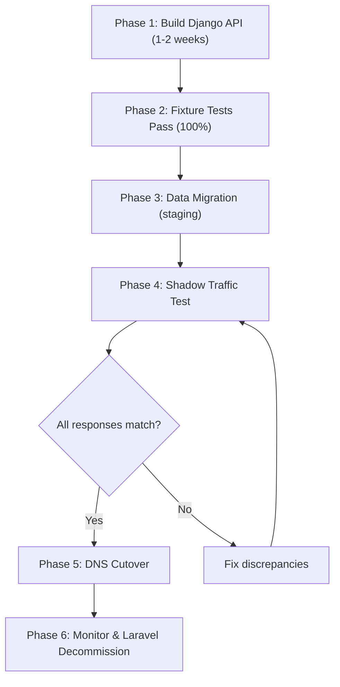

# KsTU SRC Backend — Laravel → Django Migration Guide

> **Scope:** Rewrite the existing Laravel REST API backend (`https://app.src-kstu.com/api/v1`) in Django + Django REST Framework, preserving 100% wire compatibility with the Flutter mobile client and any future React Native client.
>
> This guide is derived from the reverse-engineered API contract in [01-architecture-and-backend.md](file:///Users/kaliblip/Developer/src_kstu_app/review-docs/01-architecture-and-backend.md), the [data models reference](file:///Users/kaliblip/Developer/src_kstu_app/review-docs/02-data-models.md), the [live API fixtures](file:///Users/kaliblip/Developer/src_kstu_app/review-docs/api-fixtures), and the [bug report](file:///Users/kaliblip/Developer/src_kstu_app/review-docs/03-bugs-and-issues.md).

---

## 1. Why Migrate & Key Risks

### 1.1 Why Django

| Concern | Laravel (current) | Django (target) |
|---|---|---|
| Language | PHP 8.x | Python 3.12+ |
| ORM | Eloquent | Django ORM (comparable power, better migrations tooling) |
| REST framework | Manual controllers or Laravel API Resources | Django REST Framework (DRF) — industry-standard, batteries-included serializers, viewsets, pagination, auth |
| Admin panel | Nova (paid) or Filament | Django Admin — built-in, free, deeply customizable |
| Auth / JWT | `tymon/jwt-auth` or Sanctum | `djangorestframework-simplejwt` — well-maintained, configurable |
| File storage | Laravel Filesystem (`Storage::disk('public')`) | `django-storages` + Django `FileField` / `ImageField` |
| Push notifications | Server-side OneSignal SDK (PHP) | `onesignal-sdk` (Python) or direct REST calls |
| Background jobs | Laravel Queues (Redis/SQS) | Celery + Redis/RabbitMQ |
| Ecosystem alignment | — | If the team's primary stack is Python/Django for other campus systems, consolidation reduces maintenance burden |

### 1.2 Critical Migration Risks

> [!CAUTION]
> The mobile app (Flutter) is **already in production** with real student data. The Django backend must produce **byte-for-byte compatible JSON responses** for every endpoint, or the app will crash.

| Risk | Mitigation |
|---|---|
| **Response envelope differences** | Test every endpoint against the [14 live API fixtures](file:///Users/kaliblip/Developer/src_kstu_app/review-docs/api-fixtures) — the Django API must match the exact JSON structure |
| **Pagination format** | Laravel's `LengthAwarePaginator` has a specific shape (`current_page`, `data`, `last_page`, `per_page`, `total`, `from`, `to`, `links[]`, `first_page_url`, `last_page_url`, `next_page_url`, `prev_page_url`, `path`). DRF's default pagination is different — you must write a **custom pagination class** |
| **JWT token format** | The Flutter app sends `Authorization: Bearer <token>` and expects `{authorisation: {token, type}}` in login responses. Use `simplejwt` with a custom response serializer |
| **Storage URL paths** | The app constructs URLs like `https://app.src-kstu.com/storage/announcement_imgs/<filename>`. Django must serve files at the same `/storage/` prefix |
| **Boolean serialization** | Laravel sometimes returns `0/1` for booleans. The Flutter `Claim` model already has bugs around this — the Django backend should return **proper JSON booleans** (`true`/`false`) with the `$casts` equivalent in DRF serializers |
| **Database migration** | Existing student, application, and announcement data must be migrated from MySQL/PostgreSQL to the Django database |

---

## 2. Architecture Overview



---

## 3. Django Project Structure

```
kstu_src_backend/
├── manage.py
├── config/
│   ├── __init__.py
│   ├── settings/
│   │   ├── base.py          # Common settings
│   │   ├── development.py
│   │   ├── staging.py
│   │   └── production.py
│   ├── urls.py               # Root URL conf: /api/v1/, /admin/, /storage/
│   ├── wsgi.py
│   └── asgi.py
├── apps/
│   ├── accounts/             # User model, auth, profile
│   │   ├── models.py
│   │   ├── serializers.py
│   │   ├── views.py
│   │   ├── urls.py
│   │   ├── admin.py
│   │   └── tests/
│   ├── announcements/        # Announcements, key moments, likes
│   │   ├── models.py
│   │   ├── serializers.py
│   │   ├── views.py
│   │   ├── urls.py
│   │   ├── admin.py
│   │   └── tests/
│   ├── campus_map/           # Campus landmarks, places
│   │   ├── models.py
│   │   ├── serializers.py
│   │   ├── views.py
│   │   ├── urls.py
│   │   ├── admin.py
│   │   └── tests/
│   ├── scholarships/         # Scholarship types, applications, documents
│   │   ├── models.py
│   │   ├── serializers.py
│   │   ├── views.py
│   │   ├── urls.py
│   │   ├── admin.py
│   │   └── tests/
│   ├── claims/               # Insurance claim types, applications, documents
│   │   ├── models.py
│   │   ├── serializers.py
│   │   ├── views.py
│   │   ├── urls.py
│   │   ├── admin.py
│   │   └── tests/
│   └── notifications/        # OneSignal integration
│       ├── services.py
│       └── tasks.py          # Celery tasks for push dispatch
├── core/
│   ├── pagination.py         # Laravel-compatible paginator
│   ├── permissions.py
│   ├── middleware.py
│   └── storage.py            # Custom storage backend for /storage/ URL prefix
├── fixtures/                  # Seed data + API fixture tests
│   └── api_fixtures/         # Copy of review-docs/api-fixtures/ for test assertions
├── requirements/
│   ├── base.txt
│   ├── dev.txt
│   └── prod.txt
├── Dockerfile
├── docker-compose.yml
└── .env.example
```

---

## 4. Django Models (Mapped from Laravel)

### 4.1 Entity-Relationship Diagram



### 4.2 Model Definitions

#### `apps/accounts/models.py` — User & Academic Structure

```python
from django.contrib.auth.models import AbstractBaseUser, BaseUserManager, PermissionsMixin
from django.db import models


class Faculty(models.Model):
    name = models.CharField(max_length=255)
    created_at = models.DateTimeField(auto_now_add=True)
    updated_at = models.DateTimeField(auto_now=True)

    class Meta:
        db_table = "faculties"
        verbose_name_plural = "faculties"

    def __str__(self):
        return self.name


class Department(models.Model):
    name = models.CharField(max_length=255)
    faculty = models.ForeignKey(Faculty, on_delete=models.CASCADE, related_name="departments")
    created_at = models.DateTimeField(auto_now_add=True)
    updated_at = models.DateTimeField(auto_now=True)

    class Meta:
        db_table = "departments"

    def __str__(self):
        return self.name


class Program(models.Model):
    name = models.CharField(max_length=255)
    department = models.ForeignKey(Department, on_delete=models.CASCADE, related_name="programs")
    created_at = models.DateTimeField(auto_now_add=True)
    updated_at = models.DateTimeField(auto_now=True)

    class Meta:
        db_table = "programs"

    def __str__(self):
        return self.name


class UserManager(BaseUserManager):
    def create_user(self, email, password=None, **extra_fields):
        if not email:
            raise ValueError("Email is required")
        email = self.normalize_email(email)
        user = self.model(email=email, **extra_fields)
        user.set_password(password)
        user.save(using=self._db)
        return user

    def create_superuser(self, email, password=None, **extra_fields):
        extra_fields.setdefault("is_staff", True)
        extra_fields.setdefault("is_superuser", True)
        return self.create_user(email, password, **extra_fields)


class User(AbstractBaseUser, PermissionsMixin):
    GENDER_CHOICES = [("male", "Male"), ("female", "Female")]

    name = models.CharField(max_length=255)
    email = models.EmailField(unique=True)
    gender = models.CharField(max_length=10, choices=GENDER_CHOICES, blank=True)
    user_img = models.ImageField(upload_to="user_imgs/", blank=True, null=True)
    index_no = models.BigIntegerField(unique=True, null=True, blank=True)
    current_level = models.CharField(max_length=10, blank=True)
    current_sem = models.IntegerField(default=1)
    faculty = models.ForeignKey(Faculty, on_delete=models.SET_NULL, null=True, blank=True)
    department = models.ForeignKey(Department, on_delete=models.SET_NULL, null=True, blank=True)
    program = models.ForeignKey(Program, on_delete=models.SET_NULL, null=True, blank=True)
    status = models.IntegerField(default=1)
    yr_of_admission = models.CharField(max_length=4, blank=True)
    yr_of_completion = models.CharField(max_length=4, blank=True)
    last_seen = models.DateTimeField(null=True, blank=True)
    phone = models.CharField(max_length=20, blank=True)
    is_staff = models.BooleanField(default=False)
    is_active = models.BooleanField(default=True)
    created_at = models.DateTimeField(auto_now_add=True)
    updated_at = models.DateTimeField(auto_now=True)

    objects = UserManager()

    USERNAME_FIELD = "email"
    REQUIRED_FIELDS = ["name"]

    class Meta:
        db_table = "users"

    def __str__(self):
        return self.name

    @property
    def faculty_name(self):
        return self.faculty.name if self.faculty else ""

    @property
    def dept_name(self):
        return self.department.name if self.department else ""

    @property
    def program_name(self):
        return self.program.name if self.program else ""
```

#### `apps/announcements/models.py`

```python
from django.db import models
from django.conf import settings


class Category(models.Model):
    """1 = Notice Board, 2 = Trending News"""
    name = models.CharField(max_length=100)

    class Meta:
        db_table = "categories"
        verbose_name_plural = "categories"

    def __str__(self):
        return self.name


class Admin(models.Model):
    """Backend admin users who post announcements (separate from Django User)."""
    name = models.CharField(max_length=255)
    email = models.EmailField(unique=True)
    password = models.CharField(max_length=255)
    created_at = models.DateTimeField(auto_now_add=True)
    updated_at = models.DateTimeField(auto_now=True)

    class Meta:
        db_table = "admins"

    def __str__(self):
        return self.name


class Announcement(models.Model):
    featured_image = models.CharField(max_length=500)         # filename in announcement_imgs/
    featured_image_min = models.CharField(max_length=500)     # thumbnail filename
    title = models.CharField(max_length=500)
    status = models.IntegerField(default=1)
    views = models.IntegerField(default=0)
    admin = models.ForeignKey(Admin, on_delete=models.CASCADE, related_name="announcements")
    category = models.ForeignKey(Category, on_delete=models.CASCADE, related_name="announcements")
    created_at = models.DateTimeField(auto_now_add=True)
    updated_at = models.DateTimeField(auto_now=True)

    class Meta:
        db_table = "announcements"
        ordering = ["-created_at"]

    def __str__(self):
        return self.title

    @property
    def likes_count(self):
        return self.likes.count()

    @property
    def likes_count_formatted(self):
        count = self.likes_count
        if count >= 1000:
            return f"{count / 1000:.1f}k"
        return str(count)

    @property
    def views_count_formatted(self):
        if self.views >= 1000:
            return f"{self.views / 1000:.1f}k"
        return str(self.views)

    @property
    def created_at_formatted(self):
        """e.g. 'Sunday, 31st May 2026'"""
        day = self.created_at.day
        suffix = "th" if 11 <= day <= 13 else {1: "st", 2: "nd", 3: "rd"}.get(day % 10, "th")
        return self.created_at.strftime(f"%A, {day}{suffix} %B %Y")


class AnnouncementLike(models.Model):
    user = models.ForeignKey(settings.AUTH_USER_MODEL, on_delete=models.CASCADE)
    announcement = models.ForeignKey(Announcement, on_delete=models.CASCADE, related_name="likes")
    created_at = models.DateTimeField(auto_now_add=True)
    updated_at = models.DateTimeField(auto_now=True)

    class Meta:
        db_table = "announcement_likes"
        unique_together = ("user", "announcement")


class AnnouncementKeyMoment(models.Model):
    announcement = models.ForeignKey(
        Announcement, on_delete=models.CASCADE, related_name="key_moments"
    )
    image_sub_title = models.CharField(max_length=500, blank=True, default="")
    image = models.CharField(max_length=500, blank=True, null=True)   # filename in moment_imgs/
    image_description = models.TextField(blank=True, default="")
    created_at = models.DateTimeField(auto_now_add=True)
    updated_at = models.DateTimeField(auto_now=True)

    class Meta:
        db_table = "announcement_key_moments"
```

#### `apps/campus_map/models.py`

```python
from django.db import models


class Campus(models.Model):
    name = models.CharField(max_length=100)

    class Meta:
        db_table = "campuses"
        verbose_name_plural = "campuses"

    def __str__(self):
        return self.name


class CampusLandmark(models.Model):
    name = models.CharField(max_length=255)
    img = models.CharField(max_length=500, blank=True)   # filename in landmark_imgs/
    latitude = models.CharField(max_length=50)            # Stored as string (see notes)
    longitude = models.CharField(max_length=50)
    status = models.IntegerField(default=1)
    campus = models.ForeignKey(Campus, on_delete=models.CASCADE, related_name="landmarks")
    created_at = models.DateTimeField(auto_now_add=True)
    updated_at = models.DateTimeField(auto_now=True)

    class Meta:
        db_table = "campus_landmarks"

    def __str__(self):
        return self.name


class LandmarkPlace(models.Model):
    name = models.CharField(max_length=255)
    landmark = models.ForeignKey(CampusLandmark, on_delete=models.CASCADE, related_name="places")
    status = models.IntegerField(default=1)
    created_at = models.DateTimeField(auto_now_add=True)
    updated_at = models.DateTimeField(auto_now=True)

    class Meta:
        db_table = "landmark_places"

    def __str__(self):
        return self.name
```

#### `apps/scholarships/models.py`

```python
from django.conf import settings
from django.contrib.postgres.fields import ArrayField
from django.db import models


class ScholarshipType(models.Model):
    name = models.CharField(max_length=255)
    description = models.TextField(blank=True, null=True)
    pdf_file = models.FileField(upload_to="scholarship_pdfs/", blank=True)
    required_document_types = ArrayField(
        models.CharField(max_length=100), default=list, blank=True
    )
    optional_document_types = ArrayField(
        models.CharField(max_length=100), default=list, blank=True
    )
    status = models.IntegerField(default=1)
    created_at = models.DateTimeField(auto_now_add=True)
    updated_at = models.DateTimeField(auto_now=True)

    class Meta:
        db_table = "scholarship_types"

    def __str__(self):
        return self.name

    @property
    def pdf_file_url(self):
        if self.pdf_file:
            return self.pdf_file.url
        return None


class ScholarshipApplication(models.Model):
    student = models.ForeignKey(settings.AUTH_USER_MODEL, on_delete=models.CASCADE)
    scholarship_type = models.ForeignKey(ScholarshipType, on_delete=models.CASCADE)
    student_full_name = models.CharField(max_length=255)
    student_number = models.CharField(max_length=20)
    contact_number = models.CharField(max_length=20)
    parent_guardian_name = models.CharField(max_length=255)
    occupation = models.CharField(max_length=255, blank=True)
    needy_reason = models.TextField(blank=True)
    is_parent_alive = models.BooleanField(default=True)
    number_of_siblings = models.IntegerField(default=0)
    benefited_previously = models.BooleanField(default=False)
    student_department = models.CharField(max_length=255, blank=True)
    student_programme = models.CharField(max_length=255, blank=True)
    application_status = models.CharField(max_length=20, default="pending")
    approved_by_name = models.CharField(max_length=255, blank=True, null=True)
    approved_at = models.DateTimeField(blank=True, null=True)
    rejection_reason = models.TextField(blank=True, null=True)
    status = models.IntegerField(default=1)
    created_at = models.DateTimeField(auto_now_add=True)
    updated_at = models.DateTimeField(auto_now=True)

    class Meta:
        db_table = "scholarship_applications"

    @property
    def scholarship_name(self):
        return self.scholarship_type.name


class ApplicationDocument(models.Model):
    application = models.ForeignKey(
        ScholarshipApplication, on_delete=models.CASCADE, related_name="documents"
    )
    document_type = models.CharField(max_length=100)
    file = models.FileField(upload_to="scholarship_documents/")
    file_url = models.CharField(max_length=500, blank=True)
    created_at = models.DateTimeField(auto_now_add=True)
    updated_at = models.DateTimeField(auto_now=True)

    class Meta:
        db_table = "application_documents"
```

#### `apps/claims/models.py`

```python
from django.conf import settings
from django.contrib.postgres.fields import ArrayField
from django.db import models


class ClaimType(models.Model):
    name = models.CharField(max_length=255)
    description = models.TextField(blank=True, null=True)
    pdf_file = models.FileField(upload_to="claim_pdfs/", blank=True)
    required_document_types = ArrayField(
        models.CharField(max_length=100), default=list, blank=True
    )
    optional_document_types = ArrayField(
        models.CharField(max_length=100), default=list, blank=True
    )
    status = models.IntegerField(default=1)
    created_at = models.DateTimeField(auto_now_add=True)
    updated_at = models.DateTimeField(auto_now=True)

    class Meta:
        db_table = "claim_types"

    def __str__(self):
        return self.name

    @property
    def pdf_file_url(self):
        if self.pdf_file:
            return self.pdf_file.url
        return None


class Claim(models.Model):
    student = models.ForeignKey(settings.AUTH_USER_MODEL, on_delete=models.CASCADE)
    claim_type = models.ForeignKey(ClaimType, on_delete=models.CASCADE)
    student_full_name = models.CharField(max_length=255)
    student_number = models.CharField(max_length=20)
    contact_number = models.CharField(max_length=20)
    level = models.CharField(max_length=10)
    date_of_birth = models.DateField(null=True, blank=True)
    name_of_deceased = models.CharField(max_length=255)
    relation_to_deceased = models.CharField(max_length=255)
    date_of_death = models.DateField(null=True, blank=True)
    place_of_death = models.CharField(max_length=255, blank=True)
    hospital_name = models.CharField(max_length=255, blank=True)
    doctor_name = models.CharField(max_length=255, blank=True)
    mortuary_name = models.CharField(max_length=255, blank=True)
    religious_body_name = models.CharField(max_length=255, blank=True)
    has_body_been_buried = models.BooleanField(default=False)
    burial_location = models.CharField(max_length=255, blank=True)
    burial_date = models.DateField(null=True, blank=True)
    student_department = models.CharField(max_length=255, blank=True)
    student_programme = models.CharField(max_length=255, blank=True)
    application_status = models.CharField(max_length=20, default="pending")
    approved_by_name = models.CharField(max_length=255, blank=True, null=True)
    approved_at = models.DateTimeField(blank=True, null=True)
    rejection_reason = models.TextField(blank=True, null=True)
    status = models.IntegerField(default=1)
    created_at = models.DateTimeField(auto_now_add=True)
    updated_at = models.DateTimeField(auto_now=True)

    class Meta:
        db_table = "claims"

    @property
    def claim_name(self):
        return self.claim_type.name


class ClaimDocument(models.Model):
    claim = models.ForeignKey(Claim, on_delete=models.CASCADE, related_name="documents")
    document_type = models.CharField(max_length=100)
    file_path = models.CharField(max_length=500)
    original_filename = models.CharField(max_length=255)
    file_size = models.CharField(max_length=20)   # String to match Laravel response
    mime_type = models.CharField(max_length=100)
    file_url = models.CharField(max_length=500, blank=True)
    status = models.IntegerField(default=1)
    created_at = models.DateTimeField(auto_now_add=True)
    updated_at = models.DateTimeField(auto_now=True)

    class Meta:
        db_table = "claim_documents"
```

---

## 5. Laravel-Compatible Pagination (Critical)

> [!IMPORTANT]
> The Flutter app parses Laravel's `LengthAwarePaginator` structure directly. DRF's built-in pagination classes produce a different format. You **must** create a custom paginator.

### `core/pagination.py`

```python
import math
from collections import OrderedDict
from rest_framework.pagination import PageNumberPagination
from rest_framework.response import Response


class LaravelPagination(PageNumberPagination):
    """
    Produces the exact JSON structure of Laravel's LengthAwarePaginator:
    {
        "current_page": 1,
        "data": [...],
        "first_page_url": "...",
        "from": 1,
        "last_page": 3,
        "last_page_url": "...",
        "links": [...],
        "next_page_url": "...",
        "path": "...",
        "per_page": 5,
        "prev_page_url": null,
        "to": 5,
        "total": 14
    }
    """
    page_size = 10
    page_query_param = "page"

    def get_paginated_response(self, data):
        page = self.page
        total = page.paginator.count
        per_page = self.get_page_size(self.request)
        current_page = page.number
        last_page = page.paginator.num_pages
        base_url = self.request.build_absolute_uri(self.request.path)

        # Build "from" and "to"
        if total == 0:
            from_val = None
            to_val = None
        else:
            from_val = (current_page - 1) * per_page + 1
            to_val = min(current_page * per_page, total)

        # Build links array (matches Laravel exactly)
        links = []
        links.append({
            "url": f"{base_url}?page={current_page - 1}" if current_page > 1 else None,
            "label": "&laquo; Previous",
            "active": False,
        })
        for i in range(1, last_page + 1):
            links.append({
                "url": f"{base_url}?page={i}",
                "label": str(i),
                "active": i == current_page,
            })
        links.append({
            "url": f"{base_url}?page={current_page + 1}" if current_page < last_page else None,
            "label": "Next &raquo;",
            "active": False,
        })

        return Response(OrderedDict([
            ("current_page", current_page),
            ("data", data),
            ("first_page_url", f"{base_url}?page=1"),
            ("from", from_val),
            ("last_page", last_page),
            ("last_page_url", f"{base_url}?page={last_page}"),
            ("links", links),
            ("next_page_url", f"{base_url}?page={current_page + 1}" if current_page < last_page else None),
            ("path", base_url),
            ("per_page", per_page),
            ("prev_page_url", f"{base_url}?page={current_page - 1}" if current_page > 1 else None),
            ("to", to_val),
            ("total", total),
        ]))
```

Create endpoint-specific subclasses:

```python
class AnnouncementPagination(LaravelPagination):
    page_size = 5

class LandmarkPagination(LaravelPagination):
    page_size = 50

class ApplicationPagination(LaravelPagination):
    page_size = 10
```

---

## 6. DRF Serializers (Wire-Compatible)

> [!NOTE]
> Every serializer must produce the **exact JSON keys** the Flutter app expects. Use `source=` to map Django field names to Laravel's `snake_case` JSON keys where they differ.

### `apps/accounts/serializers.py`

```python
from rest_framework import serializers
from .models import User


class UserSerializer(serializers.ModelSerializer):
    faculty_id = serializers.IntegerField(source="faculty.id", allow_null=True, default=None)
    dept_id = serializers.IntegerField(source="department.id", allow_null=True, default=None)
    program_id = serializers.IntegerField(source="program.id", allow_null=True, default=None)
    faculty_name = serializers.CharField(read_only=True)
    dept_name = serializers.CharField(read_only=True)
    program_name = serializers.CharField(read_only=True)
    user_img = serializers.SerializerMethodField()

    class Meta:
        model = User
        fields = [
            "id", "name", "email", "gender", "user_img", "index_no",
            "current_level", "current_sem", "faculty_id", "dept_id",
            "program_id", "status", "yr_of_admission", "yr_of_completion",
            "last_seen", "phone", "created_at", "updated_at",
            "faculty_name", "dept_name", "program_name",
        ]

    def get_user_img(self, obj):
        if obj.user_img:
            return obj.user_img.name.split("/")[-1]  # Return just filename
        return None


class LoginResponseSerializer(serializers.Serializer):
    """
    Matches the Laravel response envelope:
    {"state": "success", "user": {...}, "authorisation": {"token": "...", "type": "bearer"}}
    """
    state = serializers.CharField(default="success")
    user = UserSerializer()
    authorisation = serializers.SerializerMethodField()

    def get_authorisation(self, obj):
        return {
            "token": obj.get("token", ""),
            "type": "bearer",
        }
```

### `apps/announcements/serializers.py`

```python
from rest_framework import serializers
from .models import Announcement, AnnouncementKeyMoment, AnnouncementLike
from apps.accounts.serializers import UserSerializer


class LikerInfoSerializer(serializers.ModelSerializer):
    """Nested inside liked_users → get_liker_info"""
    class Meta:
        from apps.accounts.models import User
        model = User
        fields = [
            "id", "name", "email", "gender", "user_img", "index_no",
            "current_level", "current_sem", "faculty_id", "dept_id",
            "program_id", "status", "yr_of_admission", "yr_of_completion",
            "last_seen", "phone", "created_at", "updated_at",
        ]


class AnnouncementLikeSerializer(serializers.ModelSerializer):
    get_liker_info = LikerInfoSerializer(source="user", read_only=True)

    class Meta:
        model = AnnouncementLike
        fields = ["id", "user_id", "announcement_id", "created_at", "updated_at", "get_liker_info"]


class AnnouncementKeyMomentSerializer(serializers.ModelSerializer):
    announcement_id = serializers.IntegerField(source="announcement.id")

    class Meta:
        model = AnnouncementKeyMoment
        fields = ["id", "announcement_id", "image_sub_title", "image", "image_description",
                   "created_at", "updated_at"]


class AnnouncementSerializer(serializers.ModelSerializer):
    admin_id = serializers.IntegerField(source="admin.id")
    category_id = serializers.IntegerField(source="category.id")
    likes_count = serializers.IntegerField(read_only=True)
    likes_count_formatted = serializers.CharField(read_only=True)
    views_count_formatted = serializers.CharField(read_only=True)
    liked_by_auth_user = serializers.SerializerMethodField()
    liked_users = AnnouncementLikeSerializer(source="likes", many=True, read_only=True)
    created_at_formatted = serializers.CharField(read_only=True)

    class Meta:
        model = Announcement
        fields = [
            "id", "featured_image", "featured_image_min", "title", "status",
            "views", "admin_id", "category_id", "created_at", "updated_at",
            "likes_count", "likes_count_formatted", "views_count_formatted",
            "liked_by_auth_user", "created_at_formatted", "liked_users",
        ]

    def get_liked_by_auth_user(self, obj):
        request = self.context.get("request")
        if request and request.user.is_authenticated:
            return obj.likes.filter(user=request.user).exists()
        return False


class AnnouncementDetailSerializer(AnnouncementSerializer):
    """Announcement detail includes inline key moments."""
    get_announcement_key_moments = AnnouncementKeyMomentSerializer(
        source="key_moments", many=True, read_only=True
    )

    class Meta(AnnouncementSerializer.Meta):
        fields = AnnouncementSerializer.Meta.fields + ["get_announcement_key_moments"]
```

---

## 7. API Views & URL Routing

### `apps/accounts/views.py`

```python
from rest_framework import status
from rest_framework.decorators import api_view, permission_classes, parser_classes
from rest_framework.parsers import MultiPartParser
from rest_framework.permissions import AllowAny, IsAuthenticated
from rest_framework.response import Response
from rest_framework_simplejwt.tokens import RefreshToken
from django.contrib.auth import authenticate

from .models import User
from .serializers import UserSerializer


@api_view(["POST"])
@permission_classes([AllowAny])
def login_view(request):
    email_or_index = request.data.get("email", "")
    password = request.data.get("password", "")

    # Laravel accepts index_no in the email field
    try:
        index_int = int(email_or_index)
        user = User.objects.filter(index_no=index_int).first()
        if user:
            email_or_index = user.email
    except (ValueError, TypeError):
        pass

    user = authenticate(request, email=email_or_index, password=password)
    if user is None:
        return Response({"message": "Invalid credentials"}, status=status.HTTP_401_UNAUTHORIZED)

    refresh = RefreshToken.for_user(user)
    return Response({
        "state": "success",
        "user": UserSerializer(user).data,
        "authorisation": {
            "token": str(refresh.access_token),
            "type": "bearer",
        },
    })


@api_view(["GET"])
@permission_classes([IsAuthenticated])
def me_view(request):
    """GET /me — returns user profile. Token is empty string (Laravel behavior)."""
    return Response({
        "state": "success",
        "user": UserSerializer(request.user).data,
        "authorisation": {
            "token": "",        # Match Laravel's /me behavior
            "type": "bearer",
        },
    })


@api_view(["POST"])
@permission_classes([AllowAny])
def forgot_password_view(request):
    email = request.data.get("email", "")
    # Generate random password, email/SMS it, save hash
    # ... implementation ...
    return Response({"message": "New password sent to your phone number"})


@api_view(["POST"])
@permission_classes([IsAuthenticated])
@parser_classes([MultiPartParser])
def update_dp_view(request):
    user = request.user
    if "user_img" in request.FILES:
        user.user_img = request.FILES["user_img"]
        user.save()
    return Response({"message": "Profile photo updated"})


@api_view(["POST"])
@permission_classes([IsAuthenticated])
def update_password_view(request):
    user = request.user
    old_pass = request.data.get("old_pass")
    new_pass = request.data.get("password")

    if not user.check_password(old_pass):
        return Response(
            {"message": "Validation Error", "errors": {"old_pass": ["Incorrect current password"]}},
            status=status.HTTP_422_UNPROCESSABLE_ENTITY,
        )

    user.set_password(new_pass)
    user.save()
    return Response({"message": "Password updated successfully"})


@api_view(["POST"])
@permission_classes([IsAuthenticated])
def logout_view(request):
    # Blacklist the refresh token if using token blacklisting
    return Response({"message": "Logged out"})
```

### `apps/announcements/views.py`

```python
from rest_framework import status
from rest_framework.decorators import api_view, permission_classes
from rest_framework.permissions import IsAuthenticated
from rest_framework.response import Response

from core.pagination import AnnouncementPagination
from .models import Announcement, AnnouncementLike
from .serializers import AnnouncementSerializer, AnnouncementDetailSerializer, AnnouncementKeyMomentSerializer


@api_view(["GET"])
@permission_classes([IsAuthenticated])
def notice_board_list(request):
    """GET /announcements/notice-board?page=N"""
    qs = Announcement.objects.filter(category_id=1, status=1).prefetch_related("likes", "likes__user")
    paginator = AnnouncementPagination()
    page = paginator.paginate_queryset(qs, request)
    serializer = AnnouncementSerializer(page, many=True, context={"request": request})
    paginated = paginator.get_paginated_response(serializer.data)
    return Response({
        "success": "Announcements Response",
        "announcements": paginated.data,
    })


@api_view(["GET"])
@permission_classes([IsAuthenticated])
def trending_news_list(request):
    """GET /announcements/trending-news?page=N"""
    qs = Announcement.objects.filter(category_id=2, status=1).prefetch_related("likes", "likes__user")
    paginator = AnnouncementPagination()
    page = paginator.paginate_queryset(qs, request)
    serializer = AnnouncementSerializer(page, many=True, context={"request": request})
    paginated = paginator.get_paginated_response(serializer.data)
    return Response({
        "success": "Announcements Response",
        "announcements": paginated.data,
    })


@api_view(["GET"])
@permission_classes([IsAuthenticated])
def announcement_detail(request, pk):
    """GET /announcement/{id}"""
    try:
        obj = Announcement.objects.prefetch_related("key_moments", "likes", "likes__user").get(pk=pk)
    except Announcement.DoesNotExist:
        return Response({"status": "error", "message": "Not found"}, status=status.HTTP_404_NOT_FOUND)

    obj.views += 1
    obj.save(update_fields=["views"])

    serializer = AnnouncementDetailSerializer(obj, context={"request": request})
    return Response({
        "status": "success",
        "message": "Announcement Detail Response",
        "data": serializer.data,
    })


@api_view(["GET"])
@permission_classes([IsAuthenticated])
def announcement_moments(request, announcement_id):
    """GET /announcement/moments/{announcementId}"""
    moments = Announcement.objects.get(pk=announcement_id).key_moments.all()
    serializer = AnnouncementKeyMomentSerializer(moments, many=True)
    return Response({
        "status": "success",
        "message": "Key Moments Response",
        "data": serializer.data,
    })


@api_view(["POST"])
@permission_classes([IsAuthenticated])
def post_interact(request, announcement_id, interact_status):
    """POST /post-interact/announcements/{announcementId}/{status}  (1=like, 0=unlike)"""
    if int(interact_status) == 1:
        AnnouncementLike.objects.get_or_create(user=request.user, announcement_id=announcement_id)
    else:
        AnnouncementLike.objects.filter(user=request.user, announcement_id=announcement_id).delete()
    return Response({"message": "Success"})
```

### `config/urls.py`

```python
from django.contrib import admin
from django.urls import path, include
from django.conf import settings
from django.conf.urls.static import static

urlpatterns = [
    path("admin/", admin.site.urls),
    path("api/v1/", include("apps.accounts.urls")),
    path("api/v1/", include("apps.announcements.urls")),
    path("api/v1/", include("apps.campus_map.urls")),
    path("api/v1/", include("apps.scholarships.urls")),
    path("api/v1/", include("apps.claims.urls")),
]

# Serve media files at /storage/ to match Laravel's public disk URL
if settings.DEBUG:
    urlpatterns += static("/storage/", document_root=settings.MEDIA_ROOT)
```

> [!WARNING]
> In production, serve `/storage/` files via Nginx/Caddy, not Django. Configure `MEDIA_URL = "/storage/"` in settings.

### App-level URL files

```python
# apps/accounts/urls.py
from django.urls import path
from . import views

urlpatterns = [
    path("login", views.login_view),
    path("logout", views.logout_view),
    path("me", views.me_view),
    path("forgot-password", views.forgot_password_view),
    path("me/update-dp", views.update_dp_view),
    path("update-password", views.update_password_view),
]

# apps/announcements/urls.py
from django.urls import path
from . import views

urlpatterns = [
    path("announcements/notice-board", views.notice_board_list),
    path("announcements/trending-news", views.trending_news_list),
    path("announcement/<int:pk>", views.announcement_detail),
    path("announcement/moments/<int:announcement_id>", views.announcement_moments),
    path("post-interact/announcements/<int:announcement_id>/<int:interact_status>", views.post_interact),
]

# apps/campus_map/urls.py
from django.urls import path
from . import views

urlpatterns = [
    path("campus-map/main-campus-landmarks", views.main_campus_landmarks),
    path("campus-map/adako-landmarks", views.adako_landmarks),
    path("campus-map/landmark/map/<int:pk>", views.landmark_map_detail),
    path("campus-map/landmark/places/<int:landmark_id>", views.landmark_places),
]

# apps/scholarships/urls.py
from django.urls import path
from . import views

urlpatterns = [
    path("scholarships/types", views.scholarship_types),
    path("scholarships/apply", views.scholarship_apply),
    path("scholarships/applications", views.scholarship_applications),
]

# apps/claims/urls.py
from django.urls import path
from . import views

urlpatterns = [
    path("claims/types", views.claim_types),
    path("claims/apply", views.claim_apply),
    path("claims/applications", views.claim_applications),
]
```

---

## 8. JWT Authentication Configuration

### `config/settings/base.py` (relevant excerpt)

```python
INSTALLED_APPS = [
    "django.contrib.admin",
    "django.contrib.auth",
    "django.contrib.contenttypes",
    "django.contrib.sessions",
    "django.contrib.messages",
    "django.contrib.staticfiles",
    # Third-party
    "rest_framework",
    "rest_framework_simplejwt",
    "rest_framework_simplejwt.token_blacklist",
    "corsheaders",
    # Local apps
    "apps.accounts",
    "apps.announcements",
    "apps.campus_map",
    "apps.scholarships",
    "apps.claims",
    "apps.notifications",
]

AUTH_USER_MODEL = "accounts.User"

MEDIA_URL = "/storage/"
MEDIA_ROOT = BASE_DIR / "storage"

REST_FRAMEWORK = {
    "DEFAULT_AUTHENTICATION_CLASSES": [
        "rest_framework_simplejwt.authentication.JWTAuthentication",
    ],
    "DEFAULT_PERMISSION_CLASSES": [
        "rest_framework.permissions.IsAuthenticated",
    ],
    "DATETIME_FORMAT": "%Y-%m-%dT%H:%M:%S.%fZ",
    "DEFAULT_RENDERER_CLASSES": [
        "rest_framework.renderers.JSONRenderer",
    ],
}

from datetime import timedelta

SIMPLE_JWT = {
    "ACCESS_TOKEN_LIFETIME": timedelta(days=30),   # Match Laravel's long-lived tokens
    "REFRESH_TOKEN_LIFETIME": timedelta(days=90),
    "AUTH_HEADER_TYPES": ("Bearer",),
    "ROTATE_REFRESH_TOKENS": False,
    "BLACKLIST_AFTER_ROTATION": True,
}
```

---

## 9. Data Migration Strategy

### 9.1 Database Migration Path



### 9.2 Migration Management Command

```python
# apps/accounts/management/commands/import_laravel_data.py
import json
from django.core.management.base import BaseCommand
from apps.accounts.models import Faculty, Department, Program, User

class Command(BaseCommand):
    help = "Import data from Laravel MySQL export"

    def add_arguments(self, parser):
        parser.add_argument("--users", type=str, help="Path to users.json")
        parser.add_argument("--faculties", type=str, help="Path to faculties.json")

    def handle(self, *args, **options):
        if options["faculties"]:
            with open(options["faculties"]) as f:
                for row in json.load(f):
                    Faculty.objects.update_or_create(
                        id=row["id"],
                        defaults={"name": row["name"]},
                    )
            self.stdout.write(self.style.SUCCESS("Faculties imported"))

        if options["users"]:
            with open(options["users"]) as f:
                for row in json.load(f):
                    User.objects.update_or_create(
                        id=row["id"],
                        defaults={
                            "name": row["name"],
                            "email": row["email"],
                            "gender": row.get("gender", ""),
                            "index_no": row.get("index_no"),
                            "current_level": row.get("current_level", ""),
                            "current_sem": row.get("current_sem", 1),
                            "faculty_id": row.get("faculty_id"),
                            "department_id": row.get("dept_id"),
                            "program_id": row.get("program_id"),
                            "status": row.get("status", 1),
                            "yr_of_admission": row.get("yr_of_admission", ""),
                            "yr_of_completion": row.get("yr_of_completion", ""),
                            "phone": row.get("phone", ""),
                            # Password hashes from Laravel (bcrypt) are compatible with Django's BCryptSHA256PasswordHasher
                            "password": row.get("password", ""),
                        },
                    )
            self.stdout.write(self.style.SUCCESS("Users imported"))
```

> [!TIP]
> Laravel uses bcrypt for passwords by default. Add `'django.contrib.auth.hashers.BCryptSHA256PasswordHasher'` to `PASSWORD_HASHERS` in Django settings to verify existing Laravel password hashes without forcing password resets.

```python
# config/settings/base.py
PASSWORD_HASHERS = [
    "django.contrib.auth.hashers.BCryptSHA256PasswordHasher",
    "django.contrib.auth.hashers.BCryptPasswordHasher",  # Laravel's default bcrypt
    "django.contrib.auth.hashers.PBKDF2PasswordHasher",
]
```

---

## 10. Fixture-Based API Conformance Tests

> [!IMPORTANT]
> The 14 JSON fixtures in [api-fixtures/](file:///Users/kaliblip/Developer/src_kstu_app/review-docs/api-fixtures) are your **contract tests**. Every Django endpoint must produce responses that match the exact structure (keys, nesting, types) of these fixtures.

```python
# tests/test_api_conformance.py
import json
from pathlib import Path
from django.test import TestCase
from rest_framework.test import APIClient

FIXTURES_DIR = Path(__file__).resolve().parent.parent / "fixtures" / "api_fixtures"


class APIConformanceTest(TestCase):
    """Verifies Django API responses match the Laravel fixture structure."""

    fixtures = ["test_seed.json"]  # Django fixture with test data

    def setUp(self):
        self.client = APIClient()
        # Login and get token
        response = self.client.post("/api/v1/login", {"email": "test@kstu.edu.gh", "password": "test123"})
        self.token = response.json()["authorisation"]["token"]
        self.client.credentials(HTTP_AUTHORIZATION=f"Bearer {self.token}")

    def _assert_keys_match(self, actual, expected, path=""):
        """Recursively verify all expected keys exist with correct types."""
        if isinstance(expected, dict):
            for key in expected:
                self.assertIn(key, actual, f"Missing key '{key}' at {path}")
                self._assert_keys_match(actual[key], expected[key], f"{path}.{key}")
        elif isinstance(expected, list) and expected:
            if actual:
                self._assert_keys_match(actual[0], expected[0], f"{path}[0]")

    def test_login_response_structure(self):
        fixture = json.loads((FIXTURES_DIR / "01-post-login.json").read_text())
        response = self.client.post("/api/v1/login", {"email": "test@kstu.edu.gh", "password": "test123"})
        self.assertEqual(response.status_code, 200)
        self._assert_keys_match(response.json(), fixture["response"])

    def test_me_response_structure(self):
        fixture = json.loads((FIXTURES_DIR / "02-get-me.json").read_text())
        response = self.client.get("/api/v1/me")
        self.assertEqual(response.status_code, 200)
        self._assert_keys_match(response.json(), fixture["response"])
        # Token must be empty string for /me
        self.assertEqual(response.json()["authorisation"]["token"], "")

    def test_notice_board_pagination_structure(self):
        fixture = json.loads((FIXTURES_DIR / "03-get-notice-board.json").read_text())
        response = self.client.get("/api/v1/announcements/notice-board?page=1")
        self.assertEqual(response.status_code, 200)
        data = response.json()
        self.assertIn("success", data)
        self.assertIn("announcements", data)
        paginator_keys = {"current_page", "data", "first_page_url", "from", "last_page",
                          "last_page_url", "links", "next_page_url", "path", "per_page",
                          "prev_page_url", "to", "total"}
        self.assertTrue(paginator_keys.issubset(set(data["announcements"].keys())))

    def test_announcement_detail_includes_key_moments(self):
        fixture = json.loads((FIXTURES_DIR / "05-get-announcement-detail.json").read_text())
        response = self.client.get("/api/v1/announcement/1")  # Adjust ID
        self.assertEqual(response.status_code, 200)
        data = response.json()
        self.assertIn("get_announcement_key_moments", data["data"])
```

---

## 11. Static File Serving & Storage Mapping

The Flutter app constructs media URLs using these patterns from [constant.dart](file:///Users/kaliblip/Developer/src_kstu_app/lib/models/constant.dart):

| Flutter constant | URL pattern | Django `MEDIA_ROOT` subdirectory |
|---|---|---|
| `announcement_imgUri` | `/storage/announcement_imgs/<filename>` | `storage/announcement_imgs/` |
| `key_moment_uri` | `/storage/moment_imgs/<filename>` | `storage/moment_imgs/` |
| `landmark_imgs` | `/storage/landmark_imgs/<filename>` | `storage/landmark_imgs/` |
| `user_imgs_base` | `/storage/user_imgs/<filename>` | `storage/user_imgs/` |
| PDF files | `/storage/scholarship_pdfs/<path>` | `storage/scholarship_pdfs/` |
| PDF files | `/storage/claim_pdfs/<path>` | `storage/claim_pdfs/` |

**Nginx config** (production):

```nginx
server {
    listen 443 ssl;
    server_name app.src-kstu.com;

    # Django API
    location /api/ {
        proxy_pass http://127.0.0.1:8000;
        proxy_set_header Host $host;
        proxy_set_header X-Forwarded-For $proxy_add_x_forwarded_for;
        proxy_set_header X-Forwarded-Proto $scheme;
    }

    # Django Admin
    location /admin/ {
        proxy_pass http://127.0.0.1:8000;
        proxy_set_header Host $host;
    }

    # Static files served directly (matches Laravel's /storage/ path)
    location /storage/ {
        alias /var/www/kstu-src/storage/;
        expires 30d;
        add_header Cache-Control "public, immutable";
    }

    # Django static (admin CSS/JS)
    location /static/ {
        alias /var/www/kstu-src/staticfiles/;
    }
}
```

---

## 12. Known Backend Bugs to Fix During Migration

> [!TIP]
> Migrating to Django is an opportunity to fix server-side issues documented in the [bug report](file:///Users/kaliblip/Developer/src_kstu_app/review-docs/03-bugs-and-issues.md).

| # | Bug | Fix in Django |
|---|---|---|
| B-07 | Logout never revokes token | Use `simplejwt` token blacklisting; call it from the logout view |
| B-15 | `has_body_been_buried` returns `0/1` instead of boolean | DRF `BooleanField` serializes as `true/false` automatically |
| B-33 | No global 401 handling | `simplejwt` returns proper `401` with `{"detail": "..."}` by default |
| — | `index_no` returned as integer (drops leading zero) | Serialize as string in `UserSerializer` if needed, or document the client-side padding |
| — | `/me` returns empty token | Explicitly return `""` in the view (preserve backward compatibility) |
| — | Latitude/longitude have leading spaces | Clean data during import; add `strip()` in model `save()` |
| — | No rate limiting | Add `DEFAULT_THROTTLE_RATES` in DRF settings |
| — | Push notification payload typo `announcemet_id` | Fix in the OneSignal dispatch code; keep sending both keys during transition |

---

## 13. Deployment & Cutover Plan



### Phase Details

| Phase | Duration | Activities |
|---|---|---|
| **1. Build** | 1–2 weeks | Implement all Django models, serializers, views, pagination, auth. Set up Docker + PostgreSQL + Redis |
| **2. Test** | 2–3 days | Run fixture-based conformance tests against all 14 endpoints. Manual testing with the Flutter app pointed at Django staging |
| **3. Data Migration** | 1 day | Export Laravel MySQL → import into Django PostgreSQL. Copy `/storage/` files to Django media root. Verify password hashes work (bcrypt compatibility) |
| **4. Shadow Traffic** | 2–3 days | Run Django in parallel on a staging subdomain. Point a test build of the Flutter app at it. Verify every screen works |
| **5. DNS Cutover** | 1 hour | Update `app.src-kstu.com` to point to the Django server. Keep Laravel running on a backup subdomain for 48 hours |
| **6. Decommission** | 1 week after cutover | Monitor error rates. Once stable, decommission Laravel |

---

## 14. `requirements/base.txt`

```
Django>=5.1,<5.2
djangorestframework>=3.15,<4.0
djangorestframework-simplejwt>=5.3,<6.0
django-cors-headers>=4.4,<5.0
django-filter>=24.3,<25.0
Pillow>=10.4,<11.0
psycopg[binary]>=3.2,<4.0
celery>=5.4,<6.0
redis>=5.1,<6.0
gunicorn>=22.0,<23.0
whitenoise>=6.7,<7.0
onesignal-sdk>=2.0,<3.0
```

---

## 15. Quick-Start Commands

```bash
# 1. Create project
mkdir kstu-src-backend && cd kstu-src-backend
python -m venv .venv && source .venv/bin/activate
pip install -r requirements/dev.txt

# 2. Initialize Django
django-admin startproject config .
python manage.py startapp accounts && mv accounts apps/
python manage.py startapp announcements && mv announcements apps/
# ... repeat for campus_map, scholarships, claims, notifications

# 3. Run migrations
python manage.py makemigrations
python manage.py migrate

# 4. Import data from Laravel
python manage.py import_laravel_data --faculties data/faculties.json --users data/users.json

# 5. Run conformance tests
python manage.py test tests.test_api_conformance -v2

# 6. Start dev server
python manage.py runserver 0.0.0.0:8000
```
