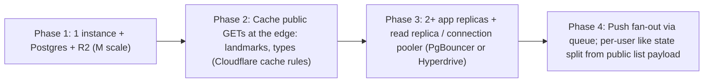
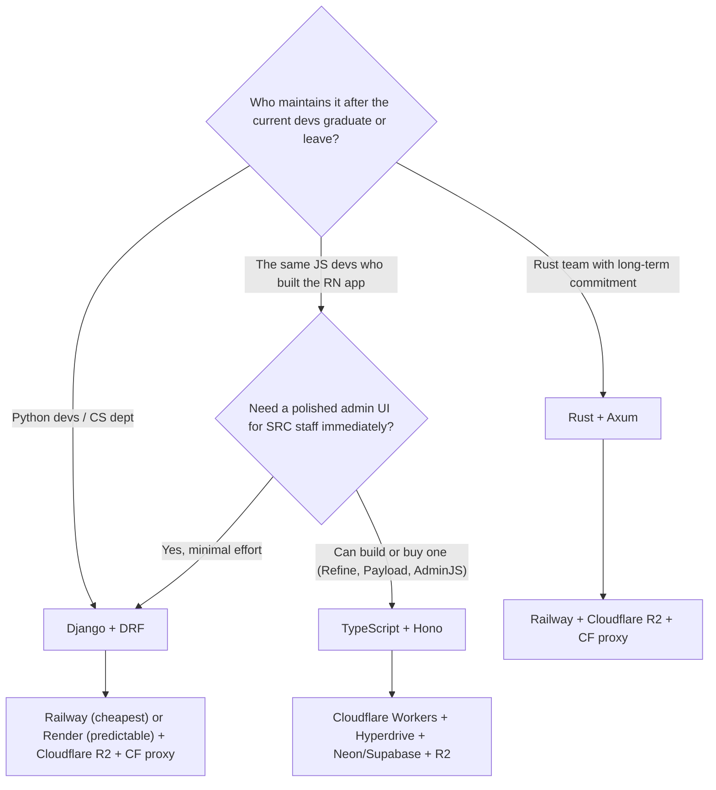

# KsTU SRC Backend Rebuild — Stack & Hosting Decision Matrix

> **Question:** Rebuild the Laravel API (`app.src-kstu.com/api/v1`) against the same 14 [API fixtures](file:///Users/kaliblip/Developer/KsTU%20SRC/src_kstu_app/review-docs/api-fixtures), serving the rebuilt React Native app ([src_kstu_rn](file:///Users/kaliblip/Developer/KsTU%20SRC/src_kstu_rn)). Which backend: **Django**, **TypeScript/Node**, or **Rust**? Which host: **Render**, **Railway**, or **Cloudflare**?
>
> Builds on [06-laravel-to-django-migration-guide.md](file:///Users/kaliblip/Developer/KsTU%20SRC/src_kstu_app/review-docs/06-laravel-to-django-migration-guide.md).

> [!WARNING]
> Prices below come from public pricing as of late 2025/2026 and are **rounded estimates**. Check each provider's pricing page before you commit. The ranking between options is more reliable than the exact dollar amounts.

---

## TL;DR

| Rank | Stack + Host | Monthly cost (≈15k students) | Build time | Why |
|---|---|---|---|---|
| 🥇 **Recommended** | **Django + DRF** on **Railway** or **Render**, Postgres, **Cloudflare R2** for `/storage/` | **$15–60** | **2–3 wks** | Django Admin is free and covers the SRC's real workload: posting announcements, approving scholarships and claims. Python is easy to hand over when the SRC executive changes every year. |
| 🥈 Strong alternative | **TypeScript (Hono)** on **Cloudflare Workers** + Hyperdrive→Postgres (or D1) + R2 | **$5–30** | **3–5 wks** | Cheapest at scale, edge PoPs in Accra and Lagos, and **one language with the RN app** (shared Zod types). You have to build or buy an admin panel. |
| 🥉 Not recommended now | **Rust (Axum + SQLx)** on Railway | **$5–25** | **6–10 wks** | Best raw performance, but you don't need it at this scale. Admin, hiring and handover all get harder. |

**Bottom line:** at KsTU scale, **any** of the three stacks handles peak traffic easily. What should drive the decision is **(1) admin and approval tooling, (2) who maintains it after the current devs leave, and (3) media storage and egress cost.** Raw speed barely matters here.

---

## 1. What the Backend Actually Has to Do

Taken from the fixtures and the RN client ([client.ts](file:///Users/kaliblip/Developer/KsTU%20SRC/src_kstu_rn/src/api/client.ts), [types.ts](file:///Users/kaliblip/Developer/KsTU%20SRC/src_kstu_rn/src/api/types.ts)):

| Domain | Endpoints | Notes |
|---|---|---|
| Auth | `login`, `logout`, `me`, `forgot-password`, `update-password`, `me/update-dp` | Login by email **or** `index_no`; JWT bearer; avatar is **multipart** upload |
| Announcements | notice-board, trending-news (paginated), detail, moments, like/unlike | Laravel `LengthAwarePaginator` shape; **real `per_page` is 10** (fixture 03), not 5 as written in guide 06 |
| Campus map | main/adako landmarks, landmark detail, places | Read-only, highly cacheable |
| Scholarships / Claims | types, apply (**multipart + documents**), my applications | Need a staff approval workflow (`application_status`, `approved_by_name`, `rejection_reason`) |
| Push | OneSignal on new announcement | Payload typo `announcemet_id` must be kept during the transition |
| **Back-office (not in fixtures)** | Create announcements + key moments, approve/reject applications, manage landmarks | **This is where most of the build effort goes** |

### Load model (why performance isn't the decider)

```
Students ≈ 15,000   Daily active ≈ 20–30%   Push spike: 30–40% open within 5 min
→ ~5,000 detail opens / 5 min ≈ 17 req/s average, ~100–150 req/s burst
```

A single 512 MB Django or Node instance with a DB index on `(category_id, status, created_at)` handles this. Rust handles it on 30 MB of RAM, but you don't need that headroom.

> [!IMPORTANT]
> **The real scalability hazard is the payload shape, and it affects every language.** Every list item embeds `liked_users[].get_liker_info` (full user objects). Fixture 03 is **21 KB for 10 posts with only 0–3 likes each**. A post with 800 likes would put about 400 KB in **one list item**. Whatever stack you pick, keep the key so the app doesn't break, but **cap it** (e.g. the latest 5 likers) and rely on `likes_count`. The RN app only reads `likes_count` / `liked_by_auth_user`. That one change matters more for scale than the language choice.

---

## 2. Backend Stack Comparison

### 2.1 Head-to-head

| Criterion | **Django + DRF** (Python) | **TypeScript** (Hono / Fastify / NestJS + Drizzle/Prisma) | **Rust** (Axum + SQLx / SeaORM) |
|---|---|---|---|
| **Fit with React Native** | Separate language. Generate RN types via `drf-spectacular` → `openapi-typescript` | ⭐ **Same language.** Share Zod schemas / types with `src/api/types.ts`; one `pnpm` monorepo | Separate language. `utoipa` → OpenAPI → TS, or `ts-rs` |
| **Admin / back-office** | ⭐ **Django Admin built in**: CRUD, search, filters, bulk approve, permissions, audit-ish history. About 1–2 days of config | Build it: AdminJS, React-Admin, Refine, or a headless CMS (Payload, Directus). About 1–2 extra weeks | Build it from scratch, or point Directus/Supabase Studio at the DB. About 2–3 extra weeks |
| **Laravel paginator compat** | Custom `PageNumberPagination` (~60 LOC, already in guide 06) | ~40 LOC helper | ~80 LOC + serde structs |
| **Multipart uploads** | Native (`MultiPartParser`, `FileField`) | `@fastify/multipart` / Hono `parseBody` | `axum::extract::Multipart`, manual streaming |
| **Laravel bcrypt (`$2y$`) hashes** | ⚠️ Django identifies hashes by a `bcrypt$` prefix, so the guide's "just add it to `PASSWORD_HASHERS`" **won't verify** raw `$2y$…` hashes. Fix: rewrite to `bcrypt$$2b$…` during import (see [doc 08 §3.2](file:///Users/kaliblip/Developer/KsTU%20SRC/src_kstu_app/review-docs/08-django-vs-nodejs.md)) | `bcrypt`/`bcryptjs`: swap `$2y$`→`$2b$` before compare (same algorithm) | `bcrypt` crate parses `$2y$` natively |
| **Background jobs** (OneSignal) | Celery + Redis (+$7–17/mo), or **skip Redis** with `procrastinate` / Django 6 tasks on Postgres | BullMQ (Redis), or Cloudflare Queues, or just `waitUntil()` | `tokio::spawn` / apalis |
| **RAM per instance** | 250–500 MB (gunicorn, 3 workers) | 80–150 MB | 15–40 MB |
| **Throughput (simple JSON+DB)** | ~1–3k req/s/core | ~5–15k req/s/core | ~20–60k req/s/core |
| **Cold start (scale-to-zero)** | 2–5 s | 0.3–1 s (Node) / ~0 ms (Workers) | ~50 ms |
| **Build time for this API** | **2–3 weeks** incl. admin | 3–5 weeks incl. admin | 6–10 weeks incl. admin |
| **Hiring / handover (Ghana, student devs)** | ⭐ Python is taught in KsTU CS; large talent pool | ⭐ JS/TS is everywhere; the same devs already work on the RN app | ❌ Rare skill; steep learning curve; high bus-factor risk |
| **Type safety** | Optional (mypy); runtime validation via serializers | Strong (TS + Zod at runtime) | ⭐ Strongest: compile-time SQL checks with SQLx |
| **Runs on Cloudflare Workers?** | ❌ Not realistically. Python Workers (Pyodide) suit FastAPI; Django + psycopg isn't viable. Only via **Cloudflare Containers** | ⭐ **Native** (Hono was built for Workers) | ⚠️ `workers-rs` (WASM): no SQLx/Tokio networking; you'd rewrite against D1/Hyperdrive bindings |

### 2.2 Tradeoffs in plain terms

**Django**
- ✅ The admin panel alone saves 1–2 weeks and gives SRC staff a usable approval UI on day one.
- ✅ The ORM and migrations map 1:1 to the existing Laravel tables (`db_table = "…"`). Guide 06 is already ~70% of the code.
- ❌ Heaviest RAM use, so you pay more per instance on usage-billed hosts (Railway).
- ❌ RN and backend use different languages, so types drift unless you add OpenAPI codegen to CI.

**TypeScript**
- ✅ One language end-to-end. `src/api/types.ts` becomes a shared package, so a fixture change breaks the build on **both** sides.
- ✅ The only stack that runs natively on Cloudflare's edge, which makes it the cheapest at scale.
- ❌ No built-in admin. Whatever admin you pick becomes another dependency to maintain.
- ❌ The ecosystem moves fast (ORM churn, framework churn), so there's more upgrade work over 3–5 years.

**Rust**
- ✅ Tiny memory, near-zero cold start, very hard to crash. Excellent if you were serving millions.
- ❌ You'd be paying 3× the build time for performance KsTU won't use.
- ❌ Biggest risk for an SRC project: whoever inherits it next year probably can't maintain it.

---

## 3. Hosting Comparison

### 3.1 Platform capabilities

| Capability | **Render** | **Railway** | **Cloudflare** |
|---|---|---|---|
| Model | Fixed-size instances (PaaS) | **Usage-based** containers (per-minute RAM/CPU) | Serverless edge (Workers) + R2/D1/KV/Queues/Hyperdrive; Containers (newer) |
| Closest region to Ghana | Frankfurt (~110–150 ms) | EU West / Amsterdam (~110–150 ms) | ⭐ **Accra & Lagos PoPs** (~10–30 ms to the edge; DB round-trip still goes to the EU unless data is on D1/KV) |
| Django | ⭐ First-class | ⭐ First-class | ❌ (Containers only; not a natural fit) |
| Node/TS | ✅ | ✅ | ⭐ Native |
| Rust | ✅ (Docker) | ✅ (Docker/Nixpacks) | ⚠️ WASM limits |
| Managed Postgres | ✅ (Render Postgres) | ✅ (template; you manage backups and tuning) | ❌ Native = **D1 (SQLite)**. For Postgres use **Hyperdrive** → Neon/Supabase |
| Redis | ✅ Key Value | ✅ template | KV / Durable Objects / Queues (not Redis) |
| Persistent disk for `/storage/` | ✅ Disks (one instance only, blocks horizontal scaling) | ✅ Volumes (one service only) | ⭐ **R2**, S3-compatible, **$0 egress** |
| Free tier for prod? | ❌ Free web services **sleep after 15 min** (30–60 s cold start); free DB expires | ❌ Trial credit only | ✅ Workers free tier is generous (100k req/day) |
| Autoscaling | Paid plans, instance-based | Replicas (manual/vertical auto) | ⭐ Automatic, effectively unlimited |
| Ops burden | Low | Low–Medium (DB backups are on you) | Low for Workers; **high if you fight runtime limits** |

### 3.2 Indicative pricing (verify before buying)

| Item | Render | Railway | Cloudflare |
|---|---|---|---|
| Base plan | $0 workspace (Pro team plans extra) | Hobby **$5/mo** (incl. $5 usage) · Pro **$20/seat** (incl. $20 usage) | Workers Paid **$5/mo** (10M req + 30M CPU-ms incl.) |
| App instance | Starter 512 MB **$7** · Standard 2 GB **$25** | ≈ **$10 per GB-RAM-month** + ≈ $20 per vCPU-month (billed on actual use) | $0.30 / extra million requests |
| Background worker | $7+ | usage | Queues ≈ $0.40/M ops |
| Postgres | ~$6 (256 MB) · ~$19 (1 GB) · ~$55 (4 GB) | usage (~$5–15 small) | Hyperdrive incl.; DB via **Neon** (free → $19) or **Supabase** (free → $25) · D1 incl. (5 GB) |
| Redis | ~$10 | usage (~$2–5) | n/a |
| Storage | Disk ~$0.25/GB-mo | Volume ~$0.15/GB-mo | **R2 $0.015/GB-mo, 10 GB free, $0 egress** |
| Egress | Included bandwidth, then paid | ~$0.05/GB | $0 (Workers/R2) |

> [!TIP]
> **Use R2 for media whatever you choose.** Announcement posters, moment images, landmark photos and documents make up most of the bandwidth. The RN app already prefetches posters to disk (see [announcement-cache.ts](file:///Users/kaliblip/Developer/KsTU%20SRC/src_kstu_rn/src/lib/announcement-cache.ts)), but every new announcement push still makes thousands of devices download the image. On R2, behind `app.src-kstu.com/storage/*`, that egress costs **$0**, and the URL paths stay identical to Laravel's.

---

## 4. The 9 Combinations: Cost at Three Scales

Assumptions: Postgres, R2 for media (~20 GB), OneSignal free tier. **S** = 5k students, **M** = 15k (KsTU today), **L** = 60k (multi-campus or national rollout).

| Stack × Host | S /mo | **M /mo** | L /mo | Notes |
|---|---|---|---|---|
| **Django × Render** | ~$20 (Starter web + Starter worker + basic DB) | **~$45–65** (Standard web $25, worker $7, DB $19, Redis $10) | ~$150–250 (2–3× Standard, 4 GB DB) | Most predictable bill; drop Redis/worker by using Postgres-backed tasks (−$17) |
| **Django × Railway** | ~$10–15 | **~$25–45** | ~$100–180 | Cheaper than Render because you pay for real usage, but RAM-heavy gunicorn eats into that |
| Django × Cloudflare (Containers) | ~$10–20 | ~$30–60 | ~$100+ | ⚠️ Newer product, cold starts, still needs external Postgres. **Not recommended** |
| TS × Render | ~$14 | ~$35–45 | ~$100–150 | Fine, but you pay instance prices for a lightweight app |
| **TS × Railway** | ~$5–10 | **~$15–25** | ~$50–100 | Good middle ground; Node idles at ~100 MB |
| **TS × Cloudflare** (Workers + Hyperdrive + Neon/Supabase + R2) | **$5** | **~$5–30** | ~$30–80 | ⭐ Cheapest, global edge, scales automatically. DB plan is most of the cost |
| Rust × Render | ~$14 | ~$30–40 | ~$70–100 | Instance pricing removes Rust's RAM advantage |
| Rust × Railway | ~$5 | ~$10–20 | ~$30–60 | ⭐ Cheapest container option, but highest build cost |
| Rust × Cloudflare (workers-rs) | $5 | ~$5–30 | ~$30–80 | ⚠️ WASM limits; a rewrite around D1/bindings. Not worth it |

### Total cost of ownership (year 1) is dominated by developer time

| | Django | TypeScript | Rust |
|---|---|---|---|
| Build effort (weeks, incl. admin) | 2–3 | 3–5 | 6–10 |
| Dev cost @ ~GH₵ 6,000 / ~\$500 per week (local contractor, illustrative) | ~\$1–1.5k | ~\$1.5–2.5k | ~\$3–5k |
| Hosting year 1 (M scale, best host) | ~\$300–550 | ~\$60–300 | ~\$120–240 |
| **Year-1 TCO** | **~\$1.3–2k** | **~\$1.6–2.8k** | **~\$3.1–5.2k** |
| Handover risk (yrs 2–5) | Low | Low | **High** |

Infra savings from Rust or Cloudflare (~\$20–40/mo) take **years** to pay back the extra build time.

---

## 5. Blockers & Risks (all stacks)

| # | Blocker | Severity | Mitigation |
|---|---|---|---|
| 1 | **Existing JWTs die at cutover** → every student is logged out | 🔴 High | Copy Laravel's `JWT_SECRET` (tymon/jwt-auth, HS256, `sub` = user id) and **accept legacy tokens** in the new backend for 30–60 days. Works in all three stacks |
| 2 | **bcrypt `$2y$` hashes** | 🔴 High (otherwise nobody can log in) | Django: prefix `bcrypt$$2b$` on import + stock `BCryptPasswordHasher`. Node: replace `$2y$`→`$2b$`. Rust: works as-is |
| 3 | **`/storage/` URLs hard-coded** in the Flutter (production) and RN apps | 🔴 High | Keep the exact paths. Migrate files to R2 and route `/storage/*` to it (Cloudflare custom domain or Worker) |
| 4 | **Ephemeral filesystems** on Render/Railway | 🟠 Med | Never write uploads to local disk; go straight to R2/S3 (`django-storages`, `@aws-sdk/client-s3`, `aws-sdk-s3` crate) |
| 5 | **Render free tier sleeps** | 🟠 Med | Don't run production on free. At least Starter ($7) |
| 6 | **Cloudflare Workers limits** (CPU-ms per request, no native TCP Postgres without Hyperdrive, 100 MB request body on paid) | 🟠 Med (TS) / 🔴 (Django, Rust) | Hono + Hyperdrive; uploads go to R2 via presigned URLs; keep image resizing off the hot path |
| 7 | **D1 is SQLite**: Postgres `ArrayField` (`required_document_types`) isn't available | 🟡 Low | Store as JSON text, or choose Hyperdrive + Postgres instead of D1 |
| 8 | **Payload bloat + PII leak** (`liked_users` exposes other students' email/phone/index_no) | 🔴 High | Return `liked_users: []`. Flutter only parses it as `List<dynamic>` and RN ignores it ([doc 08 §7](file:///Users/kaliblip/Developer/KsTU%20SRC/src_kstu_app/review-docs/08-django-vs-nodejs.md)) |
| 9 | **Flutter app still in stores** | 🔴 High | Fixture conformance tests must pass for **both** clients; keep quirks (`/me` returns `token: ""`, `announcemet_id`) |
| 10 | **Data residency / university IT policy** | 🟡 Unknown | Confirm KsTU allows student PII in EU/US clouds. Supabase/Neon EU (Frankfurt) is the safest default |
| 11 | **Guide 06 errata** | 🟡 Low | `AnnouncementPagination.page_size` must be **10**; fix the bcrypt hasher note (blocker 2) |

---

## 6. Scalability Path



| Lever | Django | TS | Rust |
|---|---|---|---|
| Horizontal scale | Add gunicorn instances (stateless with R2 + JWT) | Same / automatic on Workers | Same |
| DB pooling | PgBouncer / `CONN_MAX_AGE` | Hyperdrive / pg pool | SQLx pool |
| Edge caching | Put Cloudflare (free plan) in front of any host | Native | Put Cloudflare in front |
| Ceiling before re-architecture | ~1–2k req/s on a few instances | ~5k+ req/s | ~20k+ req/s |

> [!NOTE]
> Put **Cloudflare's free proxy in front of whichever host you pick** (DNS, TLS, DDoS, caching `/storage/*` and campus-map GETs). That's a hybrid ("Render/Railway for compute, Cloudflare for edge + R2"), and it's the setup most production teams use.

---

## 7. Decision Guide



### Recommendation

1. **Backend: Django + DRF.** Guide 06 already covers most of it, Django Admin solves the back-office, and it's the easiest to hand over.
2. **Compute: Railway** (lowest bill at this scale) or **Render** (fixed, predictable invoices, which helps if the SRC budget needs a fixed line item). Pick a Frankfurt/EU region.
3. **Database: managed Postgres in the EU.** Render Postgres, or **Supabase** (you already have Supabase MCP connected, and you get daily backups + Studio as a second admin UI).
4. **Media: Cloudflare R2** behind `app.src-kstu.com/storage/*`, with the **Cloudflare proxy** in front of everything.
5. **Skip Redis/Celery at launch.** Send OneSignal pushes from a Postgres-backed task queue. Add Redis only if needed.
6. **Before cutover:** legacy-JWT acceptance, the bcrypt `$2y$` hasher, `liked_users` cap, and all 14 fixture tests passing against **both** Flutter and RN builds.

**Expected:** ~2–3 weeks to build, **~\$25–45/mo** at today's scale, and headroom to ~5× growth without architecture changes.

If the team is JS-only and wants the lowest long-term cost, switch to **Hono on Cloudflare Workers** and budget 1–2 extra weeks for an admin panel.
