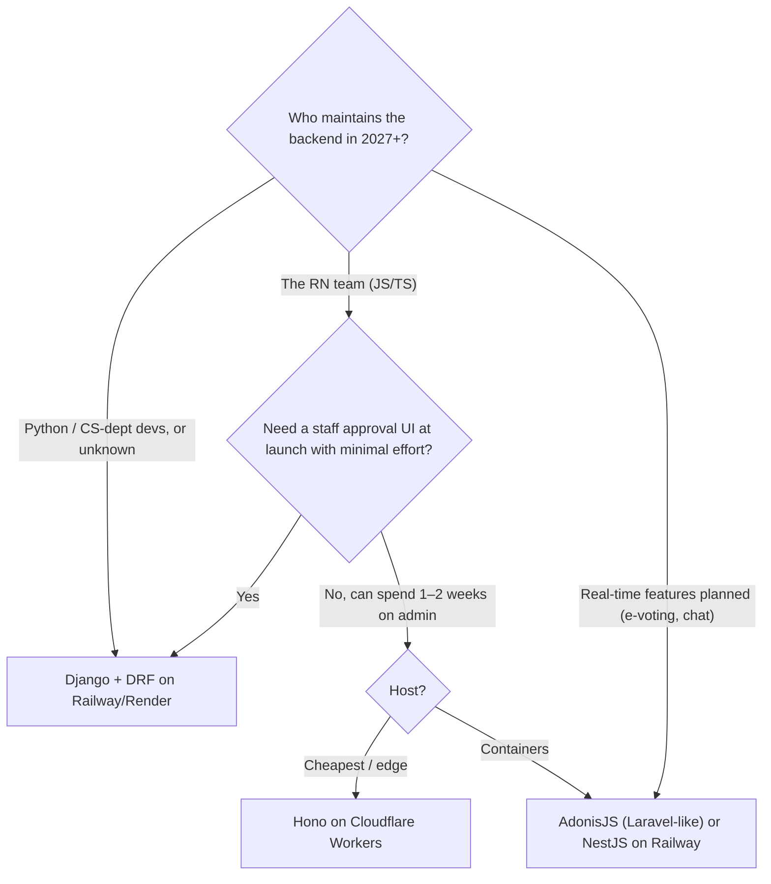

# Django vs Node.js for the KsTU SRC Backend

> **Context:** This rebuilds the Laravel API to match the 14 [API fixtures](file:///Users/kaliblip/Developer/KsTU%20SRC/src_kstu_app/review-docs/api-fixtures), serving both the Flutter app (in stores) and the React Native app ([src_kstu_rn](file:///Users/kaliblip/Developer/KsTU%20SRC/src_kstu_rn)). It goes deeper than the three-way comparison in [07-backend-stack-and-hosting-decision.md](file:///Users/kaliblip/Developer/KsTU%20SRC/src_kstu_app/review-docs/07-backend-stack-and-hosting-decision.md).

---

## TL;DR

| | **Django + DRF** | **Node.js (TypeScript)** |
|---|---|---|
| Pick it if… | SRC staff need a **working admin/approval UI right away**, and future maintainers are likely Python/CS-department devs | The **same JS devs who built the RN app** will own the backend, you want **Cloudflare Workers** pricing, or you plan **real-time** features (live election results, chat) |
| Build time (this API + back-office) | **~2–3 weeks** | **~3–5 weeks** |
| Hosting at ~15k students | ~\$25–65/mo (Railway/Render) | ~\$5–45/mo (Workers → Render) |
| Biggest win | Django Admin is free and ready on day one | One language and **shared types** with the RN app |
| Biggest cost | Separate language from RN, so types can drift | You have to build or buy an admin panel |

**Verdict for KsTU:** **Django** by a small margin. The back-office (posting announcements, approving scholarships and claims) is the largest part of the work, and Django Admin covers it for free. If the team is all-JS and committed long term, **Node.js with AdonisJS or NestJS** is just as valid.

Performance is **not** a deciding factor. Both handle KsTU's peak load on one small instance (§5).

---

## 1. "Node.js" is a runtime. Pick a framework first

Django is one opinionated framework. On Node, the framework you choose decides how much you have to build yourself:

| Node framework | Feels like | ORM | Admin | Best for KsTU when… |
|---|---|---|---|---|
| **AdonisJS v6** | **Laravel in TypeScript** (Lucid ORM ≈ Eloquent, migrations, auth, validator, mail) | Lucid | ❌ | The team knows the current Laravel code. **Easiest port from Laravel** |
| **NestJS** | Django/Spring-style modules, DI, decorators | Prisma / TypeORM / Drizzle | ❌ | You want enforced structure for rotating student devs |
| **Fastify** | Lean and fast; you assemble the pieces | Drizzle / Prisma | ❌ | A small, experienced team |
| **Hono** | Minimal, built for the edge | Drizzle + Hyperdrive / D1 | ❌ | Deploying to **Cloudflare Workers** |
| Express | Minimal, old-school | any | ❌ | Not recommended for new work. Fastify or Hono do the same job better |

None of them ship an admin panel. The comparison below assumes **AdonisJS or NestJS** (the closest to Django in "batteries"), or **Hono** where Cloudflare is involved.

---

## 2. Head-to-head on KsTU's actual requirements

| Requirement | Django + DRF | Node.js (TS) | Edge |
|---|---|---|---|
| Map to existing Laravel tables | `class Meta: db_table = "announcements"`; `inspectdb` can generate models from the live DB | Lucid/Prisma/Drizzle all support existing tables; `prisma db pull` / `drizzle-kit pull` introspect | Tie |
| Laravel paginator shape | ~60 LOC custom paginator ([guide 06 §5](file:///Users/kaliblip/Developer/KsTU%20SRC/src_kstu_app/review-docs/06-laravel-to-django-migration-guide.md)) | ~40 LOC helper (AdonisJS's paginator is close to Laravel's out of the box) | Tie, slight Node edge with Adonis |
| Laravel timestamp format `2025-01-13T14:32:32.000000Z` | One setting (`DATETIME_FORMAT`) | ⚠️ `Date.toISOString()` gives **3** decimal places (`.000Z`), so you need a formatter (§3.1) | **Django** |
| Legacy `$2y$` bcrypt passwords | Rewrite the prefix on import, then use the stock hasher (§3.2) | `bcrypt.compare` after a `$2y$`→`$2b$` swap (§3.2) | Tie |
| Accept legacy Laravel JWTs (avoid logging everyone out) | Custom DRF auth class with PyJWT (§3.3) | `jose.jwtVerify`, about 10 lines (§3.3) | **Node** (slightly simpler) |
| Multipart claim/scholarship uploads → R2 | `django-storages` + `FileField`: built in | `@fastify/multipart` or Adonis `request.file()` + `@aws-sdk/client-s3` | **Django** (less code) |
| **Back-office / approvals** | **Django Admin**: list, filter, search, bulk-approve, permissions, change history. ~1–2 days | AdminJS / Refine / React-Admin, or a CMS (Payload, Directus). **~1–2 weeks** | **Django** (decisive) |
| Shared types with RN | `drf-spectacular` → OpenAPI → `openapi-typescript` in CI | ⭐ Shared Zod schemas in a monorepo; [types.ts](file:///Users/kaliblip/Developer/KsTU%20SRC/src_kstu_rn/src/api/types.ts) becomes the contract | **Node** (decisive) |
| Push notifications (OneSignal) | Celery + Redis, or a Postgres-backed queue (`procrastinate`, `django-tasks`) | BullMQ + Redis, pg-boss (Postgres), or Cloudflare Queues / `waitUntil` | Tie |
| Real-time (future: live e-voting results, chat) | Django Channels + Redis: workable but bolted on | ⭐ Socket.IO / WebSockets / Durable Objects are native | **Node** |
| Secure defaults | ⭐ CSRF (admin), password validators, parameterized ORM, security middleware, clickjacking protection: all on by default | You assemble it: helmet, rate limiting, validation, CORS. Easy to miss something | **Django** |
| Dependency risk | Small, stable dependency tree | Large npm tree; more supply-chain and upgrade churn | **Django** |
| Runs on Cloudflare Workers | ❌ (Containers only) | ⭐ Native (Hono) | **Node** |
| LTS horizon | Django 5.2 LTS → Apr 2028 | Node 24 LTS → Apr 2028; framework and ORM majors move faster | Django (more stable) |

---

## 3. The hard parts, side by side

### 3.1 Laravel timestamp format

All timestamps in the fixtures look like `2026-05-31T01:49:06.000000Z` (6 decimal places, UTC).

````carousel
```python
# Django: config/settings/base.py
USE_TZ = True
TIME_ZONE = "UTC"  # Ghana is UTC+0 with no DST, so no surprises
REST_FRAMEWORK = {
    "DATETIME_FORMAT": "%Y-%m-%dT%H:%M:%S.%fZ",  # -> .000000Z
}
```
<!-- slide -->
```ts
// Node: toISOString() returns ".000Z" (3 digits). Pad to Laravel's 6.
export const laravelDate = (d: Date | null) =>
  d ? d.toISOString().replace(/\.(\d{3})Z$/, '.$1000Z') : null;
// Apply it in every serializer/transformer (or a JSON replacer).
```
````

### 3.2 Existing Laravel passwords (`$2y$10$…`)

> [!IMPORTANT]
> **Correction to guide 06:** adding `BCryptPasswordHasher` to `PASSWORD_HASHERS` alone **won't** verify imported hashes. Django identifies a hash by its `algorithm$` prefix, and a raw `$2y$…` has none. Rewrite the prefix during import instead. No custom hasher is needed.

````carousel
```python
# Django: in import_laravel_data
pw = row["password"]                       # "$2y$10$abc..."
if pw.startswith("$2y$"):
    pw = "bcrypt$$2b$" + pw[4:]            # -> "bcrypt$$2b$10$abc..."
user.password = pw

# settings: put the preferred hasher FIRST so Django re-hashes on next login
PASSWORD_HASHERS = [
    "django.contrib.auth.hashers.PBKDF2PasswordHasher",
    "django.contrib.auth.hashers.BCryptPasswordHasher",  # plain bcrypt, NOT BCryptSHA256
]
```
<!-- slide -->
```ts
// Node: same algorithm; $2y$ and $2b$ are interchangeable for verification
import bcrypt from 'bcryptjs';

const ok = await bcrypt.compare(
  password,
  user.password.replace(/^\$2y\$/, '$2b$'),
);
// Use the async API: sync bcrypt blocks the event loop for every request.
```
````

### 3.3 Accepting legacy Laravel JWTs at cutover

Laravel (tymon/jwt-auth) signs HS256 tokens with `JWT_SECRET` and puts the user id in `sub`. If you accept those tokens for 30–60 days, nobody gets logged out when DNS flips.

````carousel
```python
# Django: core/auth.py. List it BEFORE SimpleJWT in DEFAULT_AUTHENTICATION_CLASSES,
# because SimpleJWT raises (rather than returns None) on tokens it can't read.
import jwt  # PyJWT
from django.conf import settings
from rest_framework.authentication import BaseAuthentication
from rest_framework.exceptions import AuthenticationFailed
from apps.accounts.models import User

class LegacyLaravelJWTAuthentication(BaseAuthentication):
    def authenticate(self, request):
        auth = request.headers.get("Authorization", "")
        if not auth.startswith("Bearer "):
            return None
        try:
            payload = jwt.decode(
                auth[7:], settings.LARAVEL_JWT_SECRET, algorithms=["HS256"],
                options={"verify_sub": False},  # tymon may emit numeric `sub`; PyJWT ≥2.10 rejects that by default
            )
        except jwt.PyJWTError:
            return None  # not a legacy token -> let SimpleJWT try
        user = User.objects.filter(pk=payload.get("sub"), is_active=True).first()
        if user is None:
            raise AuthenticationFailed("User not found")
        return (user, None)
```
<!-- slide -->
```ts
// Node: middleware, try the new token first, then the legacy one
import { jwtVerify } from 'jose';
const legacyKey = new TextEncoder().encode(process.env.LARAVEL_JWT_SECRET!);

export async function resolveUserId(token: string): Promise<number | null> {
  for (const key of [newKey, legacyKey]) {
    try {
      const { payload } = await jwtVerify(token, key, { algorithms: ['HS256'] });
      return Number(payload.sub);
    } catch {}
  }
  return null;
}
```
````

> [!NOTE]
> Check both snippets against a **real staging token** before cutover. Decode one at jwt.io to confirm the `sub` type and whether `JWT_SECRET` is used raw or base64-decoded.

### 3.4 Admin / approval workflow (the decisive part)

````carousel
```python
# Django: apps/scholarships/admin.py. This is the whole approval UI.
from django.contrib import admin
from django.utils import timezone
from .models import ScholarshipApplication, ApplicationDocument

class DocumentInline(admin.TabularInline):
    model = ApplicationDocument
    extra = 0

@admin.register(ScholarshipApplication)
class ScholarshipApplicationAdmin(admin.ModelAdmin):
    list_display = ("student_full_name", "student_number", "scholarship_type",
                    "application_status", "created_at")
    list_filter = ("application_status", "scholarship_type")
    search_fields = ("student_full_name", "student_number")
    inlines = [DocumentInline]
    actions = ["approve"]

    @admin.action(description="Approve selected applications")
    def approve(self, request, queryset):
        queryset.update(
            application_status="approved",
            approved_by_name=request.user.name,  # custom User has `name`, not get_full_name()
            approved_at=timezone.now(),
        )
```
<!-- slide -->
```text
Node.js: no built-in equivalent. Options:

1. AdminJS (+ Prisma/TypeORM adapter)   ~3–5 days   auto-CRUD, weaker UX for custom actions
2. Refine / React-Admin SPA             ~1–2 weeks  best UX, but it's a second frontend to maintain
3. Payload CMS / Directus               ~1 week     strong admin, but it's another system to host and
                                                    keep compatible with the Laravel-shaped API
4. Supabase Studio (if DB is Supabase)  ~0 days     raw table editor only: no workflow, risky for staff
```
````

---

## 4. Stack-specific gotchas

### Node.js

| Gotcha | Impact | Fix |
|---|---|---|
| `index_no` is `BIGINT` (`52242620003`). **Prisma** returns `bigint`, and `JSON.stringify` **throws** on it | Login and `/me` crash | Drizzle `bigint({ mode: 'number' })`, or map to `Number()` (safe: 11 digits < 2⁵³) |
| `toISOString()` precision | Timestamps don't match the fixtures | §3.1 formatter |
| CPU work on the event loop (sync bcrypt, image resizing with `sharp`) | One slow request stalls **every** request | Async APIs; offload resizing to a queue or worker |
| No admin, no default security middleware | Extra work and room for mistakes | Pick a full framework (Adonis/Nest) and add helmet + rate limiting from day one |
| ORM and framework churn | Upgrade work every year | Pin versions; prefer Drizzle/Lucid (thin) over heavy abstractions |

### Django

| Gotcha | Impact | Fix |
|---|---|---|
| **N+1 queries**: guide 06's `liked_by_auth_user` runs one query **per announcement** | 10+ extra queries per page | Annotate once (snippet below) |
| Sync gunicorn workers: concurrency = workers × threads | Slow DB or OneSignal calls tie up workers | `gunicorn -w 3 --threads 4`; send pushes from a task queue, not in the request |
| Heavier RAM (~300–450 MB for 3 workers) | Costs ~\$3–4/mo more per instance on Railway | Irrelevant at KsTU scale |
| Types drift from RN | Silent client breakage | `drf-spectacular` + `openapi-typescript` + fixture tests in CI |
| Model `@property likes_count` clashes with annotations | `AttributeError` when annotating | Drop the properties; annotate under the serializer's source names |

```python
# Django: one query for counts + "did I like it", instead of N+1
from django.db.models import Count, Exists, OuterRef

qs = (Announcement.objects
      .filter(category_id=1, status=1)
      .annotate(
          n_likes=Count("likes", distinct=True),
          liked=Exists(AnnouncementLike.objects.filter(
              announcement=OuterRef("pk"), user=request.user)),
      ))
# serializer: likes_count = IntegerField(source="n_likes"); liked_by_auth_user = BooleanField(source="liked")
```

---

## 5. Performance at KsTU scale

Peak load is a push-notification spike: about **100–150 req/s** for a few minutes. Most of that is notice-board and detail GETs, with a ~20–40 ms Postgres round-trip to an EU region.

| | Django (gunicorn 3 workers × 4 threads) | Node.js (1 process) |
|---|---|---|
| Concurrent requests needed (Little's law: 150 req/s × ~50 ms) | ~8 | ~8 |
| Concurrent requests available | 12 | Hundreds (async I/O) |
| Approx. throughput ceiling, simple JSON + DB, 1 vCPU | ~500–1,500 req/s | ~3,000–8,000 req/s |
| RAM | ~300–450 MB | ~80–150 MB |
| **Headroom over KsTU peak** | **~5–10×** | **~25–50×** |

Both are comfortably sufficient. Node's extra headroom only matters if this becomes a **multi-university or national** platform.

---

## 6. Cost (from [doc 07](file:///Users/kaliblip/Developer/KsTU%20SRC/src_kstu_app/review-docs/07-backend-stack-and-hosting-decision.md), ~15k students, R2 for media)

| Host | Django | Node.js |
|---|---|---|
| **Railway** | ~\$25–45/mo | ~\$15–25/mo |
| **Render** | ~\$45–65/mo | ~\$35–45/mo |
| **Cloudflare** | ❌ not practical | **~\$5–30/mo** (Workers + Hyperdrive + Neon/Supabase) |
| Year-1 dev effort (illustrative ~\$500/wk) | ~\$1–1.5k | ~\$1.5–2.5k |

Node saves about \$10–40/month in hosting. Django saves about 1–2 weeks of build time. **That balances out after roughly 2–4 years**, about as long as the next SRC dev team stays.

---

## 7. Must-fix in either stack (found in the fixtures)

> [!CAUTION]
> **Privacy leak:** every announcement's `liked_users[].get_liker_info` exposes **other students' email, phone number and index number** to any logged-in user ([03-get-notice-board.json](file:///Users/kaliblip/Developer/KsTU%20SRC/src_kstu_app/review-docs/api-fixtures/03-get-notice-board.json)). Flutter only parses it as `List<dynamic>` ([announcement.dart](file:///Users/kaliblip/Developer/KsTU%20SRC/src_kstu_app/lib/models/announcement.dart#L65)), and the RN app never reads it. **Return `"liked_users": []`.** That's safe for both clients, fixes the PII exposure, and removes most of the 21 KB payload.

| # | Issue | Applies to |
|---|---|---|
| 1 | Return `liked_users: []` (above) | Both |
| 2 | Detail response `message` is `"Announcement Response"` (fixture 05), **not** `"Announcement Detail Response"` as written in guide 06 | Both |
| 3 | Announcement `per_page` is **10** (fixture 03), not 5 | Both |
| 4 | `/me` must keep returning `"token": ""`; push payload must keep the `announcemet_id` typo during transition | Both |
| 5 | bcrypt import prefix (§3.2), legacy JWT acceptance (§3.3) | Both |

---

## 8. Decision



**Recommendation:** **Django + DRF** on Railway (or Render for a fixed bill), Postgres in the EU, R2 for `/storage/`, Cloudflare proxy in front. Pick **Node.js (AdonisJS for a Laravel-style port, Hono for Cloudflare)** if the RN developers will own the backend long term or real-time features are on the roadmap.
