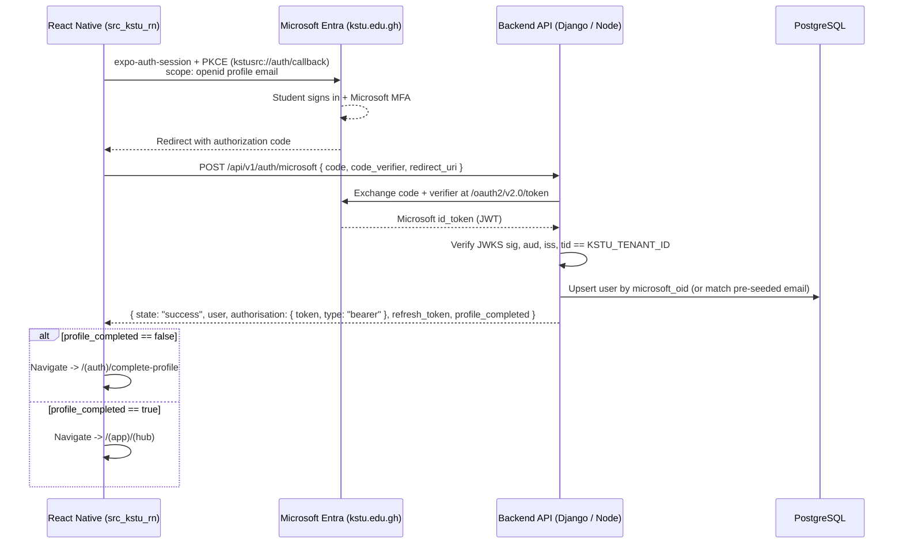

# Replacing Auth & Database with Microsoft Entra ID (`kstu.edu.gh`)

> **Scope:** Architectural blueprint for replacing the legacy Laravel password auth and MySQL database with a clean-slate **PostgreSQL** database and **Microsoft Entra ID (Azure AD) single-tenant SSO** scoped strictly to `kstu.edu.gh`, serving the rebuilt React Native app ([src_kstu_rn](file:///Users/kaliblip/Developer/KsTU%20SRC/src_kstu_rn)).
>
> Supersedes the legacy migration assumptions (password hash conversion + legacy JWT validation) in [06](file:///Users/kaliblip/Developer/KsTU%20SRC/src_kstu_app/review-docs/06-laravel-to-django-migration-guide.md), [07](file:///Users/kaliblip/Developer/KsTU%20SRC/src_kstu_app/review-docs/07-backend-stack-and-hosting-decision.md), and [08](file:///Users/kaliblip/Developer/KsTU%20SRC/src_kstu_app/review-docs/08-django-vs-nodejs.md).

---

## TL;DR — What Changes When You Replace Both Auth & DB

| Area | Old Plan (Keep Laravel Auth/DB Contract) | New Plan (Microsoft Entra + Fresh DB) |
|---|---|---|
| **Login** | Email/Index + password (`POST /login`), `/forgot-password`, `/update-password`, external `/user/register` web link | **Single button:** "Continue with KsTU Microsoft Account" (`kstu.edu.gh` tenant OIDC + PKCE) |
| **Account creation** | Manual web registration (`app.src-kstu.com/user/register`) | **Just-In-Time (JIT)** auto-creation on first `@kstu.edu.gh` sign-in + **1-time Complete Profile** screen |
| **User identity** | `users.id` + `$2y$` bcrypt hashes + separate `admins` table | Unified `users` table keyed by immutable **`microsoft_oid`** (`UUID`) + `role` (`student` / `exec` / `admin`) |
| **Passkey / Biometrics** | `login.tsx` saves raw email + password in `SecureStore` | Password removed; biometrics unlock the stored **app refresh token** cleanly |
| **Legacy Flutter app** | Kept alive during backend cutover | **Breaks immediately at cutover** — replace on App Store / Play Store with the RN build (`com.kstu.src`) |
| **Backend ranking** | Django > Node > Supabase | **Supabase Auth + Postgres becomes genuinely viable** alongside Django / Hono (§5) |

---

## 1. How Scoped `kstu.edu.gh` Auth Works

### 1.1 Single-Tenant Enforcement (Two Layers)

Never rely solely on checking `email.endsWith('@kstu.edu.gh')` or using Microsoft's `/common` endpoint. Enforce scoping at **both** Microsoft's edge and your backend:

1. **Authorize URL (Microsoft edge):**
   Use the single-tenant authority instead of `/common` or `/organizations`:
   ```
   https://login.microsoftonline.com/kstu.edu.gh/v2.0/authorize
   ```
   *(In production, resolve `kstu.edu.gh` to its immutable Tenant GUID via `https://login.microsoftonline.com/kstu.edu.gh/v2.0/.well-known/openid-configuration` and pin that GUID.)*
   Microsoft will block personal `@outlook.com`/`@hotmail.com` accounts and external universities/companies before any token is issued.

2. **Server-Side Token Verification (Backend gate):**
   When verifying the Microsoft `id_token` via Microsoft's JWKS endpoint (`https://login.microsoftonline.com/<KSTU_TENANT_ID>/discovery/v2.0/keys`):
   - `iss` == `https://login.microsoftonline.com/<KSTU_TENANT_ID>/v2.0`
   - `aud` == `<YOUR_APP_CLIENT_ID>`
   - **`tid` == `<KSTU_TENANT_ID>`** *(mandatory tenant lock)*
   - `exp` / `nbf` valid
   - Domain allowlist on `email` / `preferred_username` (e.g. `@kstu.edu.gh` or approved subdomains if KsTU uses student subdomains like `@st.kstu.edu.gh` — verify real student UPNs first!)

3. **Identity Key: Use `oid`, Never `email`**
   Microsoft issues an immutable `oid` (Object ID UUID) per user in the tenant. Students' display names or emails can occasionally be updated by ICT, but `oid` never changes.

### 1.2 Auth Flow: RN App ↔ Microsoft ↔ Backend



**Why mint your own app JWT instead of forwarding Microsoft's token on every API call?**
- Microsoft ID tokens expire in 1 hour and are not designed as backend API bearer tokens.
- Issuing your own short-lived access JWT + rotating refresh token (stored in `expo-secure-store`) enables instant logout revocation, offline session grace, custom role claims (`student` vs `exec` vs `admin`), and keeps the mobile API client clean.

---

## 2. Database Replacement Design (PostgreSQL)

Replacing MySQL + Laravel lets you eliminate every historical schema bug documented in `03-bugs-and-issues.md` and `06-laravel-to-django-migration-guide.md`.

### 2.1 What Changes in the Schema

| Table / Field | Legacy Laravel (MySQL) | Clean-Slate Postgres |
|---|---|---|
| `users` auth fields | `email`, `password` (`$2y$`), `remember_token` | **Drop password fields.** Add `microsoft_oid UUID UNIQUE`, `microsoft_tid UUID NOT NULL`, `role VARCHAR(20) DEFAULT 'student'`, `profile_completed BOOLEAN DEFAULT FALSE` |
| `users.index_no` | `BIGINT` (drops leading `0` -> `52242620003` instead of `052242620003`) | **`VARCHAR(20) UNIQUE NULL`** — preserves exact leading zeros; nullable until onboarding finishes |
| `users.faculty_id` / `dept_id` / `program_id` / `current_level` | Required at web registration | **Nullable** on initial SSO row; set during `complete-profile` |
| `admins` table | Separate table + separate passwords | **Eliminated.** SRC Executives and Admins sign in via `@kstu.edu.gh` SSO; gated by `users.role IN ('exec', 'admin')` (or Entra security group membership) |
| `refresh_tokens` | None (`/logout` was a no-op, Bug B-07) | Added (hashed token, `user_id`, `expires_at`, `revoked_at`) |
| `claims.has_body_been_buried` & booleans | Tinyint `0/1` quirks | Proper Postgres `BOOLEAN` |
| `announcements` likes | `liked_users[]` leaked other students' emails/phones/index numbers | Keep `announcement_likes` table; return `likes_count` + `liked_by_auth_user` and **`liked_users: []`** |

### 2.2 What to Seed vs. Drop from the Old System

- **Drop completely:** old passwords, sessions/tokens, legacy `admins` credentials.
- **Seed / Keep (content & lookups):** `faculties`, `departments`, `programs`, `campuses`, `campus_landmarks`, `landmark_places`, `categories`, `scholarship_types`, `claim_types`, and active `announcements` + `announcement_key_moments` + `/storage/` files in Cloudflare R2.
- **Optional historical continuity (zero-downtime user linking):**
  If you want returning students to keep their past scholarship/claim applications without forcing manual re-linking, pre-seed `users` (with `microsoft_oid = NULL`, `profile_completed = TRUE`) and `scholarship_applications`/`claims` from the old export. On first Microsoft login, match on `LOWER(email)` where `microsoft_oid IS NULL`, attach `microsoft_oid`, and mark verified.

---

## 3. Required Changes in `src_kstu_rn`

The React Native app ([src_kstu_rn](file:///Users/kaliblip/Developer/KsTU%20SRC/src_kstu_rn)) already uses `@react-native-community/netinfo`, `expo-web-browser` (line 4 of `login.tsx`), `expo-secure-store`, and `scheme: "kstusrc"` in [app.json](file:///Users/kaliblip/Developer/KsTU%20SRC/src_kstu_rn/app.json#L9).

### Exact Files Impacted

| File | Current Behavior | Change Needed |
|---|---|---|
| [src/app/(auth)/login.tsx](file:///Users/kaliblip/Developer/KsTU%20SRC/src_kstu_rn/src/app/(auth)/login.tsx) | Email/Index + Password inputs, `setPasskeyCredentials(id, pw)`, external `/user/register` link | Replace form with **"Sign in with KsTU Microsoft"** button using `expo-auth-session`; remove register link and raw password storage |
| [src/app/(auth)/forgot-password.tsx](file:///Users/kaliblip/Developer/KsTU%20SRC/src_kstu_rn/src/app/(auth)/forgot-password.tsx) | Calls `POST /forgot-password` | **Delete route** (Microsoft SSPR / KsTU ICT handles password recovery) |
| `src/app/(app)/update-password.tsx`, [DrawerContent.tsx](file:///Users/kaliblip/Developer/KsTU%20SRC/src_kstu_rn/src/components/DrawerContent.tsx#L62), [ProfileSettingsMenus.tsx](file:///Users/kaliblip/Developer/KsTU%20SRC/src_kstu_rn/src/components/profile/ProfileSettingsMenus.tsx#L375) | In-app password change | **Remove screen & nav links** |
| **New:** `src/app/(auth)/complete-profile.tsx` | Doesn't exist (web registration did this) | Collect `index_no`, `faculty_id`, `dept_id`, `program_id`, `current_level`, `current_sem`, `yr_of_admission`, `yr_of_completion`, `phone`, `gender` if `user.profile_completed === false` |
| [src/stores/auth-store.ts](file:///Users/kaliblip/Developer/KsTU%20SRC/src_kstu_rn/src/stores/auth-store.ts) | States: `hydrating \| signedOut \| signedIn` | Add `needsProfile` state (or route guard in `_layout.tsx`), plus refresh-token rotation |
| [src/api/auth.ts](file:///Users/kaliblip/Developer/KsTU%20SRC/src_kstu_rn/src/api/auth.ts) & [src/api/types.ts](file:///Users/kaliblip/Developer/KsTU%20SRC/src_kstu_rn/src/api/types.ts) | `login(identifier, password)`, `forgotPassword`, `updatePassword` | Replace with `loginWithMicrosoft({ code, codeVerifier, redirectUri })`, `refreshSession()`, `completeProfile(payload)`, and `fetchAcademicHierarchy()` |

> [!TIP]
> **Why `complete-profile.tsx` matters:** Screens like [profile.tsx](file:///Users/kaliblip/Developer/KsTU%20SRC/src_kstu_rn/src/app/(app)/profile.tsx), [DrawerContent.tsx](file:///Users/kaliblip/Developer/KsTU%20SRC/src_kstu_rn/src/components/DrawerContent.tsx#L209), [scholarships/index.tsx](file:///Users/kaliblip/Developer/KsTU%20SRC/src_kstu_rn/src/app/(app)/scholarships/index.tsx#L54), and [claims/index.tsx](file:///Users/kaliblip/Developer/KsTU%20SRC/src_kstu_rn/src/app/(app)/claims/index.tsx#L54) all expect `index_no`, `current_level`, `faculty_name`, `dept_name`, and `program_name`. Microsoft Entra typically only provides `name`, `email`, and `oid` unless KsTU ICT syncs SIS attributes into Entra directory extensions.

---

## 4. Critical Blockers to Verify Early

| # | Blocker | Severity | Detail & Mitigation |
|---|---|---|---|
| 1 | **KsTU ICT Admin Consent (`AADSTS90094`)** | 🔴 **Highest** | If you don't own the `kstu.edu.gh` Azure tenant—or if ICT has disabled user app consent—students will hit *"Need admin approval"* on login. **Action:** Request KsTU ICT to register the single-tenant App Registration (or grant tenant-wide consent for basic `openid profile email` scopes, which expose zero inbox/OneDrive data). |
| 2 | **Student Email / UPN Domain Variants** | 🔴 High | In `01-post-login.json`, email is `sd.dotitiaku620003@kstu.edu.gh`, while staff or other cohorts may use `@kstu.edu.gh` or a student subdomain. Confirm exact UPN formats in Entra before writing domain checks, or rely on `tid` alone (since `tid` already proves membership in KsTU's directory). |
| 3 | **Apple & Google Store Review** | 🔴 High | Reviewers do **not** have `@kstu.edu.gh` accounts. **Mitigations:** (a) Provision a demo account in Entra (or a guarded review-only login) and enter its credentials in App Store Connect / Play Console. (b) Under **Apple Guideline 4.8**, an app limited to an existing education/enterprise organization (`kstu.edu.gh`) is **exempt** from needing "Sign in with Apple"—cite this exception explicitly in App Review Notes. |
| 4 | **Custom Scheme Redirects (`kstusrc://`)** | 🟠 Med | `expo-auth-session` with `kstusrc://auth/callback` works in EAS Dev Client and store builds, **not** in Expo Go. Also prefer registering Android SHA-1/package or Universal Links (`https://app.src-kstu.com/auth/callback`) if Microsoft Authenticator broker flow is enabled later. |
| 5 | **Retiring the Legacy Flutter App** | 🔴 High | Removing Laravel password auth immediately breaks Flutter `1.2.5+2` currently in stores. Plan a coordinated cutover: release `src_kstu_rn` as the new update under `com.kstu.src`, and optionally return HTTP `426 Upgrade Required` on legacy `/api/v1/login`. |

---

## 5. How This Changes the Backend Choice (Django vs Node vs Supabase)

Replacing both auth and database shifts the decision from docs `07` and `08`:

| Stack | Fit with Microsoft Entra + New Postgres DB | Admin / Back-Office | Estimate |
|---|---|---|---|
| **Supabase** *(Postgres + Auth Azure Provider + Edge Functions/Hono)* | ⭐ **Much stronger now.** Supabase Auth natively handles Microsoft/Azure single-tenant OAuth (`Azure Tenant URL`), refresh tokens, and RLS—zero custom JWT/JWKS plumbing needed. Free up to 50k MAUs; \$25/mo Pro for backups/scale. | Supabase Studio is raw tables only (still weak for scholarship/claim approvals unless paired with Refine/Directus) | ~2–3 weeks (plus admin UI) |
| **Django + DRF + Postgres** | Verify MS code/ID token with `PyJWT` + `httpx` (~60 LOC) and mint app JWTs. Bonus: wire **`django-allauth` OIDC** so SRC executives also log into **Django Admin** via `@kstu.edu.gh`—no separate admin passwords. | ⭐ Built-in approval UI with `role`-based permissions | **~2–3 weeks total** |
| **Node.js (Hono / AdonisJS) on Cloudflare / Railway** | `jose` verifies MS tokens natively (~40 LOC), runs even on Cloudflare Workers + Hyperdrive + Postgres. | Build/buy Refine or AdminJS | ~3–5 weeks |

### Bottom Line

- **Still prioritize Django + Postgres (+ Cloudflare R2)** if you want the cleanest all-in-one backend + SRC approval dashboard (now even simpler because you drop `import_laravel_data` bcrypt hacks and legacy JWT dual-verification).
- **Consider Supabase Auth + Postgres** if you want to skip building auth/token-rotation infrastructure completely—provided you still add a Postgres trigger/policy locking sign-ups to KsTU's tenant/domain and build a clean lightweight approval view for SRC executives.
