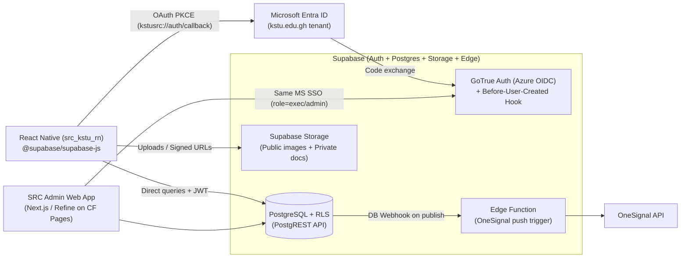
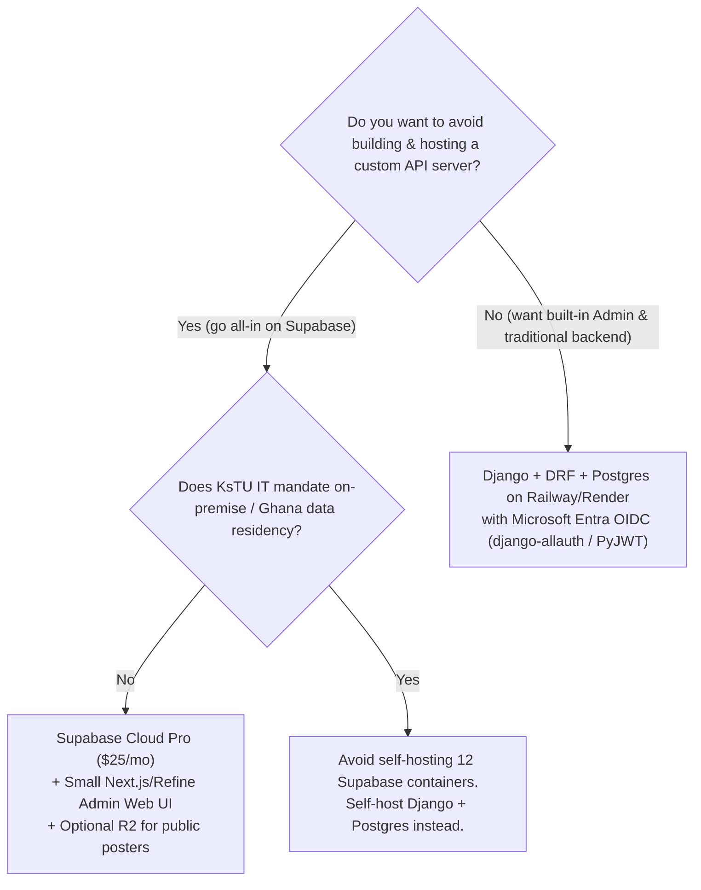

# Moving to Supabase with Microsoft Entra Auth (`kstu.edu.gh`) — Cloud vs. Self-Hosted

> **Scope:** Evaluates replacing the backend, auth, and database completely with **Supabase** + **Microsoft Entra ID (`kstu.edu.gh`)** for [src_kstu_rn](file:///Users/kaliblip/Developer/KsTU%20SRC/src_kstu_rn), and compares **Supabase Cloud** against **Self-Hosted Supabase**.
>
> Continues the decision series from [07](file:///Users/kaliblip/Developer/KsTU%20SRC/src_kstu_app/review-docs/07-backend-stack-and-hosting-decision.md), [08](file:///Users/kaliblip/Developer/KsTU%20SRC/src_kstu_app/review-docs/08-django-vs-nodejs.md), and [09](file:///Users/kaliblip/Developer/KsTU%20SRC/src_kstu_app/review-docs/09-microsoft-entra-auth-and-db-replacement.md).

---

## TL;DR

1. **Supabase + Microsoft Auth works very well here — and can eliminate a custom Django/Node API entirely.** Supabase Auth (GoTrue) handles Microsoft single-tenant OAuth + refresh tokens, Postgres + Row-Level Security (RLS) replaces the REST endpoints, Storage handles files (including **private** buckets for scholarship/claim documents), and Edge Functions handle OneSignal pushes.
2. **You still have to build an Admin Dashboard.** Supabase Studio is a raw DB tool—unsafe for non-technical SRC executives. Budget ~1–1.5 weeks for a small React/Next.js/Refine admin web app using the same Microsoft SSO.
3. **If you pick Supabase, choose Supabase Cloud (\$25/mo Pro), NOT Self-Hosted.** Self-hosted Supabase is **10–12+ Docker containers** requiring a 4–8 GB VPS (~\$15–30/mo), off-site backups, Kong hardening, and upgrade maintenance—so it costs nearly the same as Cloud Pro while creating severe handover risk when student devs graduate. If you truly want to self-host, running Django + Postgres is far simpler than self-hosting Supabase.

---

## 1. How the Architecture Works with Supabase

### 1.1 Microsoft Entra (`kstu.edu.gh`) Inside Supabase Auth

1. **Provider Configuration:** Enable **Azure (Microsoft)** in Supabase Auth:
   - **Azure Client ID** & **Azure Client Secret** (note: Supabase GoTrue acts as a confidential client on the callback, so unlike pure mobile PKCE, you configure a Web redirect URI `https://<project-ref>.supabase.co/auth/v1/callback` in Azure App Registration and `kstusrc://auth/callback` in Supabase Redirect URLs).
   - **Azure Tenant URL:** `https://login.microsoftonline.com/<KSTU_TENANT_ID>` (or `https://login.microsoftonline.com/kstu.edu.gh`).
2. **React Native Client Flow (`src_kstu_rn`):**
   - Call `supabase.auth.signInWithOAuth({ provider: 'azure', options: { redirectTo: 'kstusrc://auth/callback', scopes: 'openid profile email', skipBrowserRedirect: true } })`.
   - Open the returned URL with `expo-web-browser` (`WebBrowser.openAuthSessionAsync(url, 'kstusrc://auth/callback')`), extract the `code`, and call `supabase.auth.exchangeCodeForSession(code)`.
   - Wire `expo-secure-store` as the Supabase client `storage` adapter so sessions persist securely (replacing manual `setToken` / `setPasskeyCredentials` password saving in [login.tsx](file:///Users/kaliblip/Developer/KsTU%20SRC/src_kstu_rn/src/app/%28auth%29/login.tsx)).
3. **Database-Level Domain Lock (Mandatory Guardrail):**
   - Never rely only on Azure configuration to block non-KsTU accounts.
   - Add a **Before User Created Auth Hook** (or `BEFORE INSERT` trigger on `auth.users`) that rejects any sign-up unless the email matches `@kstu.edu.gh` (or approved student subdomains) and `provider = 'azure'` (with an optional single exception for an Apple/Google App Review test user).

### 1.2 Replacing the 14 API Endpoints Without a Custom Backend

All files under `src_kstu_rn/src/api/` (`528` lines total across 6 files) migrate cleanly:

| Current `src/api/*` | Supabase Equivalent | Notes |
|---|---|---|
| `auth.ts` (`POST /login`, `GET /me`, `/logout`) | `supabase.auth.*` + `profiles` table | Eliminates `/forgot-password`, `/update-password`, `/user/register`. Adds 1-time `complete-profile` check (`profile_completed = false`). |
| `announcements.ts` (notice-board, trending, detail, like) | `supabase.from('announcements').select(...)` + `rpc('increment_announcement_views')` | Drops Laravel's `LengthAwarePaginator` wrapper and `liked_users` PII leak cleanly; keeps 20-item offline cache in [announcement-cache.ts](file:///Users/kaliblip/Developer/KsTU%20SRC/src_kstu_rn/src/lib/announcement-cache.ts) untouched! |
| `campus-map.ts` (landmarks, places) | `supabase.from('campus_landmarks').select('*, landmark_places(*)')` | Replaces hardcoded string coordinate `.trim()` hacks with clean numeric `DOUBLE PRECISION`. |
| `services.ts` (scholarships & claims + uploads) | `supabase.storage.from(...).upload(...)` + `supabase.from(...).insert(...)` | **Huge security upgrade:** student attachments go into **private** buckets readable only via short-lived signed URLs by the student and `exec`/`admin` roles. |
| Server OneSignal Push | **Postgres DB Webhook → Supabase Edge Function** | Fires automatically when an executive inserts/publishes an announcement (`status = 1`). Keeps `ONESIGNAL_REST_API_KEY` off the client. |

### 1.3 Key Adjustments Required in `src_kstu_rn`

- **User ID type:** Supabase `auth.uid()` is a `UUID` (`string`), whereas [types.ts](file:///Users/kaliblip/Developer/KsTU%20SRC/src_kstu_rn/src/api/types.ts#L7) and [push.ts](file:///Users/kaliblip/Developer/KsTU%20SRC/src_kstu_rn/src/services/push.ts#L84) currently type `user.id` as `number`. Update `User.id` to `string` (UUID); `OneSignal.login(String(userId))` already passes a string.
- **Role-based RLS:** Add `role TEXT DEFAULT 'student'` (`'student' | 'exec' | 'admin'`) on `public.profiles`. Prevent students from updating their own `role` or `application_status` via RLS `WITH CHECK` policies / column triggers.
- **Complete Profile screen:** Microsoft Entra lacks `index_no`, `faculty`, `department`, `program`, and `current_level`. First-time users route to `/(auth)/complete-profile` before entering `/(app)/(hub)`.

---

## 2. Supabase Cloud vs. Self-Hosted Supabase

Self-hosting Supabase is **not** like deploying a single Django or Node container. Running Supabase yourself means managing a **10–12+ container stack**:

> PostgreSQL · GoTrue (Auth) · PostgREST · Kong (API Gateway) · Realtime (Elixir) · Storage API · postgres-meta · Studio · Edge Runtime (Deno) · Supavisor · Log/Analytics services

### 2.1 Side-by-Side Comparison

| Dimension | **Supabase Cloud (Managed)** | **Self-Hosted Supabase (Docker Compose / Coolify)** |
|---|---|---|
| **Plan / Cost (~15k students)** | **Free (\$0):** Unusable for real prod — **pauses after 7 days inactivity**, 500 MB DB, 5 GB egress. **Pro (\$25/mo):** 100k MAUs, 8 GB DB, 250 GB egress, 100 GB Storage, daily automated backups, no pausing. | **\$15–30/mo** VPS (minimum **4 GB RAM**, ideally **8 GB RAM / 2–4 vCPU** so Postgres + Realtime + GoTrue don't OOM) + backup storage. |
| **Setup & Maintenance** | ~15 minutes. Upgrades, TLS, pooling, backups, and security patches handled for you. | ~2–5 days setup (DNS, TLS reverse proxy, Kong routing, `GOTRUE_EXTERNAL_AZURE_*` env config, SMTP, backup cron). Ongoing Docker upgrades across 12 services. |
| **Security Hardening** | Built-in org RBAC, MFA, audit logs, managed TLS, Auth Hooks UI. | **Watch out:** Self-hosted **Studio** has no built-in multi-user auth (only basic auth credentials via Kong). Must hide behind Cloudflare Access / VPN / Nginx auth. |
| **Feature Gaps** | Full feature set. | Rougher Edge Functions workflow, manual log retention, some Cloud platform integrations (branching/dashboard UX) missing or manual. |
| **Latency from Kumasi, Ghana** | AWS `eu-west-1` / `eu-central-1` (~110–140 ms) or `af-south-1` Cape Town. | EU VPS (~110–140 ms). Hosting on a KsTU campus VM gives ~10 ms on campus Wi-Fi, **but campus power/ISP outages kill the entire app**. |
| **Annual SRC Handover Risk** | ⭐ **Low:** Add incoming student devs to the Supabase org; revoke outgoing devs cleanly. | 🔴 **High:** If the student who set up the VPS SSH, Docker stack, and `pg_dump` scripts graduates without handing off properly, the system becomes unmaintainable. |

### 2.2 Hidden Traps Specific to Supabase

1. **Free Tier Pausing & Egress Trap:** Do not launch 15,000 students on Supabase Cloud Free. Besides the 7-day pause limit, 15k phones fetching announcement posters (`200–500 KB` each) after a push notification can consume 5 GB of Free egress in a single day.
   - **Mitigation:** Use **Pro (\$25/mo)** (250 GB egress), OR store public media (`announcement_imgs`, `moment_imgs`, `landmark_imgs`) on **Cloudflare R2 (\$0 egress)** while keeping private scholarship/claim documents in Supabase Storage.
2. **Don't Expose Supabase Studio as the SRC Admin Panel:** Give SRC executives a dedicated, locked-down web form (Refine / Next.js on Cloudflare Pages) backed by RLS (`role IN ('exec', 'admin')`), never raw DB table access.
3. **Auth Redirect Deep Links Need Dev/Store Builds:** `kstusrc://auth/callback` works in EAS builds and Dev Clients ([app.json](file:///Users/kaliblip/Developer/KsTU%20SRC/src_kstu_rn/app.json#L9)), **not** inside Expo Go.

---

## 3. Decision Summary: Which Setup Should You Pick?

### Honest Recommendation for KsTU SRC

- **If choosing Supabase → use Supabase Cloud Pro (\$25/mo)** (optionally putting public images on R2). It gives you Microsoft SSO, Postgres, RLS security for private claim/scholarship docs, Edge Functions for OneSignal pushes, and easy annual handover — just plan **1–1.5 weeks** to build a simple web admin portal for SRC executives.
- **Do NOT self-host Supabase** unless KsTU strictly requires an on-campus server; it saves almost no money (\$15–30 VPS vs \$25 Pro) and creates heavy maintenance debt for future student cohorts. If you prefer self-hosting on your own VPS, **Django + Postgres** is a much leaner, safer 2-container setup with Django Admin built in.

---

## 4. Phased Path (`Hobby / Free → Pro → Self-Hosted`) & GHS Cost Breakdown

**Yes, you can start on Supabase Free (Hobby, \$0), upgrade to Pro in one click, and later migrate to self-hosted** without forcing students to reinstall the mobile app — provided you follow three architectural rules from Day 1:

1. **Hide `<project-ref>.supabase.co` behind your own subdomain (`api.src-kstu.com`) from Day 1:**
   - Supabase's native Custom Domain add-on requires **Pro (\$25) + \$10/mo**. While on Free, put a free **Cloudflare Worker reverse proxy** (100k req/day free) at `https://api.src-kstu.com` forwarding to `<project-ref>.supabase.co`, and register `https://api.src-kstu.com/auth/v1/callback` in KsTU's Microsoft Entra App Registration.
   - When moving to Self-Hosted later, change only the DNS / proxy origin to point at your VPS — **zero mobile app update or Azure reconfiguration needed**.
2. **Offload public images to Cloudflare R2 from Day 1:**
   - Keep `announcement_imgs`, `moment_imgs`, and `landmark_imgs` on **Cloudflare R2** (10 GB free storage, **\$0 egress**). Only store Auth, Postgres JSON, and private scholarship/claim PDFs on Supabase so Free's **1 GB Storage** and **5 GB uncached egress** aren't drained by image downloads.
3. **Preserve `auth.users`, Storage paths, & `JWT_SECRET` when moving to Self-Hosted:**
   - Export Postgres (`auth`, `public`, and `storage` schemas) via `pg_dump` / `pg_restore` (retaining all user UUIDs and Microsoft `oid` bindings), sync private bucket objects (`scholarship_documents`, `claim_documents`), and copy your JWT signing key into the self-hosted `.env`.

---

### 4.1 Step-by-Step Transition Triggers (`Hobby → Pro → Self-Hosted`)

| Transition | Trigger / When to Move | Effort & Downtime | Checklist |
|---|---|---|---|
| **Hobby (Free) → Pro** | Before full campus launch (when real student applications start arriving) | **1-click in Dashboard (< 1 min, zero downtime)** | 1. Enable Pro (\$25/mo) to unlock automated **daily backups** and remove the **7-day inactivity pause**. 2. Keep **Spend Cap ON** initially so unexpected traffic spikes don't generate surprise bills. 3. Optional: enable Custom Domain (\$10/mo) and remove the CF Worker proxy. |
| **Pro → Self-Hosted** | Only if KsTU IT mandates institutional hosting, or if cutting ~GH₵ 1,860/yr matters and you have a Docker/Linux maintainer | **1–2 days setup + ~15–30 min maintenance cutover** | 1. Provision 8 GB RAM Linux VPS (e.g., Hetzner CX33) + Docker Compose stack. 2. Configure `.env` (`GOTRUE_EXTERNAL_AZURE_*`, `JWT_SECRET`, SMTP). 3. `pg_dump` Cloud DB (`auth`, `public`, `storage`) → `pg_restore` on VPS. 4. Sync private bucket files to VPS storage volume. 5. Lock Studio behind **Cloudflare Access** (Zero Trust). 6. Flip `api.src-kstu.com` DNS/Worker origin to VPS. 7. Verify `pg_dump` → R2 daily backup cron before pausing Cloud Pro. |

### 4.2 When Free Forces an Upgrade to Pro

| Free Tier Limit | Reality for KsTU (~15k students) |
|---|---|
| **No automated backups** | **Main production blocker.** Once live students submit real scholarship/claim applications, you need Pro's daily backups. |
| **Pauses after 7 days idle** | Safe during active semesters, risky over long vacation breaks (can pause mid-break). |
| **50,000 MAUs** | Enough for all ~15k students + staff. |
| **500 MB DB** | Text tables + 15k profiles typically use < 80 MB. |
| **5 GB uncached egress** | Sufficient for dev/pilot and light launch if images are on R2; heavy full-campus semester traffic can cross 5 GB JSON egress. |

---

### 4.3 Itemized Cost Breakdown in GHS (1 USD ≈ GH₵ 11.77 mid-market, Nov 2026)

> [!NOTE]
> Ghanaian bank Visa/Mastercard international billing typically adds a ~3–5% FX spread (effective **~GH₵ 12.15–12.35 / \$1**). Both mid-market and estimated card totals are shown below.

#### Stage 1: Hobby / Free Tier (`GH₵ 0 / mo`)

| Component | Service & Tier | USD / mo | Mid-Rate GH₵ / mo | Notes |
|---|---|---|---|---|
| Auth + Postgres + Private Docs + Edge | Supabase **Free** | \$0 | **GH₵ 0** | 50k MAU, 500 MB DB, 5 GB uncached + 5 GB cached egress, 1 GB Storage. **No backups; pauses after 7 days idle.** |
| Public Images (`/storage/announcement_imgs`, etc.) | Cloudflare **R2 Free** | \$0 | **GH₵ 0** | 10 GB storage, **\$0 egress** forever |
| Custom Subdomain Proxy (`api.src-kstu.com`) | Cloudflare **Workers Free** | \$0 | **GH₵ 0** | 100k req/day included |
| SRC Executive Admin Web App | Cloudflare **Pages Free** | \$0 | **GH₵ 0** | Unlimited bandwidth & static hosting |
| Push Notifications | OneSignal **Free** | \$0 | **GH₵ 0** | Unlimited mobile push |
| **Stage 1 Monthly Infra Total** | — | **\$0** | **GH₵ 0** | Best for development, testing & closed campus beta |

#### Stage 2: Supabase Cloud Pro (`GH₵ 294–412 / mo`)

| Option | Components | USD / mo | Mid-Rate GH₵ / mo | Est. Card Billing (GH₵ / mo) | Annual Infra (Mid-Rate GH₵) |
|---|---|---|---|---|---|
| **2A. Pro + CF Worker Proxy** *(Recommended)* | Supabase **Pro** (\$25) + R2 Free + CF Worker Proxy + CF Pages + OneSignal | **\$25** | **GH₵ 294** | **~GH₵ 305–310** | **GH₵ 3,531** |
| **2B. Pro + Native Custom Domain** | Supabase **Pro** (\$25) + Custom Domain add-on (\$10) + R2 Free + CF Pages + OneSignal | **\$35** | **GH₵ 412** | **~GH₵ 428–432** | **GH₵ 4,943** |

*Included in Pro:* 100,000 MAU, 8 GB Postgres DB, 250 GB uncached + 250 GB cached egress, 100 GB Storage, 7-day automated daily backups, zero inactivity pausing.

#### Stage 3: Self-Hosted Supabase (Budget EU VPS or Campus VM)

| Component / Option | Service | USD / mo | Mid-Rate GH₵ / mo | Est. Card Billing (GH₵ / mo) | Annual Infra (Mid-Rate GH₵) |
|---|---|---|---|---|---|
| **3A. Hetzner Cloud CX33** *(4 vCPU, 8 GB RAM, 80 GB NVMe, 20 TB traffic)* | VPS (€8.49) + automated Hetzner snapshots (~€1.70) + off-site `pg_dump` to R2 Free (\$0) + Cloudflare Access Free (\$0, locks Studio) + R2/Pages/OneSignal (\$0) | **~\$11–12** | **~GH₵ 130–141** | **~GH₵ 138–150** | **~GH₵ 1,560–1,692** |
| **3B. KsTU Campus / University VM** | University-hosted Ubuntu VM (8 GB RAM) + off-site `pg_dump` to R2 Free (\$0) + Cloudflare Tunnel (\$0) | **\$0** | **GH₵ 0** | **GH₵ 0** | **GH₵ 0** *(⚠️ downtime during campus power/ISP outages)* |

---

### 4.4 Fixed Ecosystem Costs (Same Regardless of Backend/Hosting)

| Item | USD | Mid-Rate GH₵ | Billing | Notes |
|---|---|---|---|---|
| **Domain** (`src-kstu.com`) | ~\$12–15 | **~GH₵ 141–177** | Yearly (~GH₵ 12–15/mo) | DNS + SSL via Cloudflare (free) |
| **Apple Developer Program** | \$99 | **GH₵ 1,165** | Yearly (~GH₵ 97/mo) | Required for App Store / TestFlight |
| **Google Play Console** | \$25 | **GH₵ 294** | One-time | Year 2+ is GH₵ 0 |
| **OneSignal Push** | \$0 | **GH₵ 0** | Free tier | Unlimited mobile push on Free plan |
| **Expo EAS Builds** | \$0 | **GH₵ 0** | Free tier | \$19/mo (**~GH₵ 224/mo**) only if you need unlimited cloud iOS builds |
| **Year-1 Store + Domain Total** | **~\$136–139** | **~GH₵ 1,600–1,636** | Year 1 | Drops to **~GH₵ 1,306–1,342/yr** in Year 2+ |

---

### 4.5 Total Year-1 SRC Budget Scenarios (Infra + Store/Domain Fees)

| Rollout Scenario | Infra (GH₵) | Store + Domain (GH₵) | Total Year-1 Mid-Rate (GH₵) | Est. Card Total (GH₵) |
|---|---|---|---|---|
| **A. Phased Launch** *(2 mos Free + 10 mos Pro @ \$25)* | GH₵ 2,943 | ~GH₵ 1,618 | **~GH₵ 4,561** | **~GH₵ 4,750** |
| **B. Full-Year Cloud Pro** *(12 mos Pro @ \$25)* | GH₵ 3,531 | ~GH₵ 1,618 | **~GH₵ 5,149** | **~GH₵ 5,360** |
| **C. Pro → Self-Hosted Hetzner** *(2 mos Free + 6 mos Pro + 4 mos Hetzner)* | ~GH₵ 2,304 | ~GH₵ 1,618 | **~GH₵ 3,922** | **~GH₵ 4,090** |
| **D. Year 2+ Self-Hosted Hetzner** *(12 mos Hetzner, no Play one-time fee)* | ~GH₵ 1,620 | ~GH₵ 1,324 | **~GH₵ 2,944 / yr** | **~GH₵ 3,080 / yr** |

### 4.6 Practical Launch Budget Recommendation

- **Months 1–2 (Build & Campus Beta):** Run at **GH₵ 0 / mo** on Supabase Free + Cloudflare R2 + Cloudflare Worker proxy.
- **Full Campus Launch (Before Semester Opens):** Upgrade to **Supabase Pro (~GH₵ 305/mo, or ~GH₵ 3,660/yr)** for automated daily backups, zero sleep risk, and painless annual SRC handover.
- **Only migrate to Self-Hosted Hetzner (~GH₵ 138–150/mo)** if KsTU IT mandates dedicated institutional hosting *or* the SRC wants to save **~GH₵ 1,860/yr** (~GH₵ 155/mo) and has a reliable Linux/Docker maintainer committed for the full academic year.

