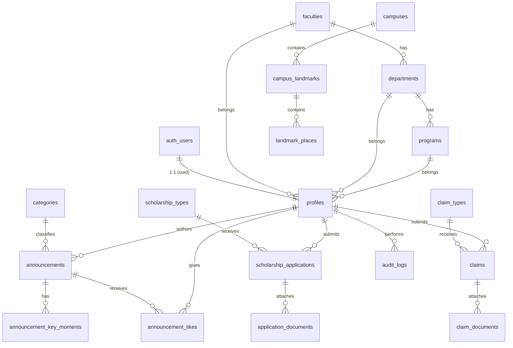

# 01 — PostgreSQL Schema, RLS Policies, Triggers & RPCs

> **Database:** Clean-slate PostgreSQL on Supabase (`public` schema + `auth.users` managed by GoTrue).
> Fixes all legacy Laravel/MySQL schema bugs (`index_no` integer truncation, separate `admins` table, `liked_users` PII leak, string coordinates, and boolean `0/1` quirks).

---

## 1. Entity-Relationship Overview



---

## 2. Storage Split: Cloudflare R2 vs. Supabase Private Buckets

| Data Type | Storage Target | Bucket Visibility | Access Mechanism |
|---|---|---|---|
| Announcement posters, key moments, campus landmarks, user avatars | **Cloudflare R2** (`media.src-kstu.com`) | **Public** (`$0` egress) | Presigned `PUT` via `r2-presign-upload` Edge Function; stored in DB as object key (e.g. `announcement_imgs/abc.jpg`) or full URL |
| Scholarship & Insurance Claim supporting documents (IDs, letters, receipts, certificates) | **Supabase Storage** (`scholarship_documents`, `claim_documents` buckets) | **Private** (strict RLS) | Uploaded by owning student to `<auth.uid()>/<application_id>/<filename>`; viewed via short-lived `createSignedUrl()` by owning student and `exec`/`admin` only |
| Scholarship / Claim blank PDF forms | Cloudflare R2 (`media.src-kstu.com/forms/...`) | **Public** | Direct download URL |

---

## 3. Full SQL Migration (`0001_initial_schema.sql`)

```sql
-- Extensions
CREATE EXTENSION IF NOT EXISTS citext;

-- =========================================================
-- 1. ACADEMIC LOOKUPS
-- =========================================================
CREATE TABLE public.faculties (
  id         BIGINT GENERATED BY DEFAULT AS IDENTITY PRIMARY KEY,
  name       TEXT NOT NULL UNIQUE,
  created_at TIMESTAMPTZ NOT NULL DEFAULT NOW(),
  updated_at TIMESTAMPTZ NOT NULL DEFAULT NOW()
);

CREATE TABLE public.departments (
  id         BIGINT GENERATED BY DEFAULT AS IDENTITY PRIMARY KEY,
  faculty_id BIGINT NOT NULL REFERENCES public.faculties(id) ON DELETE CASCADE,
  name       TEXT NOT NULL,
  created_at TIMESTAMPTZ NOT NULL DEFAULT NOW(),
  updated_at TIMESTAMPTZ NOT NULL DEFAULT NOW(),
  UNIQUE (faculty_id, name)
);

CREATE TABLE public.programs (
  id            BIGINT GENERATED BY DEFAULT AS IDENTITY PRIMARY KEY,
  department_id BIGINT NOT NULL REFERENCES public.departments(id) ON DELETE CASCADE,
  name          TEXT NOT NULL,
  created_at    TIMESTAMPTZ NOT NULL DEFAULT NOW(),
  updated_at    TIMESTAMPTZ NOT NULL DEFAULT NOW(),
  UNIQUE (department_id, name)
);

-- =========================================================
-- 2. UNIFIED PROFILES (replaces Laravel users + admins)
-- =========================================================
CREATE TABLE public.profiles (
  id                UUID PRIMARY KEY REFERENCES auth.users(id) ON DELETE CASCADE,
  microsoft_oid     UUID UNIQUE,                              -- Immutable Entra Object ID
  microsoft_tid     UUID,                                     -- Verified KsTU Tenant ID
  email             CITEXT NOT NULL UNIQUE,
  name              TEXT NOT NULL,
  role              TEXT NOT NULL DEFAULT 'student'
                      CHECK (role IN ('student', 'exec', 'admin')),
  profile_completed BOOLEAN NOT NULL DEFAULT FALSE,

  -- Student academic details (nullable until complete-profile onboarding)
  index_no          VARCHAR(20) UNIQUE,                       -- Preserves leading zeros (e.g. '052242620003')
  gender            TEXT CHECK (gender IN ('male', 'female')),
  user_img          TEXT,                                     -- R2 key under user_imgs/
  phone             VARCHAR(20),
  current_level     VARCHAR(10),
  current_sem       SMALLINT DEFAULT 1 CHECK (current_sem IN (1, 2)),
  faculty_id        BIGINT REFERENCES public.faculties(id) ON DELETE SET NULL,
  dept_id           BIGINT REFERENCES public.departments(id) ON DELETE SET NULL,
  program_id        BIGINT REFERENCES public.programs(id) ON DELETE SET NULL,
  yr_of_admission   CHAR(4),
  yr_of_completion  CHAR(4),
  status            SMALLINT NOT NULL DEFAULT 1,
  last_seen         TIMESTAMPTZ,
  created_at        TIMESTAMPTZ NOT NULL DEFAULT NOW(),
  updated_at        TIMESTAMPTZ NOT NULL DEFAULT NOW()
);

CREATE INDEX idx_profiles_role ON public.profiles(role) WHERE role <> 'student';

-- =========================================================
-- 3. ANNOUNCEMENTS & KEY MOMENTS
-- =========================================================
CREATE TABLE public.categories (
  id   SMALLINT PRIMARY KEY,
  name TEXT NOT NULL UNIQUE
);

INSERT INTO public.categories (id, name) VALUES
  (1, 'Notice Board'),
  (2, 'Trending News');

CREATE TABLE public.announcements (
  id                 BIGINT GENERATED BY DEFAULT AS IDENTITY PRIMARY KEY,
  category_id        SMALLINT NOT NULL REFERENCES public.categories(id),
  author_id          UUID REFERENCES public.profiles(id) ON DELETE SET NULL,
  title              TEXT NOT NULL,
  featured_image     TEXT NOT NULL,                           -- R2 key under announcement_imgs/
  featured_image_min TEXT NOT NULL,                           -- Optimized thumbnail (<300 KB for WhatsApp OG)
  status             SMALLINT NOT NULL DEFAULT 1,             -- 0 = draft, 1 = published, 2 = archived
  views              INTEGER NOT NULL DEFAULT 0,
  push_sent_at       TIMESTAMPTZ,
  created_at         TIMESTAMPTZ NOT NULL DEFAULT NOW(),
  updated_at         TIMESTAMPTZ NOT NULL DEFAULT NOW()
);

CREATE INDEX idx_announcements_feed
  ON public.announcements (category_id, status, created_at DESC);

CREATE TABLE public.announcement_key_moments (
  id                BIGINT GENERATED BY DEFAULT AS IDENTITY PRIMARY KEY,
  announcement_id   BIGINT NOT NULL REFERENCES public.announcements(id) ON DELETE CASCADE,
  sort_order        INTEGER NOT NULL DEFAULT 0,
  image_sub_title   TEXT NOT NULL DEFAULT '',
  image             TEXT,                                     -- Nullable for text-only key moments
  image_description TEXT NOT NULL DEFAULT '',
  created_at        TIMESTAMPTZ NOT NULL DEFAULT NOW(),
  updated_at        TIMESTAMPTZ NOT NULL DEFAULT NOW()
);

CREATE INDEX idx_moments_announcement
  ON public.announcement_key_moments (announcement_id, sort_order, id);

CREATE TABLE public.announcement_likes (
  announcement_id BIGINT NOT NULL REFERENCES public.announcements(id) ON DELETE CASCADE,
  user_id         UUID NOT NULL REFERENCES public.profiles(id) ON DELETE CASCADE,
  created_at      TIMESTAMPTZ NOT NULL DEFAULT NOW(),
  PRIMARY KEY (announcement_id, user_id)
);

-- =========================================================
-- 4. CAMPUS MAP
-- =========================================================
CREATE TABLE public.campuses (
  id   SMALLINT PRIMARY KEY,
  name TEXT NOT NULL UNIQUE
);

INSERT INTO public.campuses (id, name) VALUES
  (1, 'Main Campus'),
  (2, 'Adako Jachie Campus');

CREATE TABLE public.campus_landmarks (
  id         BIGINT GENERATED BY DEFAULT AS IDENTITY PRIMARY KEY,
  campus_id  SMALLINT NOT NULL REFERENCES public.campuses(id) ON DELETE CASCADE,
  name       TEXT NOT NULL,
  img        TEXT,                                            -- R2 key under landmark_imgs/
  latitude   DOUBLE PRECISION NOT NULL,
  longitude  DOUBLE PRECISION NOT NULL,
  status     SMALLINT NOT NULL DEFAULT 1,
  created_at TIMESTAMPTZ NOT NULL DEFAULT NOW(),
  updated_at TIMESTAMPTZ NOT NULL DEFAULT NOW()
);

CREATE TABLE public.landmark_places (
  id          BIGINT GENERATED BY DEFAULT AS IDENTITY PRIMARY KEY,
  landmark_id BIGINT NOT NULL REFERENCES public.campus_landmarks(id) ON DELETE CASCADE,
  name        TEXT NOT NULL,
  status      SMALLINT NOT NULL DEFAULT 1,
  created_at  TIMESTAMPTZ NOT NULL DEFAULT NOW(),
  updated_at  TIMESTAMPTZ NOT NULL DEFAULT NOW()
);

-- =========================================================
-- 5. SCHOLARSHIPS & CLAIMS
-- =========================================================
CREATE TABLE public.scholarship_types (
  id                      BIGINT GENERATED BY DEFAULT AS IDENTITY PRIMARY KEY,
  name                    TEXT NOT NULL,
  description             TEXT,
  pdf_file                TEXT,
  required_document_types TEXT[] NOT NULL DEFAULT '{}',
  optional_document_types TEXT[] NOT NULL DEFAULT '{}',
  status                  SMALLINT NOT NULL DEFAULT 1,
  created_at              TIMESTAMPTZ NOT NULL DEFAULT NOW(),
  updated_at              TIMESTAMPTZ NOT NULL DEFAULT NOW()
);

CREATE TABLE public.scholarship_applications (
  id                   BIGINT GENERATED BY DEFAULT AS IDENTITY PRIMARY KEY,
  student_id           UUID NOT NULL REFERENCES public.profiles(id) ON DELETE CASCADE,
  scholarship_type_id  BIGINT NOT NULL REFERENCES public.scholarship_types(id),
  student_full_name    TEXT NOT NULL,
  student_number       VARCHAR(20) NOT NULL,
  contact_number       VARCHAR(20) NOT NULL,
  parent_guardian_name TEXT NOT NULL,
  occupation           TEXT NOT NULL DEFAULT '',
  needy_reason         TEXT NOT NULL DEFAULT '',
  is_parent_alive      BOOLEAN NOT NULL DEFAULT TRUE,
  number_of_siblings   INTEGER NOT NULL DEFAULT 0,
  benefited_previously BOOLEAN NOT NULL DEFAULT FALSE,
  student_department   TEXT NOT NULL DEFAULT '',
  student_programme    TEXT NOT NULL DEFAULT '',
  application_status   TEXT NOT NULL DEFAULT 'pending'
                         CHECK (application_status IN ('pending', 'approved', 'rejected')),
  approved_by_id       UUID REFERENCES public.profiles(id) ON DELETE SET NULL,
  approved_by_name     TEXT,
  approved_at          TIMESTAMPTZ,
  rejection_reason     TEXT,
  status               SMALLINT NOT NULL DEFAULT 1,
  created_at           TIMESTAMPTZ NOT NULL DEFAULT NOW(),
  updated_at           TIMESTAMPTZ NOT NULL DEFAULT NOW()
);

CREATE INDEX idx_scholarship_apps_student ON public.scholarship_applications(student_id, created_at DESC);
CREATE INDEX idx_scholarship_apps_status  ON public.scholarship_applications(application_status, created_at DESC);

CREATE TABLE public.application_documents (
  id                BIGINT GENERATED BY DEFAULT AS IDENTITY PRIMARY KEY,
  application_id    BIGINT NOT NULL REFERENCES public.scholarship_applications(id) ON DELETE CASCADE,
  document_type     TEXT NOT NULL,
  storage_path      TEXT NOT NULL,                            -- Path inside private 'scholarship_documents' bucket
  original_filename TEXT NOT NULL,
  file_size         BIGINT NOT NULL,
  mime_type         TEXT NOT NULL,
  created_at        TIMESTAMPTZ NOT NULL DEFAULT NOW()
);

CREATE TABLE public.claim_types (
  id                      BIGINT GENERATED BY DEFAULT AS IDENTITY PRIMARY KEY,
  name                    TEXT NOT NULL,
  description             TEXT,
  pdf_file                TEXT,
  required_document_types TEXT[] NOT NULL DEFAULT '{}',
  optional_document_types TEXT[] NOT NULL DEFAULT '{}',
  status                  SMALLINT NOT NULL DEFAULT 1,
  created_at              TIMESTAMPTZ NOT NULL DEFAULT NOW(),
  updated_at              TIMESTAMPTZ NOT NULL DEFAULT NOW()
);

CREATE TABLE public.claims (
  id                  BIGINT GENERATED BY DEFAULT AS IDENTITY PRIMARY KEY,
  student_id          UUID NOT NULL REFERENCES public.profiles(id) ON DELETE CASCADE,
  claim_type_id       BIGINT NOT NULL REFERENCES public.claim_types(id),
  student_full_name   TEXT NOT NULL,
  student_number      VARCHAR(20) NOT NULL,
  contact_number      VARCHAR(20) NOT NULL,
  level               VARCHAR(10) NOT NULL,
  date_of_birth       DATE,
  name_of_deceased    TEXT NOT NULL,
  relation_to_deceased TEXT NOT NULL,
  date_of_death       DATE,
  place_of_death      TEXT NOT NULL DEFAULT '',
  hospital_name       TEXT NOT NULL DEFAULT '',
  doctor_name         TEXT NOT NULL DEFAULT '',
  mortuary_name       TEXT NOT NULL DEFAULT '',
  religious_body_name TEXT NOT NULL DEFAULT '',
  has_body_been_buried BOOLEAN NOT NULL DEFAULT FALSE,
  burial_location     TEXT NOT NULL DEFAULT '',
  burial_date         DATE,
  student_department  TEXT NOT NULL DEFAULT '',
  student_programme   TEXT NOT NULL DEFAULT '',
  application_status  TEXT NOT NULL DEFAULT 'pending'
                        CHECK (application_status IN ('pending', 'approved', 'rejected')),
  approved_by_id      UUID REFERENCES public.profiles(id) ON DELETE SET NULL,
  approved_by_name    TEXT,
  approved_at         TIMESTAMPTZ,
  rejection_reason    TEXT,
  status              SMALLINT NOT NULL DEFAULT 1,
  created_at          TIMESTAMPTZ NOT NULL DEFAULT NOW(),
  updated_at          TIMESTAMPTZ NOT NULL DEFAULT NOW()
);

CREATE INDEX idx_claims_student ON public.claims(student_id, created_at DESC);
CREATE INDEX idx_claims_status  ON public.claims(application_status, created_at DESC);

CREATE TABLE public.claim_documents (
  id                BIGINT GENERATED BY DEFAULT AS IDENTITY PRIMARY KEY,
  claim_id          BIGINT NOT NULL REFERENCES public.claims(id) ON DELETE CASCADE,
  document_type     TEXT NOT NULL,
  storage_path      TEXT NOT NULL,                            -- Path inside private 'claim_documents' bucket
  original_filename TEXT NOT NULL,
  file_size         BIGINT NOT NULL,
  mime_type         TEXT NOT NULL,
  created_at        TIMESTAMPTZ NOT NULL DEFAULT NOW()
);

-- =========================================================
-- 6. APPEND-ONLY AUDIT LOGS (replaces Next.js Server Actions)
-- =========================================================
CREATE TABLE public.audit_logs (
  id         BIGINT GENERATED BY DEFAULT AS IDENTITY PRIMARY KEY,
  actor_id   UUID REFERENCES public.profiles(id) ON DELETE SET NULL,
  table_name TEXT NOT NULL,
  record_id  TEXT NOT NULL,
  action     TEXT NOT NULL CHECK (action IN ('INSERT', 'UPDATE', 'DELETE')),
  old_data   JSONB,
  new_data   JSONB,
  created_at TIMESTAMPTZ NOT NULL DEFAULT NOW()
);

CREATE INDEX idx_audit_logs_created ON public.audit_logs(created_at DESC);
```

---

## 4. Row-Level Security (RLS) & Guard Triggers (`0002_rls_and_security.sql`)

```sql
-- Helper: avoid infinite recursion on profiles checks
CREATE OR REPLACE FUNCTION public.is_staff()
RETURNS BOOLEAN
LANGUAGE SQL
STABLE
SECURITY DEFINER
SET search_path = public
AS $$
  SELECT EXISTS (
    SELECT 1 FROM public.profiles
    WHERE id = auth.uid() AND role IN ('exec', 'admin')
  );
$$;

CREATE OR REPLACE FUNCTION public.is_admin()
RETURNS BOOLEAN
LANGUAGE SQL
STABLE
SECURITY DEFINER
SET search_path = public
AS $$
  SELECT EXISTS (
    SELECT 1 FROM public.profiles
    WHERE id = auth.uid() AND role = 'admin'
  );
$$;

-- Enable RLS on every public table
ALTER TABLE public.faculties ENABLE ROW LEVEL SECURITY;
ALTER TABLE public.departments ENABLE ROW LEVEL SECURITY;
ALTER TABLE public.programs ENABLE ROW LEVEL SECURITY;
ALTER TABLE public.profiles ENABLE ROW LEVEL SECURITY;
ALTER TABLE public.categories ENABLE ROW LEVEL SECURITY;
ALTER TABLE public.announcements ENABLE ROW LEVEL SECURITY;
ALTER TABLE public.announcement_key_moments ENABLE ROW LEVEL SECURITY;
ALTER TABLE public.announcement_likes ENABLE ROW LEVEL SECURITY;
ALTER TABLE public.campuses ENABLE ROW LEVEL SECURITY;
ALTER TABLE public.campus_landmarks ENABLE ROW LEVEL SECURITY;
ALTER TABLE public.landmark_places ENABLE ROW LEVEL SECURITY;
ALTER TABLE public.scholarship_types ENABLE ROW LEVEL SECURITY;
ALTER TABLE public.scholarship_applications ENABLE ROW LEVEL SECURITY;
ALTER TABLE public.application_documents ENABLE ROW LEVEL SECURITY;
ALTER TABLE public.claim_types ENABLE ROW LEVEL SECURITY;
ALTER TABLE public.claims ENABLE ROW LEVEL SECURITY;
ALTER TABLE public.claim_documents ENABLE ROW LEVEL SECURITY;
ALTER TABLE public.audit_logs ENABLE ROW LEVEL SECURITY;

-- Lookups: authenticated users read; staff write
CREATE POLICY "read_faculties" ON public.faculties FOR SELECT TO authenticated USING (TRUE);
CREATE POLICY "write_faculties" ON public.faculties FOR ALL TO authenticated USING (public.is_staff()) WITH CHECK (public.is_staff());

CREATE POLICY "read_departments" ON public.departments FOR SELECT TO authenticated USING (TRUE);
CREATE POLICY "write_departments" ON public.departments FOR ALL TO authenticated USING (public.is_staff()) WITH CHECK (public.is_staff());

CREATE POLICY "read_programs" ON public.programs FOR SELECT TO authenticated USING (TRUE);
CREATE POLICY "write_programs" ON public.programs FOR ALL TO authenticated USING (public.is_staff()) WITH CHECK (public.is_staff());

CREATE POLICY "read_categories" ON public.categories FOR SELECT TO authenticated USING (TRUE);
CREATE POLICY "read_campuses" ON public.campuses FOR SELECT TO authenticated USING (TRUE);

-- Profiles: students only see/edit their own profile; staff see all
CREATE POLICY "read_own_or_staff_profiles" ON public.profiles
  FOR SELECT TO authenticated USING (id = auth.uid() OR public.is_staff());

CREATE POLICY "update_own_profile" ON public.profiles
  FOR UPDATE TO authenticated USING (id = auth.uid()) WITH CHECK (id = auth.uid());

-- Prevent privilege escalation on profiles.role / microsoft_oid via client UPDATE
CREATE OR REPLACE FUNCTION public.guard_profile_immutable_cols()
RETURNS TRIGGER
LANGUAGE plpgsql
SECURITY DEFINER
SET search_path = public
AS $$
BEGIN
  IF NOT public.is_admin() THEN
    IF NEW.role IS DISTINCT FROM OLD.role
       OR NEW.microsoft_oid IS DISTINCT FROM OLD.microsoft_oid
       OR NEW.microsoft_tid IS DISTINCT FROM OLD.microsoft_tid
       OR NEW.email IS DISTINCT FROM OLD.email THEN
      RAISE EXCEPTION 'Forbidden modification of protected profile fields';
    END IF;
  END IF;
  NEW.updated_at = NOW();
  RETURN NEW;
END;
$$;

CREATE TRIGGER trg_guard_profile_cols
  BEFORE UPDATE ON public.profiles
  FOR EACH ROW EXECUTE FUNCTION public.guard_profile_immutable_cols();

-- Announcements & Moments
CREATE POLICY "read_published_announcements" ON public.announcements
  FOR SELECT TO authenticated USING (status = 1 OR public.is_staff());
CREATE POLICY "staff_manage_announcements" ON public.announcements
  FOR ALL TO authenticated USING (public.is_staff()) WITH CHECK (public.is_staff());

CREATE POLICY "read_published_moments" ON public.announcement_key_moments
  FOR SELECT TO authenticated
  USING (
    EXISTS (
      SELECT 1 FROM public.announcements a
      WHERE a.id = announcement_id AND (a.status = 1 OR public.is_staff())
    )
  );
CREATE POLICY "staff_manage_moments" ON public.announcement_key_moments
  FOR ALL TO authenticated USING (public.is_staff()) WITH CHECK (public.is_staff());

-- Likes: strictly per-user (zero PII leak across students!)
CREATE POLICY "read_own_likes" ON public.announcement_likes
  FOR SELECT TO authenticated USING (user_id = auth.uid() OR public.is_staff());
CREATE POLICY "insert_own_like" ON public.announcement_likes
  FOR INSERT TO authenticated WITH CHECK (user_id = auth.uid());
CREATE POLICY "delete_own_like" ON public.announcement_likes
  FOR DELETE TO authenticated USING (user_id = auth.uid());

-- Campus Map
CREATE POLICY "read_landmarks" ON public.campus_landmarks
  FOR SELECT TO authenticated USING (status = 1 OR public.is_staff());
CREATE POLICY "staff_manage_landmarks" ON public.campus_landmarks
  FOR ALL TO authenticated USING (public.is_staff()) WITH CHECK (public.is_staff());

CREATE POLICY "read_landmark_places" ON public.landmark_places
  FOR SELECT TO authenticated USING (status = 1 OR public.is_staff());
CREATE POLICY "staff_manage_places" ON public.landmark_places
  FOR ALL TO authenticated USING (public.is_staff()) WITH CHECK (public.is_staff());

-- Scholarships & Claims
CREATE POLICY "read_scholarship_types" ON public.scholarship_types
  FOR SELECT TO authenticated USING (status = 1 OR public.is_staff());
CREATE POLICY "staff_manage_scholarship_types" ON public.scholarship_types
  FOR ALL TO authenticated USING (public.is_staff()) WITH CHECK (public.is_staff());

CREATE POLICY "student_read_own_scholarships" ON public.scholarship_applications
  FOR SELECT TO authenticated USING (student_id = auth.uid() OR public.is_staff());
CREATE POLICY "student_insert_own_scholarship" ON public.scholarship_applications
  FOR INSERT TO authenticated
  WITH CHECK (
    student_id = auth.uid()
    AND application_status = 'pending'
    AND approved_by_id IS NULL
    AND approved_by_name IS NULL
    AND approved_at IS NULL
  );

CREATE POLICY "read_app_docs" ON public.application_documents
  FOR SELECT TO authenticated
  USING (
    public.is_staff() OR EXISTS (
      SELECT 1 FROM public.scholarship_applications sa
      WHERE sa.id = application_id AND sa.student_id = auth.uid()
    )
  );
CREATE POLICY "insert_own_app_docs" ON public.application_documents
  FOR INSERT TO authenticated
  WITH CHECK (
    EXISTS (
      SELECT 1 FROM public.scholarship_applications sa
      WHERE sa.id = application_id AND sa.student_id = auth.uid()
    )
  );

CREATE POLICY "read_claim_types" ON public.claim_types
  FOR SELECT TO authenticated USING (status = 1 OR public.is_staff());
CREATE POLICY "staff_manage_claim_types" ON public.claim_types
  FOR ALL TO authenticated USING (public.is_staff()) WITH CHECK (public.is_staff());

CREATE POLICY "student_read_own_claims" ON public.claims
  FOR SELECT TO authenticated USING (student_id = auth.uid() OR public.is_staff());
CREATE POLICY "student_insert_own_claim" ON public.claims
  FOR INSERT TO authenticated
  WITH CHECK (
    student_id = auth.uid()
    AND application_status = 'pending'
    AND approved_by_id IS NULL
    AND approved_by_name IS NULL
    AND approved_at IS NULL
  );

CREATE POLICY "read_claim_docs" ON public.claim_documents
  FOR SELECT TO authenticated
  USING (
    public.is_staff() OR EXISTS (
      SELECT 1 FROM public.claims c
      WHERE c.id = claim_id AND c.student_id = auth.uid()
    )
  );
CREATE POLICY "insert_own_claim_docs" ON public.claim_documents
  FOR INSERT TO authenticated
  WITH CHECK (
    EXISTS (
      SELECT 1 FROM public.claims c
      WHERE c.id = claim_id AND c.student_id = auth.uid()
    )
  );

-- Audit logs: append-only via triggers, readable by admins only
CREATE POLICY "admin_read_audit_logs" ON public.audit_logs
  FOR SELECT TO authenticated USING (public.is_admin());

-- =========================================================
-- PRIVATE SUPABASE STORAGE BUCKET POLICIES
-- =========================================================
INSERT INTO storage.buckets (id, name, public)
VALUES ('scholarship_documents', 'scholarship_documents', FALSE),
       ('claim_documents', 'claim_documents', FALSE)
ON CONFLICT (id) DO NOTHING;

-- Folder convention: <student_uuid>/<application_id>/<filename>
CREATE POLICY "upload_own_private_docs" ON storage.objects
  FOR INSERT TO authenticated
  WITH CHECK (
    bucket_id IN ('scholarship_documents', 'claim_documents')
    AND (storage.foldername(name))[1] = auth.uid()::TEXT
  );

CREATE POLICY "read_own_or_staff_private_docs" ON storage.objects
  FOR SELECT TO authenticated
  USING (
    bucket_id IN ('scholarship_documents', 'claim_documents')
    AND (
      public.is_staff()
      OR (storage.foldername(name))[1] = auth.uid()::TEXT
    )
  );
```

---

## 5. Views, RPCs & Automatic Audit Triggers (`0003_rpcs_and_audit.sql`)

```sql
-- Efficient feed view/RPC with aggregated like counts & current user's like status
CREATE OR REPLACE FUNCTION public.get_announcements_feed(
  p_category_id SMALLINT,
  p_page INTEGER DEFAULT 1,
  p_page_size INTEGER DEFAULT 10
)
RETURNS TABLE (
  id BIGINT,
  category_id SMALLINT,
  title TEXT,
  featured_image TEXT,
  featured_image_min TEXT,
  views INTEGER,
  likes_count BIGINT,
  liked_by_auth_user BOOLEAN,
  created_at TIMESTAMPTZ,
  updated_at TIMESTAMPTZ,
  total_count BIGINT
)
LANGUAGE SQL
STABLE
SECURITY INVOKER
AS $$
  SELECT
    a.id,
    a.category_id,
    a.title,
    a.featured_image,
    a.featured_image_min,
    a.views,
    COUNT(l.user_id) AS likes_count,
    BOOL_OR(l.user_id = auth.uid()) IS TRUE AS liked_by_auth_user,
    a.created_at,
    a.updated_at,
    COUNT(*) OVER() AS total_count
  FROM public.announcements a
  LEFT JOIN public.announcement_likes l ON l.announcement_id = a.id
  WHERE a.category_id = p_category_id AND a.status = 1
  GROUP BY a.id
  ORDER BY a.created_at DESC
  LIMIT p_page_size
  OFFSET (GREATEST(p_page, 1) - 1) * p_page_size;
$$;

-- Increment announcement view safely without granting UPDATE on announcements
CREATE OR REPLACE FUNCTION public.increment_announcement_views(p_id BIGINT)
RETURNS VOID
LANGUAGE SQL
SECURITY DEFINER
SET search_path = public
AS $$
  UPDATE public.announcements SET views = views + 1 WHERE id = p_id AND status = 1;
$$;

-- Narrow public preview RPC for the Cloudflare WhatsApp OG Worker (anon-callable)
CREATE OR REPLACE FUNCTION public.get_announcement_share_preview(p_id BIGINT)
RETURNS TABLE (
  id BIGINT,
  title TEXT,
  featured_image_min TEXT,
  created_at TIMESTAMPTZ
)
LANGUAGE SQL
STABLE
SECURITY DEFINER
SET search_path = public
AS $$
  SELECT a.id, a.title, a.featured_image_min, a.created_at
  FROM public.announcements a
  WHERE a.id = p_id AND a.status = 1
  LIMIT 1;
$$;

REVOKE ALL ON FUNCTION public.get_announcement_share_preview(BIGINT) FROM PUBLIC;
GRANT EXECUTE ON FUNCTION public.get_announcement_share_preview(BIGINT) TO anon, authenticated;

-- Tamper-proof scholarship & claim approval RPCs
CREATE OR REPLACE FUNCTION public.review_scholarship_application(
  p_id BIGINT,
  p_status TEXT,
  p_reason TEXT DEFAULT NULL
)
RETURNS VOID
LANGUAGE plpgsql
SECURITY DEFINER
SET search_path = public
AS $$
DECLARE
  v_reviewer TEXT;
BEGIN
  IF NOT public.is_staff() THEN
    RAISE EXCEPTION 'Unauthorized: executive or admin role required';
  END IF;
  IF p_status NOT IN ('approved', 'rejected', 'pending') THEN
    RAISE EXCEPTION 'Invalid status';
  END IF;

  SELECT name INTO v_reviewer FROM public.profiles WHERE id = auth.uid();

  UPDATE public.scholarship_applications
  SET application_status = p_status,
      approved_by_id     = CASE WHEN p_status = 'pending' THEN NULL ELSE auth.uid() END,
      approved_by_name   = CASE WHEN p_status = 'pending' THEN NULL ELSE v_reviewer END,
      approved_at        = CASE WHEN p_status = 'pending' THEN NULL ELSE NOW() END,
      rejection_reason   = CASE WHEN p_status = 'rejected' THEN p_reason ELSE NULL END,
      updated_at         = NOW()
  WHERE id = p_id;
END;
$$;

CREATE OR REPLACE FUNCTION public.review_claim(
  p_id BIGINT,
  p_status TEXT,
  p_reason TEXT DEFAULT NULL
)
RETURNS VOID
LANGUAGE plpgsql
SECURITY DEFINER
SET search_path = public
AS $$
DECLARE
  v_reviewer TEXT;
BEGIN
  IF NOT public.is_staff() THEN
    RAISE EXCEPTION 'Unauthorized: executive or admin role required';
  END IF;
  IF p_status NOT IN ('approved', 'rejected', 'pending') THEN
    RAISE EXCEPTION 'Invalid status';
  END IF;

  SELECT name INTO v_reviewer FROM public.profiles WHERE id = auth.uid();

  UPDATE public.claims
  SET application_status = p_status,
      approved_by_id     = CASE WHEN p_status = 'pending' THEN NULL ELSE auth.uid() END,
      approved_by_name   = CASE WHEN p_status = 'pending' THEN NULL ELSE v_reviewer END,
      approved_at        = CASE WHEN p_status = 'pending' THEN NULL ELSE NOW() END,
      rejection_reason   = CASE WHEN p_status = 'rejected' THEN p_reason ELSE NULL END,
      updated_at         = NOW()
  WHERE id = p_id;
END;
$$;

-- Automatic audit logging trigger across critical tables
CREATE OR REPLACE FUNCTION public.record_audit_log()
RETURNS TRIGGER
LANGUAGE plpgsql
SECURITY DEFINER
SET search_path = public
AS $$
BEGIN
  INSERT INTO public.audit_logs (actor_id, table_name, record_id, action, old_data, new_data)
  VALUES (
    auth.uid(),
    TG_TABLE_NAME,
    COALESCE(NEW.id::TEXT, OLD.id::TEXT),
    TG_OP,
    CASE WHEN TG_OP IN ('UPDATE', 'DELETE') THEN to_jsonb(OLD) ELSE NULL END,
    CASE WHEN TG_OP IN ('INSERT', 'UPDATE') THEN to_jsonb(NEW) ELSE NULL END
  );
  RETURN COALESCE(NEW, OLD);
END;
$$;

CREATE TRIGGER audit_announcements
  AFTER INSERT OR UPDATE OR DELETE ON public.announcements
  FOR EACH ROW EXECUTE FUNCTION public.record_audit_log();

CREATE TRIGGER audit_scholarships
  AFTER UPDATE OR DELETE ON public.scholarship_applications
  FOR EACH ROW EXECUTE FUNCTION public.record_audit_log();

CREATE TRIGGER audit_claims
  AFTER UPDATE OR DELETE ON public.claims
  FOR EACH ROW EXECUTE FUNCTION public.record_audit_log();

CREATE TRIGGER audit_profile_roles
  AFTER UPDATE OF role ON public.profiles
  FOR EACH ROW
  WHEN (OLD.role IS DISTINCT FROM NEW.role)
  EXECUTE FUNCTION public.record_audit_log();
```
