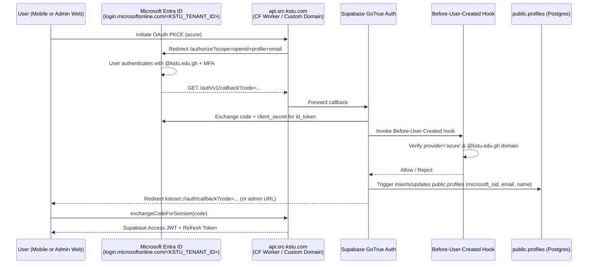

# 02 — Microsoft Entra ID (`kstu.edu.gh`) Scoped Auth Guide

> **Goal:** Allow **only verified KsTU students & staff** inside the `kstu.edu.gh` Microsoft Entra ID (Azure AD) tenant to sign into the mobile app (`src_kstu_rn`) and admin dashboard (`admin.src-kstu.com`), with zero password management or legacy bcrypt migration.

---

## 1. End-to-End Authentication Architecture



---

## 2. Microsoft Azure App Registration Setup (Coordinate with KsTU ICT)

Ask KsTU's Directorate of ICT (or an admin with `Cloud Application Administrator` role on `kstu.edu.gh`) to create **one** App Registration:

| Setting | Value |
|---|---|
| **Display Name** | `KsTU SRC Mobile & Portal` |
| **Supported account types** | **Accounts in this organizational directory only (`kstu.edu.gh` — Single tenant)** |
| **Redirect URI (Platform: Web)** | `https://api.src-kstu.com/auth/v1/callback` |
| **API Permissions (Delegated)** | `User.Read`, `openid`, `profile`, `email` *(do NOT request Mail, Files, or Calendar — keeping scopes minimal makes ICT approval fast)* |
| **Admin Consent** | Grant tenant-wide admin consent for the above 4 basic scopes so students never hit **`AADSTS90094`** (*"Need admin approval"*) |
| **Credentials** | Generate Client Secret (24-month expiry; set calendar reminder for incoming SRC team to rotate) |

**Deliverables needed from ICT:**
1. **Application (Client) ID** (`AZURE_CLIENT_ID`)
2. **Client Secret Value** (`AZURE_CLIENT_SECRET`)
3. **Directory (Tenant) ID** (`KSTU_TENANT_ID` — GUID, verifiable via `https://login.microsoftonline.com/kstu.edu.gh/v2.0/.well-known/openid-configuration`)

> [!IMPORTANT]
> Confirm with KsTU ICT whether students also use any subdomain UPN (e.g. `@st.kstu.edu.gh`) in addition to `@kstu.edu.gh` before writing the domain regex below. In production fixture `01-post-login.json`, student email is `sd.dotitiaku620003@kstu.edu.gh`.

---

## 3. Supabase Auth Configuration

1. In **Supabase Dashboard → Authentication → Providers → Azure**:
   - **Azure Enabled:** `ON`
   - **Client ID:** `<AZURE_CLIENT_ID>`
   - **Client Secret:** `<AZURE_CLIENT_SECRET>`
   - **Azure Tenant URL:** `https://login.microsoftonline.com/<KSTU_TENANT_ID>`
   - Disable **Email / Password** sign-ups (`Enable Email Signup = OFF`) so nobody can create non-Microsoft accounts. *(Keep Email Sign-In disabled unless temporarily enabled for one store-reviewer test user — see §6.)*
2. Under **Authentication → URL Configuration**:
   - **Site URL:** `https://src-kstu.com`
   - **Additional Redirect URLs:**
     - `kstusrc://auth/callback` (mobile app)
     - `https://admin.src-kstu.com/auth/callback` (production admin)
     - `http://localhost:3000/auth/callback` (local admin dev)

---

## 4. Database-Level Guardrails (`0004_auth_hooks_and_sync.sql`)

Never rely solely on Azure UI settings to guard the database. Enforce domain validation and sync `auth.users` → `public.profiles` inside Postgres:

### 4.1 Auto-Sync Trigger (`auth.users` → `public.profiles`)

```sql
CREATE OR REPLACE FUNCTION public.handle_microsoft_user_sync()
RETURNS TRIGGER
LANGUAGE plpgsql
SECURITY DEFINER
SET search_path = public
AS $$
DECLARE
  v_email TEXT;
  v_oid   UUID;
  v_tid   UUID;
  v_name  TEXT;
BEGIN
  v_email := LOWER(COALESCE(NEW.email, ''));
  v_name  := COALESCE(
    NEW.raw_user_meta_data->>'full_name',
    NEW.raw_user_meta_data->>'name',
    SPLIT_PART(v_email, '@', 1)
  );

  -- Entra exposes sub/oid inside raw_user_meta_data depending on GoTrue version
  v_oid := NULLIF(COALESCE(
    NEW.raw_user_meta_data->>'provider_id',
    NEW.raw_user_meta_data->>'oid',
    NEW.raw_user_meta_data->>'sub'
  ), '')::UUID;

  v_tid := NULLIF(NEW.raw_user_meta_data->>'tid', '')::UUID;

  -- Enforce @kstu.edu.gh (adjust regex if student subdomain exists; exclude single store reviewer email)
  IF v_email <> 'appreview@kstu.edu.gh'
     AND v_email !~ '^[^@]+@([a-z0-9-]+\.)?kstu\.edu\.gh$' THEN
    RAISE EXCEPTION 'Only kstu.edu.gh accounts are permitted';
  END IF;

  INSERT INTO public.profiles (id, microsoft_oid, microsoft_tid, email, name)
  VALUES (NEW.id, v_oid, v_tid, v_email, v_name)
  ON CONFLICT (id) DO UPDATE
  SET email         = EXCLUDED.email,
      name          = COALESCE(NULLIF(EXCLUDED.name, ''), public.profiles.name),
      microsoft_oid = COALESCE(EXCLUDED.microsoft_oid, public.profiles.microsoft_oid),
      microsoft_tid = COALESCE(EXCLUDED.microsoft_tid, public.profiles.microsoft_tid),
      last_seen     = NOW();

  RETURN NEW;
END;
$$;

CREATE TRIGGER on_auth_user_created_or_updated
  AFTER INSERT OR UPDATE ON auth.users
  FOR EACH ROW EXECUTE FUNCTION public.handle_microsoft_user_sync();
```

*(Optionally, you can also attach a Supabase **Before User Created Auth Hook** Edge Function so blocked accounts are rejected before any row touches `auth.users`.)*

---

## 5. How Both Clients Handle Auth

### 5.1 Mobile App (`src_kstu_rn`)
1. User taps **"Sign in with KsTU Microsoft"** on [login.tsx](file:///Users/kaliblip/Developer/KsTU%20SRC/src_kstu_rn/src/app/%28auth%29/login.tsx).
2. App invokes `supabase.auth.signInWithOAuth({ provider: 'azure', options: { redirectTo: 'kstusrc://auth/callback', scopes: 'openid profile email', skipBrowserRedirect: true } })`, opens the URL via `expo-web-browser`, and exchanges the returned `code` with `exchangeCodeForSession(code)`.
3. App queries `public.profiles` for `auth.uid()`.
4. **Routing gate:**
   - If `profile.profile_completed === false`: route to `/(auth)/complete-profile` to collect `index_no`, `faculty_id`, `dept_id`, `program_id`, `current_level`, `current_sem`, `yr_of_admission`, `yr_of_completion`, `phone`, `gender` (marking `profile_completed = true` on save).
   - If `profile.profile_completed === true`: route to `/(app)/(hub)`.
5. **Biometrics / Passkey:** Keep Face ID / Touch ID via `expo-local-authentication` as an app-lock check on cold start before unlocking the persisted Supabase session from `expo-secure-store` (zero password storage).

### 5.2 Admin Dashboard (`admin.src-kstu.com`)
1. Executive clicks **"Sign in with KsTU Microsoft"** → redirects to `https://admin.src-kstu.com/auth/callback`.
2. Dashboard fetches `profiles.role` for `auth.uid()`.
3. If `role === 'student'` (any regular student tries opening `admin.src-kstu.com`): immediately call `supabase.auth.signOut()` and display **"Access denied — SRC Executive or Admin role required"**. Even if bypassed client-side, RLS rejects all admin reads/writes.

---

## 6. App Store & Google Play Review Requirements

Apple and Google reviewers do **not** own `@kstu.edu.gh` Microsoft accounts. Handle this cleanly before submission:

1. **Demo Reviewer Account:** Request KsTU ICT to provision one sandbox account inside Entra (e.g. `appreview@kstu.edu.gh`, or use a temporary test email account in Supabase Auth locked to a single demo profile row with `role = 'student'`) and include its credentials in **App Store Connect → App Review Information** and **Play Console → App Access**.
2. **Apple Guideline 4.8 ("Sign in with Apple" Exemption):**
   Under **App Store Review Guideline 4.8**, third-party social login normally requires offering Sign in with Apple **except** when:
   > *"Your app is an education, enterprise, or business app that requires the user to sign in with an existing education or enterprise account."*
   Explicitly cite this education-account exemption (`kstu.edu.gh` student directory) in your App Store Connect review notes so the review is not rejected.
