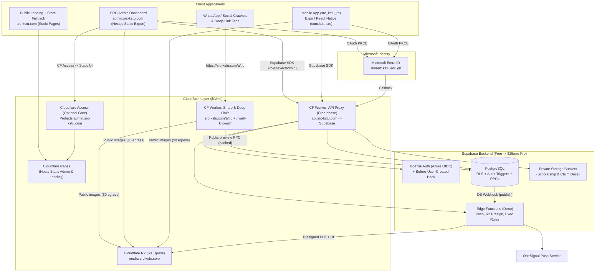

# KsTU SRC Platform — Target Backend & System Architecture

> **Status:** Approved architecture specification for rebuilding the KsTU SRC backend, admin dashboard, public landing/share pages, and integrating [src_kstu_rn](file:///Users/kaliblip/Developer/KsTU%20SRC/src_kstu_rn).
>
> **Core Stack:** **Supabase** (Auth + PostgreSQL + RLS + Edge Functions + Private Storage) · **Microsoft Entra ID** (`kstu.edu.gh` single-tenant SSO) · **Cloudflare** (DNS, Workers proxy, R2 public media, Pages for Admin & Landing).

---

## Documents in This Folder

| Document | Covers |
|---|---|
| **[01-database-schema-rls-and-triggers.md](file:///Users/kaliblip/Developer/KsTU%20SRC/src_kstu_app/review-docs/target-architecture/01-database-schema-rls-and-triggers.md)** | Complete PostgreSQL DDL, Row-Level Security (RLS) policies, tamper-proof `SECURITY DEFINER` RPCs, automatic `audit_logs` triggers, storage bucket design, and fixture seed plan |
| **[02-microsoft-entra-auth-guide.md](file:///Users/kaliblip/Developer/KsTU%20SRC/src_kstu_app/review-docs/target-architecture/02-microsoft-entra-auth-guide.md)** | KsTU `kstu.edu.gh` Azure App Registration, Supabase GoTrue integration, DB-level tenant/domain locks, Mobile & Web login flows, profile onboarding, and Store Review rules |
| **[03-backend-edge-functions-and-workers.md](file:///Users/kaliblip/Developer/KsTU%20SRC/src_kstu_app/review-docs/target-architecture/03-backend-edge-functions-and-workers.md)** | Cloudflare Workers (`api.src-kstu.com` proxy, `src-kstu.com/a/:id` WhatsApp OG previews & Universal Links) and Supabase Edge Functions (`send-announcement-push`, `r2-presign-upload`, `manage-exec-role`) |
| **[04-admin-dashboard-and-landing-page.md](file:///Users/kaliblip/Developer/KsTU%20SRC/src_kstu_app/review-docs/target-architecture/04-admin-dashboard-and-landing-page.md)** | Static Next.js Admin Dashboard (`admin.src-kstu.com`), Public Landing Page (`src-kstu.com`), Cloudflare Pages + GitHub Org CI/CD workflow, and Cloudflare Access setup |
| **[05-mobile-client-integration-guide.md](file:///Users/kaliblip/Developer/KsTU%20SRC/src_kstu_app/review-docs/target-architecture/05-mobile-client-integration-guide.md)** | Exact refactoring plan for `src_kstu_rn` (`@supabase/supabase-js`, PKCE SSO, `complete-profile`, R2 URLs, preserving the 20-item offline cache, and Universal/App Links) |

---

## 1. System Topology & Domain Map



### Domain Routing Summary

| Subdomain / Path | Hosted On | Purpose | Access Policy |
|---|---|---|---|
| `src-kstu.com/` (`/privacy`, `/terms`) | Cloudflare Pages | Public app landing page, store download buttons, Apple/Google store policy pages | Public |
| `src-kstu.com/a/:id` & `/.well-known/*` | Cloudflare Worker | WhatsApp/social OG preview metadata (`featured_image_min`) + iOS Universal Links & Android App Links | Public (narrow preview RPC only) |
| `admin.src-kstu.com` | Cloudflare Pages (`output: 'export'`) | SRC Executive Admin Dashboard (announcements, scholarship/claim review, landmarks, audit logs) | Microsoft SSO (`role IN ('exec', 'admin')`) + optional Cloudflare Access |
| `api.src-kstu.com` | Cloudflare Worker Proxy (Free) → Supabase Custom Domain (Pro) → VPS (if self-hosted) | Unified Supabase API endpoint (`auth`, `rest`, `storage`, `functions`) — prevents hardcoding `<ref>.supabase.co` | Authenticated JWT + RLS |
| `media.src-kstu.com` | Cloudflare R2 | Public media (`announcement_imgs/`, `moment_imgs/`, `landmark_imgs/`, `user_imgs/`) | Public read, **\$0 egress**; presigned uploads only via Edge Function |

---

## 2. Repository & Team Collaboration Model (`kstu-src` GitHub Org)

All code lives inside the **`kstu-src` GitHub Organization**, allowing student developers to collaborate with feature branches and Pull Requests while keeping hosting free on Cloudflare:

```
kstu-src (GitHub Organization)
├── src-kstu-mobile        # Expo / React Native app (src_kstu_rn) — EAS builds (kstu-src-app org)
├── src-kstu-backend       # Supabase SQL migrations, RLS, Edge Functions + Cloudflare Workers
├── src-kstu-admin         # Next.js (output: 'export') Admin Dashboard -> admin.src-kstu.com
└── src-kstu-web           # Static Landing Page -> src-kstu.com (can share monorepo with admin)
```

- **Why Cloudflare Pages instead of Vercel Hobby:** Private `kstu-src` org repos and unlimited collaborator PR previews work natively on Cloudflare Pages for **GH₵ 0/mo** (Vercel Hobby blocks private org repos and collaborator commit authors unless paying `$20/seat/mo`).
- **Database & Edge Function versioning:** All Postgres tables, RLS policies, triggers, and Edge Functions live as tracked SQL migrations in `src-kstu-backend/supabase/migrations/` and deploy via GitHub Actions (`supabase db push`, `supabase functions deploy`, `wrangler deploy`). Never rely on untracked manual edits in the Supabase dashboard.

---

## 3. Rollout & Cost Roadmap

| Stage | Infrastructure | Monthly Infra (GH₵) | Trigger to Advance |
|---|---|---|---|
| **1. Build & Beta** | Supabase **Free** + R2 Free + CF Workers/Pages Free | **GH₵ 0 / mo** | Initial build, KsTU ICT Azure setup, internal testing |
| **2. Campus Launch** | Supabase **Pro (`$25/mo`)** + R2 Free + CF Workers/Pages Free | **GH₵ 294 / mo** *(~GH₵ 305–310 card)* | Before opening to 15,000 students — unlocks **daily backups**, **no 7-day pause**, and **250 GB egress** |
| **3. Optional Self-Host** | Hetzner CX33 (8 GB RAM) + R2 Free + CF Pages/Workers | **~GH₵ 130–141 / mo** *(~GH₵ 138–150 card)* | Only if mandated by KsTU IT or budget cuts and a Linux/Docker maintainer is available; swaps via `api.src-kstu.com` with **zero mobile update** |

---

## 4. Recommended Build Order

1. **Week 1 — Identity & Database Foundation:**
   - Request KsTU ICT Azure App Registration (`kstu.edu.gh` tenant, redirect `https://api.src-kstu.com/auth/v1/callback`).
   - Provision Cloudflare DNS, R2 bucket (`media.src-kstu.com`), and `api.src-kstu.com` Worker proxy.
   - Apply SQL migrations (`01-database-schema-rls-and-triggers.md`) + `Before User Created` domain lock + seed academic/campus/initial content data.
2. **Week 2 — Edge Functions, Share Worker & Admin Dashboard:**
   - Deploy `r2-presign-upload`, `send-announcement-push`, `manage-exec-role` Edge Functions + `src-kstu.com/a/:id` Share Worker.
   - Build static Next.js Admin Dashboard (`admin.src-kstu.com`) on Cloudflare Pages + Landing page (`src-kstu.com`).
3. **Week 3 — React Native Client Cutover (`src_kstu_rn`):**
   - Switch `src_kstu_rn` from Laravel API to `@supabase/supabase-js` (`api.src-kstu.com`), Microsoft OAuth PKCE, `complete-profile`, R2 URLs, and Universal/App Links (`05-mobile-client-integration-guide.md`).
   - Verify offline 20-item cache, OneSignal push deep-linking, and WhatsApp share cards; submit replacement build (`com.kstu.src`) with Apple Guideline 4.8 review notes + demo account.
4. **Launch Gate:** Upgrade Supabase project to **Pro (`$25/mo`)** before opening to full student body.
